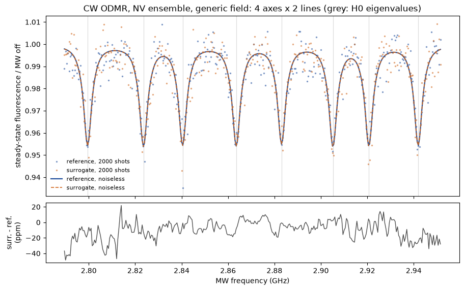
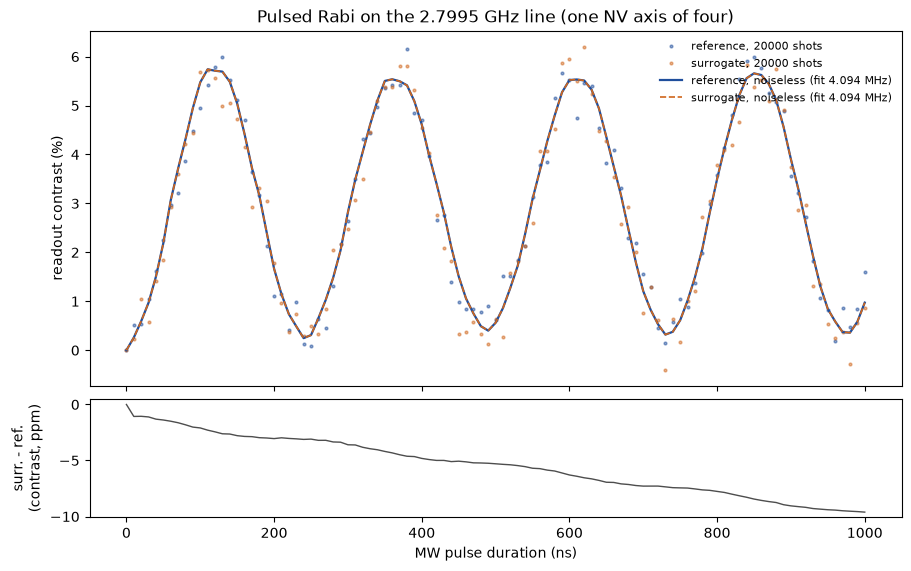
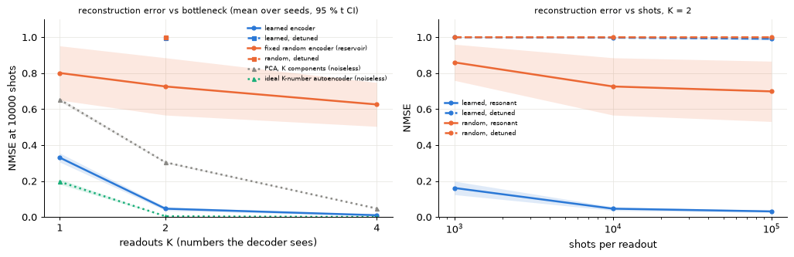
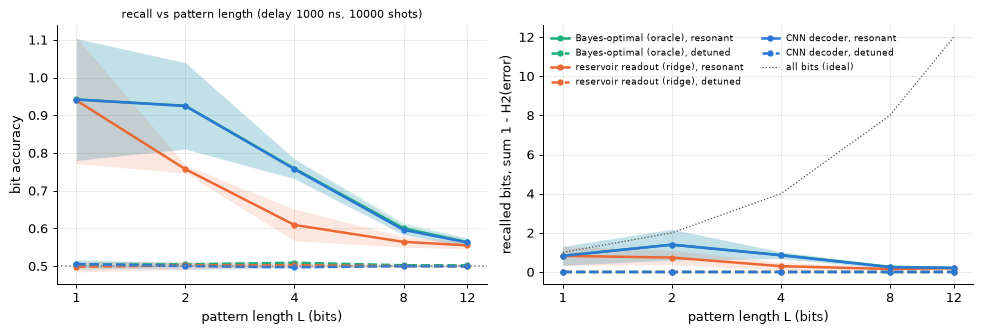
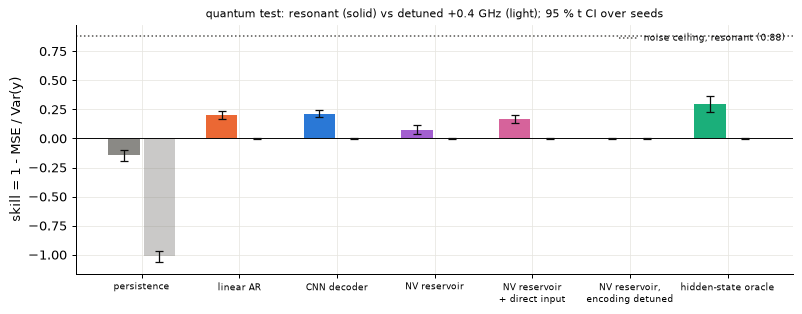
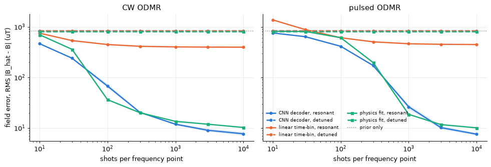

# Glowbox

An open-source nilware.io lab project: neural networks get the controls and sensors of a room-temperature quantum
system (NV centres in diamond), explore it, and we test whether they learn to use the quantum spin dynamics.
Simulation first; hardware later.

The goal, scope, phases, tasks and working agreement are in [project-definition.md](project-definition.md).

*Continuous-wave ODMR of an NV ensemble in a generic magnetic field: four crystal axes, two lines each. The exact
QuTiP reference and the fast GPU surrogate agree to within 50 ppm (bottom panel).*

*Pulsed Rabi oscillations on the 2.7995 GHz line, with T2\* decay: both simulators fit 4.094 MHz and differ by under
10 ppm.*

Licence: MIT (LICENSE).

Layout: `glowbox/` (sim, control, learn, dream, experiments, analysis, hw), `tests/`, `docs/`. Setup and the
GPU-machine workflow: [docs/dev.md](docs/dev.md). Physics spec: [docs/physics.md](docs/physics.md).

## Status

**Milestone 4 done** (a learned pulse encoder trained end to end through the differentiable surrogate; Task 4,
compress-and-reconstruct; Task 1 re-run with a learned sensor protocol; the quantum test for both). Reports:
[docs/results/m4-autoencoder.md](docs/results/m4-autoencoder.md),
[docs/results/m4-learned-sensor.md](docs/results/m4-learned-sensor.md).

*Task 4: 4x4 edge patches written by a learned encoder into MW blocks, read back as K gated photon counts, decoded by
an MLP; mean over 5 seeds with 95 % t CIs. Learned encoder (blue) vs the same parametrisation fixed at random
(milestone-3 reservoir, orange), noiseless PCA and a noiseless K-number autoencoder; detuned: dashed.*

- Task 4, K = 2 readouts, 10^4 shots (banks and evaluation at 32 T2* quadrature nodes, converged against 64):
  NMSE 0.047 [0.037, 0.058] with the learned encoder, 0.72 [0.56, 0.88] with the fixed random one; linear PCA
  with two noiseless numbers 0.305, a noiseless two-number autoencoder 0.0044. Detuned 400 MHz, both fall to the
  mean patch (0.998 / 1.000; the learned arm's tiny residual is off-resonant drive and vanishes at 800 MHz); gap
  0.950 [0.939, 0.962] (learned).
- The learned strategy relies on Rabi rotation angles: shifting every MW duration by 20 ns multiplies its error by
  9 with the decoder frozen and by 2.7 with the decoder retrained, the same area change made with the amplitude
  costs as much, and scrambling the segment phases doubles it (coherent rotations within T2*). Learned sequences
  run on the QuTiP reference agree to 1e-5.
- Task 1 with a learned sensor protocol (40 points; the encoder sets amplitude, phase, frequency and duration of two
  MW segments per point, starting from milestone 2's pulsed ODMR): 75.7 [71.8, 79.6] uT at 1000 shots per point
  against 364 [348, 379] uT for the fixed pulsed protocol and 60.1 [50.8, 69.5] uT for fixed CW on the same grid,
  same decoder recipe. It learned stronger, frequency-split composite pulses and switched off points the field
  prior never needs. It beats CW at <= 100 shots but not at high shots (it controls only the MW, not the laser).
  Detuned, all fall to the prior (833 uT); it relies on its pulse timing (+330 % error at +-50 ns, frozen decoder)
  and on coherent phases between its segments.
- Code: `glowbox/learn/encoder.py` (bounded pulse parametrisation, grid durations with straight-through gradients),
  `glowbox/sim/surrogate/runs.py` (run-length surrogate path: one propagator per pulse or readout window, exact
  duration gradients), `glowbox/learn/autoencoder.py` (Task 4), `glowbox/learn/sensor.py` (learned sensor
  protocol). Notes: [docs/notes/encoder.md](docs/notes/encoder.md).

Run (RTX 5070 Ti: Task 4 ~105 min, Task 1 ~156 min; `--quick` ~10 min each on a 32-core CPU, much longer on a laptop):

    uv run python -m glowbox.experiments.m4_autoencoder --quick
    uv run python -m glowbox.experiments.m4_learned_sensor --quick

**Milestone 3 done** (reservoir baseline; Task 2, store a bit pattern in the pulse response and recall it; Task 3,
predict the next fluorescence reading; the quantum test for both). Reports:
[docs/results/m3-bit-memory.md](docs/results/m3-bit-memory.md),
[docs/results/m3-forecast.md](docs/results/m3-forecast.md).

*Task 2: L bits written into a block of MW segments by a fixed random pulse encoder, held through a 1 µs dark
delay, recalled from one time-resolved readout at 10^4 shots; mean over 5 seeds with 95 % t CIs. The CNN (blue)
lies on top of the Bayes-optimal oracle; detuned (dashed) every readout is at chance.*

- Task 2, headline L = 4, 1 µs delay, 10^4 shots: bit accuracy 0.759 [0.733, 0.785] for the Bayes-optimal oracle,
  0.757 [0.731, 0.783] for the CNN decoder and 0.609 [0.567, 0.651] for the reservoir's linear readout (ridge);
  detuned 0.497-0.509. Gaps: CNN 0.260 [0.236, 0.285], ridge 0.107 [0.067, 0.147]. One readout returns at most
  ~1.4 recalled bits at 10^4 shots (L = 2) and ~1.9 at 10^5 (L = 4): it sees nearly one number (the total
  ms = 0 population), so longer patterns crowd it. Recall is flat in the delay from 0.1 to 10 µs with or without a
  pi/2 read pulse: nothing readable is lost to dephasing on the T2* scale, consistent with storage in spin
  populations (T1 = 5 ms).

*Task 3: skill (1 - MSE / Var) of one-step predictions of the next reading of an NV ensemble driven by a hidden,
correlated MW amplitude (10^4 shots per reading), mean over 5 seeds with 95 % t CIs; light bars: detuned.*

- Task 3, resonant: CNN decoder 0.212 [0.181, 0.243], linear AR 0.202 [0.171, 0.233] (CNN better by 0.009
  [0.005, 0.014], paired), NV reservoir (fixed random encoding of the past readings, 8 time-multiplexed readouts,
  ridge) 0.076 [0.038, 0.114], reservoir + direct input 0.171 [0.136, 0.205]. The hidden-state oracle
  (Bayes-optimal given the true drive history and spin state) bounds what is predictable at 0.296 [0.230, 0.361]:
  most of the next reading is the drive's unpredictable innovation. Detuned, every predictor is at ~0
  (|skill| < 0.001); the gaps are significant for all of them. With only its own encoding detuned the reservoir
  drops to 0.000 [-0.001, 0.000]: its skill comes from its spins.
- Timing: nothing in M3 learns timing (fixed protocols, fixed random encoders). Frozen readouts rely on the exact
  pulse areas of the encoding (Task 2 CNN: bit accuracy falls by 0.24 [0.20, 0.29] when every write pulse is 30 ns
  shorter; Task 3 reservoir ridge: skill falls by 0.04-0.08 for ±20 ns), while readouts retrained on the shifted
  encoding do as well as before: the information needs Rabi-scale pulses, not one exact timing. The CNNs' readout
  weighting follows the spin-contrast transient (r = 0.81 Task 2, 0.91 Task 3).
- Code: `glowbox/learn/reservoir.py` (fixed random pulse encoder, time multiplexing, ridge readout),
  `glowbox/learn/bit_memory.py` (Task 2 protocol, codebooks, Bayes-optimal readout), `glowbox/learn/forecast.py`
  (driven series, cycle-wise simulation, hidden-state oracle). Key results re-checked on the QuTiP reference
  (templates and features within 3e-4 of the peak; readout decisions unchanged, predictions within 2.5 % of the
  signal sd).

Run (RTX 5070 Ti: Task 2 ~90 min, Task 3 ~27 min; `--quick` a few minutes):

    uv run python -m glowbox.experiments.m3_bit_memory --quick
    uv run python -m glowbox.experiments.m3_forecast --quick

**Milestone 2 done** (Task 1, estimate a hidden magnetic field from the glow; decoders, baselines and the quantum
test). Report: [docs/results/m2-field-estimation.md](docs/results/m2-field-estimation.md).

*RMS error of the estimated field (|B| 0.5-3 mT, any direction, folded into the identifiable wedge) vs shots per
sweep point, CW and pulsed ODMR, mean over 5 seeds with 95 % CIs. Detuned (dashed): every estimator falls to the
prior.*

- At 1000 shots per point the CNN decoder reaches 11.9 [11.0, 12.9] µT (CW) and 26.4 [21.1, 31.8] µT (pulsed;
  95 % Student-t CIs over 5 seeds); the linear time-bin baseline ~400 µT; prior only 830 µT. The physics fit
  (Lorentzian dips at the H0 transitions of a trial field, seed 0, same 300 fields) is as good or better than the
  CNN at 100-300 shots (CW) and 300-1000 shots (pulsed, typical case; 18.6 vs 35.9 µT RMSE at 1000); the CNN wins
  where the fit finds few dips (<= 30 shots CW, <= 100 pulsed) and on RMSE at >= 1000 (CW) / 3000 (pulsed) shots.
  The CNN's uncertainty is well calibrated below 1000 shots and 5-16 % over-confident at >= 1000.
- Quantum test: with the microwaves 400 MHz off resonance every learned estimator drops to the prior (skill
  ~0); gap 819 [816, 822] µT (CW CNN), 804 [798, 810] µT (pulsed CNN). Timing: no timing is learned in M2 (fixed
  protocols). The hand-designed pulsed protocol relies on its pi pulse (`protocol_uses_rabi_timing`: frozen-decoder
  error 8-14x higher at 110 / 510 ns, which mixes contrast loss and distribution shift); what the decoder learned
  is a readout time-bin weighting that follows the spin-contrast transient (saliency vs contrast r = 0.98). The
  decoders agree on QuTiP-reference inputs to < 0.02 µT.
- Code: `glowbox/learn/field_data.py` (priors, protocols, surrogate datasets), `glowbox/learn/decoder.py`
  (1D CNN + Gaussian NLL, linear time-bin baseline), `glowbox/analysis/field_fit.py` (physics fit),
  `glowbox/analysis/quantum_test.py` (the reusable quantum-test harness), surrogate fast paths for sweeps
  (`glowbox/sim/surrogate/sweeps.py`).

Run (the full config trains 20 decoders: ~100 min on an RTX 5070 Ti; `--quick` ~8 min on a CPU):

    uv run python -m glowbox.experiments.m2_field_estimation --quick
    uv run python -m glowbox.experiments.m2_field_estimation --report-dir docs/results

**Milestone 1 done** (simulate CW ODMR and Rabi oscillations for an NV ensemble, plot both, test the fast surrogate
against the QuTiP reference). Report with plots and numbers: [docs/results/m1-odmr-rabi.md](docs/results/m1-odmr-rabi.md).

What works:

- `glowbox/control/pulse.py`: pulse sequences on a 10 ns grid (laser, MW segments, magnet), standard protocols.
- `glowbox/sim/reference/`: QuTiP reference, seven-level Lindblad model per NV axis, four orientations, T2*
  quadrature, T1/T2, shot noise, laser drift; exact per-bin propagation. CPU, about 0.2-1 s per sequence.
- `glowbox/sim/surrogate/`: the same physics in batched, differentiable torch (CPU or CUDA). Agrees with the
  reference to ~1e-9 per bin in float64 and ~1e-4 in float32; hundreds of thousands of shots per second on the GPU.
- Both implement `run(sequence, env) -> FluorescenceTrace` (`glowbox/sim/interface.py`) and reproduce the
  validation suite of [docs/physics.md](docs/physics.md) section 9 (ODMR, Rabi, Ramsey, Hahn echo, detuned control).
- `glowbox/analysis/runlog.py`: per-run config, seed, git hash, Parquet traces and metrics, Markdown reports.

Run milestone 1:

    uv run python -m glowbox.experiments.m1_odmr_rabi --quick                      # ~30 s smoke run
    uv run python -m glowbox.experiments.m1_odmr_rabi --report-dir docs/results    # full run, committed report

Tests: `uv run pytest` (about 2-3 minutes; CUDA tests are skipped without a GPU, slow ones need `-m slow`).

Next: the remaining phase-2 learners (the RL agent, adaptive measurement), Tasks 2-3 with learned encodings, and
the phase-3 DeepDream experiments, each with the quantum test.
