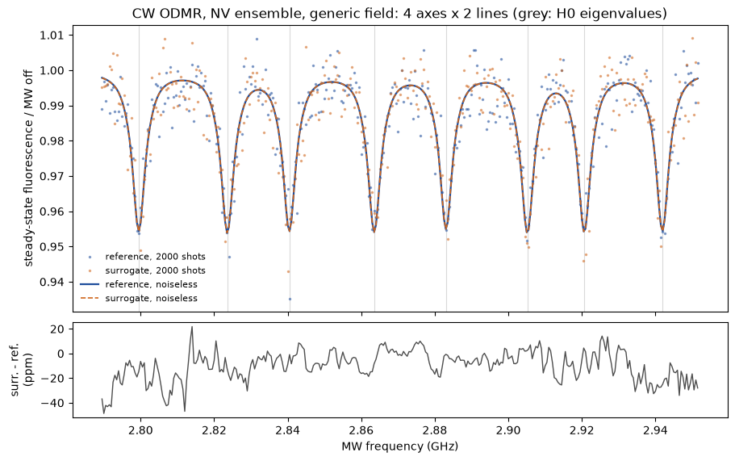
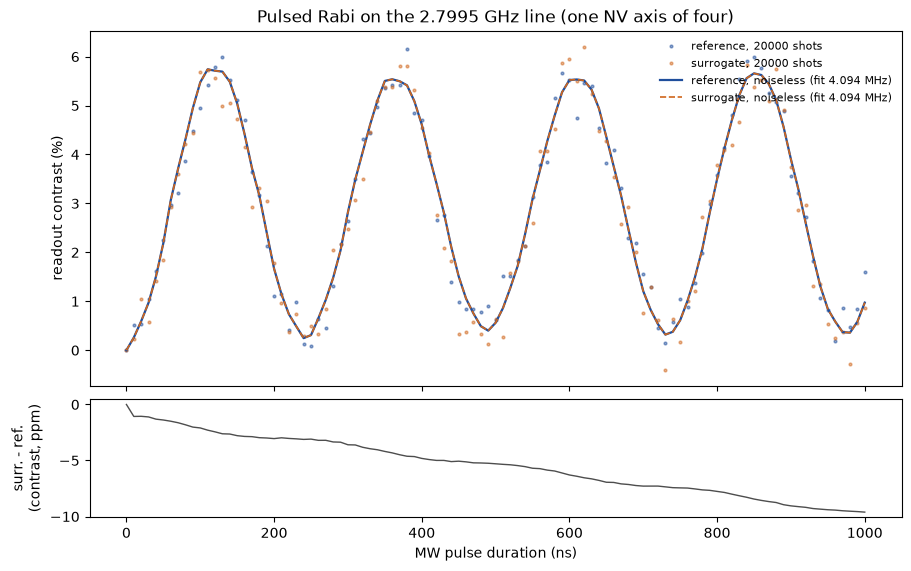

# Milestone 1: CW ODMR and Rabi, surrogate vs QuTiP reference

Both simulators ran the same sequences with the same parameters, detuning nodes (M = 32) and seeds: the QuTiP reference (seven-level Lindblad, CPU) and the fast surrogate (torch, float32, on the GPU when present). Field B = (1.20, 0.70, 2.50) mT in the crystal frame, so the four NV axes are inequivalent and CW ODMR shows eight lines; all other parameters are the `EnvParams` defaults (T2* = 1 µs, T2 = 10 µs, β = 0.1, 1000 NVs, collection 0.003, background 10000 counts/s).

## Plots

**CW ODMR** (325 frequencies, 0.5 MHz step, 4 µs laser + MW at amplitude 0.1, steady state from the last 1500 ns): fluorescence relative to MW off. Dots are 2000 shots of photon counts per point from each simulator, lines the noiseless rates; grey verticals are the transition frequencies from diagonalising H0 per axis. The lower panel is the surrogate minus the reference (noiseless), in parts per million.

**Pulsed Rabi** on the 2.7995 GHz line (axis 0), MW amplitude 0.5, 0 to 1000 ns in 10 ns steps, 2 µs init, 3 µs dark, readout contrast from the first 300 ns of the readout pulse relative to no MW. Dots: 20000 shots per duration; lines: noiseless. Only one axis of four is resonant, so the contrast is a quarter of a single-axis contrast.

## Comparison

Noiseless rates, every bin of every sequence: max |surrogate − reference| / peak rate = 5.3e-05 (ODMR), 2.2e-05 (Rabi). That is float32 round-off: in float64 the two agree to ~1e-9 (tests/sim/test_surrogate_vs_reference.py).

CW ODMR lines (Lorentzian fit to the noiseless spectrum around each grid minimum):

| axis | line | H0 eigenvalue (GHz) | grid min ref / surr (GHz) | fit centre ref − surr (Hz) | contrast ref / surr (%) | FWHM ref / surr (MHz) |
| --- | --- | --- | --- | --- | --- | --- |
| 0 | f− | 2.79950 | 2.7995 / 2.7995 | -288 | 4.537 / 4.538 | 4.413 / 4.415 |
| 0 | f+ | 2.94191 | 2.9420 / 2.9420 | +531 | 4.538 / 4.540 | 4.423 / 4.426 |
| 1 | f− | 2.84044 | 2.8405 / 2.8405 | +448 | 4.525 / 4.525 | 4.505 / 4.504 |
| 1 | f+ | 2.90518 | 2.9050 / 2.9050 | +166 | 4.580 / 4.580 | 4.571 / 4.571 |
| 2 | f− | 2.82358 | 2.8235 / 2.8235 | -426 | 4.574 / 4.576 | 4.530 / 4.531 |
| 2 | f+ | 2.92067 | 2.9205 / 2.9205 | +332 | 4.549 / 4.549 | 4.540 / 4.543 |
| 3 | f− | 2.86354 | 2.8635 / 2.8635 | +1039 | 4.552 / 4.553 | 4.532 / 4.532 |
| 3 | f+ | 2.88308 | 2.8830 / 2.8830 | +465 | 4.466 / 4.466 | 4.460 / 4.462 |

Rabi (fit offset + A·exp(−t/τ)·cos(2πft + φ) to the contrast):

| | f (MHz) | τ (µs) | A (%) |
| --- | --- | --- | --- |
| reference, noiseless | 4.0936 | 15.086 | 2.758 |
| surrogate, noiseless | 4.0936 | 15.104 | 2.758 |
| surrogate, 20000 shots | 4.0957 | 11763023.258 | 2.703 |

Spec value f_R = rabi_full_scale · a · √(2/3) = 4.0825 MHz. The fitted frequency is slightly higher because off-resonant spins of the Lorentzian T2* distribution oscillate at √(f_R² + δ²); τ is an effective exponential time (the T2*-averaged envelope is not exponential).

## Speed

Wall time on this run: reference 122.8 s (ODMR) + 94.4 s (Rabi) on the CPU; surrogate 6.68 s + 5.11 s.

Surrogate throughput, `run_batch` of Rabi sequences (noiseless simulation plus Poisson counts for every shot, M = 32, float32, no laser drift; best of 2):

| device | sequences x bins | shots each | time (s) | shots/s | sequences/s |
| --- | --- | --- | --- | --- | --- |
| NVIDIA GeForce RTX 5070 Ti | 256 x 613 | 1000 | 0.67 | 384,856 | 384.9 |
| CPU (36 torch threads) | 256 x 613 | 1000 | 8.65 | 29,589 | 29.6 |

Cost is per distinct sequence; extra shots only add Poisson sampling. With laser drift every shot is its own simulation (docs/notes/surrogate.md).





## Provenance

- run id: `20261125-194349-m1-odmr-rabi-a838`
- git: `5dfdf15a8819bdf6d0a19707ae7eac2a945004aa`
- seed: 20261125
- device: cuda NVIDIA GeForce RTX 5070 Ti
- python 3.12.14, glowbox 0.1.0, torch 2.11.0+cu128, qutip 5.3.1, numpy 2.5.5, scipy 1.18.1, pyarrow 26.0.1
- started 2026-11-25T19:43:49+00:00, finished 2026-11-25T19:48:05+00:00

## Config

```yaml
env:
  b_field_t:
  - 0.0012
  - 0.0007
  - 0.0025
n_detuning: 32
name: m1-odmr-rabi
odmr:
  amplitude: 0.1
  duration_ns: 4000
  late_ns: 1500
  margin_hz: 10000000.0
  shots: 2000
  step_hz: 500000.0
rabi:
  amplitude: 0.5
  init_ns: 2000
  line:
  - 0
  - 0
  max_ns: 1000
  readout_ns: 600
  settle_ns: 3000
  shots: 20000
  step_ns: 10
  window_ns: 300
seed: 20261125
throughput:
  devices:
  - cuda
  - cpu
  n_sequences: 256
  repeat: 2
  shots: 1000
```

## Final metrics

| metric | value |
| --- | --- |
| odmr_points | 325 |
| odmr_max_rel_rate_diff | 5.34981e-05 |
| rabi_max_rel_rate_diff | 2.20379e-05 |
| rabi_freq_ref_hz | 4.09358e+06 |
| rabi_freq_sur_hz | 4.09357e+06 |
| rabi_freq_sur_noisy_hz | 4.09574e+06 |
| rabi_decay_ref_s | 1.50857e-05 |
| rabi_decay_sur_s | 1.51045e-05 |
| rabi_amp_ref | 0.027581 |
| rabi_amp_sur | 0.0275799 |
| rabi_freq_spec_hz | 4.08248e+06 |
| ref_seconds_odmr | 122.758 |
| sur_seconds_odmr | 6.6834 |
| ref_seconds_rabi | 94.3811 |
| sur_seconds_rabi | 5.10706 |
| shots_per_s_cuda | 384856 |
| shots_per_s_cpu | 29589.5 |
