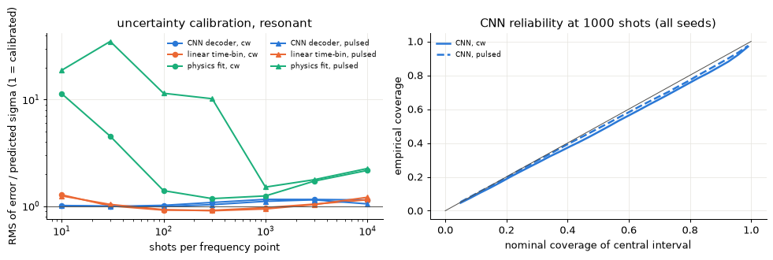

# Milestone 2: Task 1, field estimation from the glow, and the quantum test

Task 1 of the brief: estimate a hidden magnetic field from the glow. Two fixed sensor protocols, three estimators, all trained and tested on the fast surrogate, the decoders re-checked on the QuTiP reference, and the quantum test (every learned estimator retrained and re-evaluated with the microwaves detuned 400 MHz off resonance) over 5 seeds.

## Task and data

- **Hidden field**: |B| uniform in [0.5, 3] mT, isotropic direction. An ODMR spectrum cannot tell the sign of B along an NV axis nor which line belongs to which axis, so B is identifiable only up to the 48 signed permutations of the crystal axes; the target is the canonical representative, B folded into the wedge Bx >= By >= Bz >= 0 (generically unique). Errors are the vector error |B_hat - B| in µT.
- **Nuisance** (one draw per group of 8 fields): T2* log-uniform 0.5-2 µs, Rabi full scale 8-12 MHz, optical beta 0.07-0.13, collection 2e-3-4e-3, background 5e3-2e4 counts/s, strain E 0-0.3 MHz. Decoders see counts normalised by their own mean, so absolute brightness is not a cue.
- **Protocols** (sweep 2.77-2.97 GHz, 200 points, 1 MHz step): *CW ODMR*, laser + MW (amplitude 0.1) in the steady state, 3 µs dwell per shot per point, one number per point; *pulsed ODMR*, 1.5 µs init, 1 µs dark, a 310 ns MW pulse at amplitude 0.2 (a pi pulse at the nominal Rabi full scale), 600 ns readout recorded in 60 bins of 10 ns: a 60 x 200 input. Shot lengths 3 µs (CW) and 3.41 µs (pulsed), so equal shots are nearly equal time budgets.
- **Datasets**: per seed 5000 train / 512 validation / 1000 test fields; the surrogate gives the noiseless mean counts of every input cell (M = 32 weighted-uniform detuning nodes, spacing 2 widths), and Poisson noise for a log-uniform number of shots in [10, 10000] is drawn fresh at every training step. CW points use the surrogate's steady-state solve, pulsed sweeps share their init + settle prefix (exact fast paths, docs/notes/surrogate.md). Bank generation took 416 s (CW) and 1555 s (pulsed) in total on cuda NVIDIA GeForce RTX 5070 Ti.

## Estimators

- **CNN decoder** (`glowbox/learn/decoder.py`, `ConvDecoder`): learned 1x1 time-bin mixing (T -> 8), a stem and 3 stages of residual 1D convolutions along the frequency axis (channels [32, 64, 128], kernel 7, stride-2 downsampling), flatten (dip positions matter, so no global pooling), log10(shots) appended, MLP to mean and log-variance of the three field components; Gaussian NLL, AdamW, 6000 steps of 256, best validation NLL kept.
- **Linear time-bin baseline** (`TimeBinLinear`): one learned weighting of the readout bins (a weighted spectrum), an affine map of it to the field, a log-variance affine in log10(shots); same loss.
- **Physics fit** (`glowbox/analysis/field_fit.py`): eight Lorentzian dips with shared width and contrast whose positions are the exact H0 transitions of a trial field (E = 0 assumed), coarse grid search over the wedge then least squares, covariance from the Jacobian; the prior when no dip is significant. Pulsed input is the sum over the readout bins (a late-window normalisation would cancel the signal here: with singlet shelving the whole 600 ns readout is spin dependent). Seed 0 only, on the first 300 test fields.

## Error vs shots

RMS field error (µT), resonant: mean over the 5 seeds with a 95 % Student-t CI over seeds (mean ± t_(n-1) s / √n; each seed has its own fields, nuisance, initialisation and noise, 1000 test fields):

| shots | cw CNN decoder | cw linear time-bin | pulsed CNN decoder | pulsed linear time-bin |
| --- | --- | --- | --- | --- |
| 10 | 464 [450, 479] | 749 [744, 754] | 756 [747, 765] | 1.37e+03 [1.36e+03, 1.39e+03] |
| 30 | 241 [234, 247] | 534 [527, 542] | 640 [625, 656] | 883 [854, 911] |
| 100 | 67.1 [57.5, 76.7] | 447 [439, 455] | 411 [399, 423] | 609 [597, 621] |
| 300 | 20.3 [19.6, 21] | 412 [401, 424] | 171 [165, 177] | 505 [498, 513] |
| 1000 | 11.9 [11, 12.9] | 401 [392, 411] | 26.4 [21.1, 31.8] | 463 [452, 474] |
| 3000 | 9.06 [7.89, 10.2] | 397 [388, 406] | 10.2 [8.62, 11.8] | 451 [442, 461] |
| 10000 | 7.76 [6.66, 8.86] | 396 [387, 405] | 7.52 [6.65, 8.4] | 447 [436, 457] |

Prior only (predicting the training mean): 830 µT.

### Physics fit vs CNN on the same fields

Seed 0 only, the first 300 test fields, every shot level; fit and CNN each see their own Poisson draw at the same number of shots. Differences are fit - CNN (negative: the fit is better) with 95 % paired-bootstrap CIs over the fields; median = typical-case error; ok = fraction of fits that found significant dips (the rest return the prior).

| protocol | shots | fit RMSE | CNN RMSE | RMSE fit - CNN | fit median | CNN median | median fit - CNN | fit ok |
| --- | --- | --- | --- | --- | --- | --- | --- | --- |
| cw | 10 | 697 | 494 | 203 [142, 259] | 534 | 302 | 232 [151, 295] | 31 % |
| cw | 30 | 359 | 236 | 123 [60.1, 181] | 60.2 | 113 | -53.1 [-70.3, -39] | 86 % |
| cw | 100 | 36.3 | 53.1 | -16.8 [-24.3, -10] | 26.1 | 33.3 | -7.2 [-12.6, -3.95] | 100 % |
| cw | 300 | 20 | 22.1 | -2.01 [-6.53, 1.57] | 15.4 | 16.7 | -1.3 [-2.7, 0.319] | 100 % |
| cw | 1000 | 13.5 | 11.4 | 2.16 [0.734, 3.63] | 8.62 | 8.79 | -0.166 [-0.963, 0.546] | 100 % |
| cw | 3000 | 11.9 | 8.92 | 2.96 [1.14, 4.92] | 5.74 | 5.96 | -0.213 [-0.893, 0.465] | 100 % |
| cw | 10000 | 10.2 | 7.55 | 2.69 [0.675, 4.62] | 3.38 | 4.62 | -1.23 [-1.61, -0.708] | 100 % |
| pulsed | 10 | 817 | 746 | 71.4 [32.7, 111] | 722 | 609 | 112 [64, 170] | 1 % |
| pulsed | 30 | 810 | 621 | 189 [148, 228] | 721 | 470 | 250 [176, 296] | 3 % |
| pulsed | 100 | 609 | 420 | 190 [136, 245] | 300 | 214 | 86.2 [-12.4, 172] | 54 % |
| pulsed | 300 | 197 | 147 | 49.7 [-6.77, 101] | 23.7 | 51.2 | -27.5 [-39, -19.7] | 97 % |
| pulsed | 1000 | 18.6 | 35.9 | -17.2 [-36.7, -0.843] | 11.7 | 13.2 | -1.47 [-3.11, -0.326] | 100 % |
| pulsed | 3000 | 11.7 | 9.16 | 2.5 [1.25, 3.79] | 7.97 | 7.29 | 0.678 [-0.286, 1.66] | 100 % |
| pulsed | 10000 | 10.1 | 6.55 | 3.53 [2.28, 4.86] | 5.58 | 4.99 | 0.591 [0.193, 1.21] | 100 % |

Comparison against the classical baseline: **cw**: by RMSE the fit is better at 100 shots, the CNN at 10, 30, 1000, 3000, 10000, no significant difference at 300; by median (typical case) the fit is better at 30, 100, 10000, the CNN at 10, no significant difference at 300, 1000, 3000; where the fit wins on median but not on RMSE, a minority of large fit errors (failed fits, mis-assigned lines, shape bias) carries its RMSE: 30 (14 % failed fits), 10000 (0 % failed fits). **pulsed**: by RMSE the fit is better at 1000 shots, the CNN at 10, 30, 100, 3000, 10000, no significant difference at 300; by median (typical case) the fit is better at 300, 1000, the CNN at 10, 30, 10000, no significant difference at 100, 3000; where the fit wins on median but not on RMSE, a minority of large fit errors (failed fits, mis-assigned lines, shape bias) carries its RMSE: 300 (3 % failed fits). In short, the physics fit is cw: as good or better by RMSE at 100, 300 shots, in the typical case at 30, 100, 300, 1000, 3000, 10000; pulsed: as good or better by RMSE at 300, 1000 shots, in the typical case at 100, 300, 1000, 3000. The CNN wins where the fit finds no dips (the lowest shot levels) and on RMSE at high shots, where the fit's E = 0 / Lorentzian-shape bias sets a floor; it is not better everywhere, and its other advantage is an uncertainty that is close to calibrated (next section).

## Calibration

Calibration of the predicted per-component sigma, resonant, mean over seeds: RMS of error / sigma (1 = calibrated) and coverage of the 68 % / 95 % intervals. Fit columns: seed 0, 300 fields.

| shots | cw CNN decoder | cw linear time-bin | pulsed CNN decoder | pulsed linear time-bin | cw fit | pulsed fit |
| --- | --- | --- | --- | --- | --- | --- |
| 10 | 1.01 (73 / 95 %) | 1.28 (57 / 88 %) | 1.01 (67 / 95 %) | 1.25 (59 / 89 %) | 11.40 (55 / 78 %) | 18.84 (66 / 96 %) |
| 30 | 0.99 (74 / 95 %) | 1.01 (68 / 95 %) | 1.00 (70 / 95 %) | 1.04 (68 / 94 %) | 4.53 (50 / 73 %) | 35.23 (64 / 94 %) |
| 100 | 1.02 (71 / 95 %) | 0.92 (73 / 97 %) | 0.99 (74 / 95 %) | 0.93 (73 / 96 %) | 1.40 (62 / 88 %) | 11.47 (52 / 74 %) |
| 300 | 1.08 (66 / 93 %) | 0.91 (73 / 97 %) | 1.03 (74 / 94 %) | 0.90 (75 / 97 %) | 1.18 (65 / 91 %) | 10.20 (50 / 77 %) |
| 1000 | 1.16 (64 / 91 %) | 0.97 (70 / 96 %) | 1.11 (66 / 93 %) | 0.94 (73 / 96 %) | 1.25 (66 / 91 %) | 1.51 (60 / 85 %) |
| 3000 | 1.15 (66 / 92 %) | 1.04 (67 / 94 %) | 1.15 (65 / 92 %) | 1.03 (69 / 94 %) | 1.72 (57 / 83 %) | 1.77 (57 / 84 %) |
| 10000 | 1.14 (70 / 93 %) | 1.15 (62 / 91 %) | 1.05 (70 / 94 %) | 1.21 (63 / 90 %) | 2.16 (54 / 79 %) | 2.26 (50 / 78 %) |

The CNN is well calibrated (z RMS within 10 % of 1) below 1000 shots (z RMS 0.99-1.08, 68 % coverage 66-74 %) and mildly over-confident (sigma about 5-16 % too small) at >= 1000 shots (z RMS 1.05-1.16; 68 % coverage 64-70 %). The physics fit's Jacobian sigma: z RMS up to 35.2 over the shot levels (failed or mis-assigned fits at low shots) and 2.16-2.26 at 10000 shots, where its error (10 µT RMS) includes the E = 0 and Lorentzian-shape bias that the Jacobian does not know about.

## Quantum test

Every learned estimator was retrained from scratch and evaluated with every MW frequency shifted by +400 MHz (no line within 222 MHz of any MW frequency in the spot checks; `check_no_line_driven`), same fields, nuisance, initialisation and noise seeds per seed (paired). Headline: RMS field error at 1000 shots; skill = 1 - error / prior-only error. 95 % Student-t CIs over the 5 seeds (the gap paired per seed); gap > 0 means better on resonance.

| metric | resonant | detuned | gap (better on resonance > 0) | per seed (resonant / detuned) |
| --- | --- | --- | --- | --- |
| cw_cnn_rmse_ut | 11.9 [11, 12.9] | 831 [827, 834] | 819 [816, 822] | 11.2, 11.7, 11.5, 12, 13.2; 829, 827, 830, 833, 834 |
| cw_linear_rmse_ut | 401 [392, 411] | 831 [827, 834] | 429 [422, 437] | 402, 393, 396, 413, 402; 829, 827, 830, 833, 834 |
| pulsed_cnn_rmse_ut | 26.4 [21.1, 31.8] | 831 [827, 834] | 804 [798, 810] | 32.2, 22.4, 24.5, 23.2, 29.8; 829, 827, 830, 833, 834 |
| pulsed_linear_rmse_ut | 463 [452, 474] | 830 [827, 834] | 367 [357, 378] | 468, 459, 455, 476, 457; 829, 827, 830, 833, 834 |
| cw_cnn_skill | 0.986 [0.985, 0.987] | -0.000159 [-0.000262, -5.72e-05] | 0.986 [0.985, 0.987] | 0.986, 0.986, 0.986, 0.986, 0.984; -9.83e-05, -0.000283, -9.8e-05, -0.000206, -0.000112 |
| cw_linear_skill | 0.517 [0.507, 0.527] | -7.89e-05 [-0.000153, -4.71e-06] | 0.517 [0.507, 0.527] | 0.515, 0.525, 0.523, 0.504, 0.518; -1.88e-05, -6.92e-05, -9.63e-05, -3.85e-05, -0.000172 |
| pulsed_cnn_skill | 0.968 [0.962, 0.975] | -0.000121 [-0.000404, 0.000162] | 0.968 [0.962, 0.975] | 0.961, 0.973, 0.971, 0.972, 0.964; -0.000445, 0.000175, -9.29e-05, -0.000205, -3.82e-05 |
| pulsed_linear_skill | 0.442 [0.429, 0.456] | -3.51e-05 [-0.000216, 0.000145] | 0.443 [0.429, 0.456] | 0.436, 0.445, 0.452, 0.428, 0.452; 0.000134, -0.000171, -6.46e-06, -0.000198, 6.53e-05 |

Outcome: cw CNN gap 819 [816, 822] µT (significant); pulsed CNN gap 804 [798, 810] µT (significant). Detuned, the CNN's skill is cw -0.000159 [-0.000262, -5.72e-05], pulsed -0.000121 [-0.000404, 0.000162]: with no line driven the spectrum carries (almost) no field information and the decoders fall back to the prior (a skill slightly below 0 is expected: the training mean they fall back to differs slightly from the test mean; the B_perp level-mixing signal that would survive detuning is far below the shot noise and is masked by the per-sample normalisation). The physics fit on the detuned spectra found dips in cw 0 %, pulsed 0 % of the cases at 1000 shots.

### Does the learned strategy use microsecond-scale timing?

No timing is learned in M2: both protocols are fixed and hand-designed, and what is learned is the decoder. The log therefore keeps two verdicts apart.

**(a) The fixed protocol** (`protocol_uses_rabi_timing`). The CW protocol has no timing structure by construction (MW and laser on together, steady state; Rabi-band fraction of its MW envelope 0.00). The pulsed protocol's MW pulse is a hand-designed pi pulse, area 1.01 pi at the nominal Rabi frequency (Rabi-band fraction 0.24). Pulse-area sensitivity: the seed-0 pulsed decoders, frozen, on test fields re-simulated with the MW pulse lengthened or shortened (RMS error at 1000 shots with a 95 % bootstrap CI over 200 fields, squared errors averaged over the 4 noise draws of each field first; line contrast = mean deepest dip of the readout-summed spectrum):

| pulse length (ns) | area (pi) | line contrast | CNN, resonant | CNN median, resonant | linear, resonant | CNN, detuned | linear, detuned |
| --- | --- | --- | --- | --- | --- | --- | --- |
| 110 | 0.36 | 2.9 % | 232 [204, 258] | 108 | 529 [496, 562] | 792 [750, 833] | 791 [749, 832] |
| 210 | 0.69 | 6.0 % | 36 [31.5, 41.2] | 23.6 | 460 [426, 495] | 792 [752, 833] | 791 [749, 832] |
| 260 | 0.85 | 6.6 % | 22.9 [20.4, 25.6] | 15.3 | 448 [414, 482] | 792 [748, 833] | 791 [751, 832] |
| 310 | 1.01 | 6.5 % | 27.9 [19.8, 38] | 13.2 | 442 [407, 478] | 792 [750, 834] | 791 [750, 832] |
| 360 | 1.18 | 5.9 % | 88.2 [66, 110] | 19.4 | 474 [444, 505] | 792 [750, 833] | 791 [748, 834] |
| 410 | 1.34 | 4.8 % | 192 [169, 213] | 71.9 | 535 [505, 565] | 792 [751, 834] | 791 [750, 833] |
| 510 | 1.67 | 3.4 % | 389 [352, 426] | 206 | 627 [597, 655] | 792 [749, 834] | 791 [747, 833] |

Verdict `protocol_uses_rabi_timing` = **True** (criterion: the protocol's pulse is a pi pulse and the resonant error rises beyond its CI for some |shift| >= 100 ns). Caveats: this is a property of the hand-designed protocol, not of anything learned; the detuned arm sits at the prior at every length, so 'the detuned error does not rise' cannot fail and is no evidence; and a frozen decoder's degradation mixes the physical loss of contrast (column) with distribution shift, since no decoder retrained at each length is run. At the trained 310 ns the CNN's RMSE is 27.9 [19.8, 38] µT against a median of 13.2 µT (RMSE / median 2.1: heavy-tailed, a few fields with overlapping lines dominate the RMSE), and 260 ns does about as well or slightly better (22.9 µT): the decoder was trained across Rabi full scales of 8-12 MHz, so the nominal pi pulse is right only on average.

**(b) What the decoder learned about time** (`decoder_weighting_follows_contrast`). The CNN's saliency per readout bin correlates with the physical spin contrast per bin at r = 0.98 (the linear model's learned time weights at r = 0.40); 48 % of the saliency falls in the first 300 ns of the readout (uniform: 50 %). Verdict **True** (criterion r >= 0.8): the decoder learned a 10-ns time-bin weighting of the readout that follows the spin-contrast transient. It chose no pulse timing: `strategy_learns_timing` = **False** for Task 1.

## Reference check (QuTiP)

3 seed-0 test fields re-simulated with the QuTiP reference (same detuning nodes; CW points 20 µs long, last 2 µs) and fed to the surrogate-trained CNN (176 s on the CPU pool):

| protocol | max feature diff / peak | max pred. diff, noiseless (µT) | RMS error at 1000 shots ref / surrogate (µT, 64 draws) |
| --- | --- | --- | --- |
| cw | 7.2e-08 | 0.00728 | 11.3 / 11.3 |
| pulsed | 3.1e-05 | 0.0144 | 32 / 32 |

## Notes and open issues

- Field priors and nuisance ranges are assumptions (`FieldPrior`), not a characterised sample; the model excludes hyperfine structure and excited-state mixing (docs/physics.md section 10), which a real spectrum has. No claim of quantum advantage: the gap only shows the estimate needs the driven spin resonance.
- The 48-fold target (`fold_to_wedge`) is exact for the line positions but only approximate for the line amplitudes: the MW drive along [100] keeps only the 16 signed permutations that fix ±x. Folding by all 48 is a deliberate, conservative (coarser) target.
- The physics fit assumes E = 0 and a Lorentzian lineshape (the pulsed line is not exactly Lorentzian); it is evaluated for seed 0 only.
- Five seeds: the over-seed CIs are Student-t intervals (a percentile bootstrap over 5 values covers ~83 % at a nominal 95 %); per-seed values are in the quantum-test table.
- Process pools: each spawn worker imports torch; with 32 workers some worker starts on the GPU machine failed for lack of page-file commit (the pools replaced them and every item completed), so the config uses 16.





## Provenance

- run id: `20261125-235523-m2-field-estimation-d5ba`
- git: `dc60fea73b2000ba60b9da29c80e2cee4ebb55cc`
- seed: 20261126
- device: cuda NVIDIA GeForce RTX 5070 Ti
- python 3.12.14, glowbox 0.1.0, torch 2.11.0+cu128, qutip 5.3.1, numpy 2.5.5, scipy 1.18.1, pyarrow 26.0.1
- started 2026-11-25T23:55:23+00:00, finished 2026-11-26T01:31:52+00:00
- the two generated summary paragraphs "Comparison against the classical baseline" and "The CNN is ..." were regenerated from this run's `fit_results.parquet` / `results.parquet` with the next commit's `fit_vs_cnn_conclusion` / `calibration_summary` (wording only; no number changed)

## Config

```yaml
bank:
  detuning_rule: uniform
  detuning_spacing: 2.0
  fields_per_env: 8
  n_detuning: 32
  n_test: 1000
  n_train: 5000
  n_val: 512
  workers: 4
decoder:
  channels:
  - 32
  - 64
  - 128
  hidden: 256
  kernel: 7
  mix_channels: 8
detuned_offset_hz: 400000000.0
eval:
  headline_shots: 1000
  shots:
  - 10
  - 30
  - 100
  - 300
  - 1000
  - 3000
  - 10000
fit:
  n_fields: 300
  workers: 16
linear_train:
  lr: 0.003
  steps: 4000
name: m2-field-estimation
prior:
  b_max_t: 0.003
  b_min_t: 0.0005
  background_cps:
  - 5000.0
  - 20000.0
  collection_efficiency:
  - 0.002
  - 0.004
  e_hz:
  - 0.0
  - 300000.0
  optical_beta_full_scale:
  - 0.07
  - 0.13
  rabi_full_scale_hz:
  - 8000000.0
  - 12000000.0
  t2_star_s:
  - 5.0e-07
  - 2.0e-06
reference:
  cw_ns: 20000
  n_fields: 3
  workers: 16
seed: 20261126
seeds:
- 0
- 1
- 2
- 3
- 4
sweep:
  cw_amplitude: 0.1
  cw_shot_ns: 3000
  f_start_hz: 2770000000.0
  f_stop_hz: 2970000000.0
  init_ns: 1500
  pi_ns: 310
  pulsed_amplitude: 0.2
  readout_ns: 600
  settle_ns: 1000
  step_hz: 1000000.0
timing:
  n_fields: 200
  noise_repeats: 4
  pi_shifts_ns:
  - -200
  - -100
  - -50
  - 0
  - 50
  - 100
  - 200
train:
  batch: 256
  eval_every: 250
  lr: 0.001
  shots_max: 10000
  shots_min: 10
  steps: 6000
  weight_decay: 0.0001
```

## Final metrics

| metric | value |
| --- | --- |
| cw_cnn_rmse_ut_resonant | 11.9121 |
| cw_cnn_rmse_ut_detuned | 830.575 |
| cw_cnn_gap_ut | 818.663 |
| cw_cnn_gap_lo_ut | 815.747 |
| cw_cnn_gap_hi_ut | 821.579 |
| cw_linear_rmse_ut_resonant | 401.141 |
| cw_linear_rmse_ut_detuned | 830.508 |
| cw_linear_gap_ut | 429.367 |
| cw_linear_gap_lo_ut | 421.739 |
| cw_linear_gap_hi_ut | 436.995 |
| cw_prior_rmse_ut | 830.443 |
| cw_fit_rmse_ut_resonant | 13.5195 |
| cw_fit_median_ut_resonant | 8.62402 |
| cw_cnn_median_ut_same_fields | 8.78976 |
| cw_ref_max_rel_feature_diff | 7.17457e-08 |
| pulsed_cnn_rmse_ut_resonant | 26.4085 |
| pulsed_cnn_rmse_ut_detuned | 830.544 |
| pulsed_cnn_gap_ut | 804.135 |
| pulsed_cnn_gap_lo_ut | 798.417 |
| pulsed_cnn_gap_hi_ut | 809.853 |
| pulsed_linear_rmse_ut_resonant | 462.972 |
| pulsed_linear_rmse_ut_detuned | 830.472 |
| pulsed_linear_gap_ut | 367.5 |
| pulsed_linear_gap_lo_ut | 356.539 |
| pulsed_linear_gap_hi_ut | 378.461 |
| pulsed_prior_rmse_ut | 830.443 |
| pulsed_fit_rmse_ut_resonant | 18.6272 |
| pulsed_fit_median_ut_resonant | 11.7264 |
| pulsed_cnn_median_ut_same_fields | 13.1944 |
| pulsed_ref_max_rel_feature_diff | 3.06278e-05 |
| protocol_uses_rabi_timing_pulsed | 1 |
| decoder_weighting_follows_contrast_pulsed | 1 |
| saliency_contrast_corr_pulsed | 0.979495 |
| strategy_learns_timing | 0 |
| no_line_margin_mhz | 222.022 |
| wall_seconds | 5789.44 |
