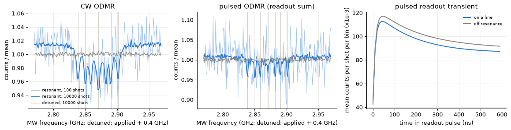
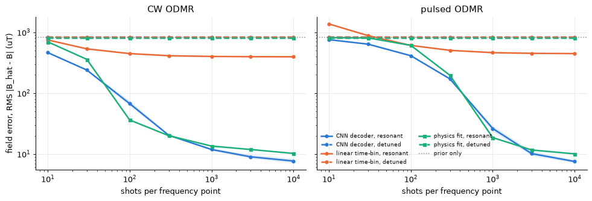
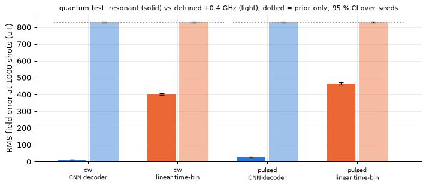
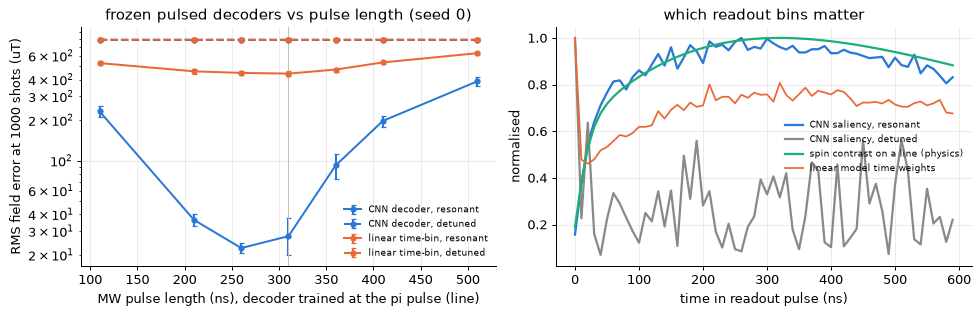

# Milestone 2: Task 1, field estimation from the glow, and the quantum test

Task 1 of the brief: estimate a hidden magnetic field from the glow. Two fixed sensor protocols, three estimators, all trained and tested on the fast surrogate, the decoders re-checked on the QuTiP reference, and the quantum test (every learned estimator retrained and re-evaluated with the microwaves detuned 400 MHz off resonance) over 5 seeds.

## Task and data

- **Hidden field**: |B| uniform in [0.5, 3] mT, isotropic direction. An ODMR spectrum cannot tell the sign of B along an NV axis nor which line belongs to which axis, so B is identifiable only up to the 48 signed permutations of the crystal axes; the target is the canonical representative, B folded into the wedge Bx >= By >= Bz >= 0 (generically unique). Errors are the vector error |B_hat - B| in µT.
- **Nuisance** (one draw per group of 8 fields): T2* log-uniform 0.5-2 µs, Rabi full scale 8-12 MHz, optical beta 0.07-0.13, collection 2e-3-4e-3, background 5e3-2e4 counts/s, strain E 0-0.3 MHz. Decoders see counts normalised by their own mean, so absolute brightness is not a cue.
- **Protocols** (sweep 2.77-2.97 GHz, 200 points, 1 MHz step): *CW ODMR*, laser + MW (amplitude 0.1) in the steady state, 3 µs dwell per shot per point, one number per point; *pulsed ODMR*, 1.5 µs init, 1 µs dark, a 310 ns MW pulse at amplitude 0.2 (a pi pulse at the nominal Rabi full scale), 600 ns readout recorded in 60 bins of 10 ns: a 60 x 200 input. Shot lengths 3 µs (CW) and 3.41 µs (pulsed), so equal shots are nearly equal time budgets.
- **Datasets**: per seed 5000 train / 512 validation / 1000 test fields; the surrogate gives the noiseless mean counts of every input cell (M = 32 weighted-uniform detuning nodes, spacing 2 widths), and Poisson noise for a log-uniform number of shots in [10, 10000] is drawn fresh at every training step. CW points use the surrogate's steady-state solve, pulsed sweeps share their init + settle prefix (exact fast paths, docs/notes/surrogate.md). Bank generation took 421 s (CW) and 1544 s (pulsed) in total on cuda NVIDIA GeForce RTX 5070 Ti.

## Estimators

- **CNN decoder** (`glowbox/learn/decoder.py`, `ConvDecoder`): learned 1x1 time-bin mixing (T -> 8), a stem and 3 stages of residual 1D convolutions along the frequency axis (channels [32, 64, 128], kernel 7, stride-2 downsampling), flatten (dip positions matter, so no global pooling), log10(shots) appended, MLP to mean and log-variance of the three field components; Gaussian NLL, AdamW, 6000 steps of 256, best validation NLL kept.
- **Linear time-bin baseline** (`TimeBinLinear`): one learned weighting of the readout bins (a weighted spectrum), an affine map of it to the field, a log-variance affine in log10(shots); same loss.
- **Physics fit** (`glowbox/analysis/field_fit.py`): eight Lorentzian dips with shared width and contrast whose positions are the exact H0 transitions of a trial field (E = 0 assumed), coarse grid search over the wedge then least squares, covariance from the Jacobian; the prior when no dip is significant. Pulsed input is the sum over the readout bins (a late-window normalisation would cancel the signal here: with singlet shelving the whole 600 ns readout is spin dependent). Seed 0 only, on the first 300 test fields.

## Error vs shots

RMS field error (µT), mean over seeds with 95 % bootstrap CI, resonant condition:

| shots | cw CNN decoder | cw linear time-bin | pulsed CNN decoder | pulsed linear time-bin | cw physics fit | pulsed physics fit |
| --- | --- | --- | --- | --- | --- | --- |
| 10 | 464 [455, 473] | 749 [746, 753] | 757 [751, 762] | 1.37e+03 [1.36e+03, 1.38e+03] | 697 | 817 |
| 30 | 240 [236, 243] | 534 [530, 539] | 639 [629, 650] | 883 [867, 904] | 359 | 810 |
| 100 | 67.4 [61.8, 75.3] | 447 [441, 452] | 412 [404, 421] | 609 [602, 617] | 36.3 | 609 |
| 300 | 20.4 [19.9, 20.9] | 412 [406, 420] | 172 [168, 175] | 505 [501, 510] | 20 | 197 |
| 1000 | 11.9 [11.4, 12.5] | 401 [395, 407] | 26.3 [23.6, 29.1] | 463 [457, 470] | 13.5 | 18.6 |
| 3000 | 9 [8.48, 9.81] | 397 [392, 403] | 10.1 [9.41, 11.2] | 451 [446, 458] | 11.9 | 11.7 |
| 10000 | 7.68 [7.17, 8.45] | 396 [391, 402] | 7.55 [7.16, 8.08] | 447 [441, 454] | 10.2 | 10.1 |

Prior only (predicting the training mean): 830 µT. Physics fit vs CNN on the *same* fields and noise level (seed 0): cw 10 shots: fit 697 vs CNN 495 µT (fit found dips in 31 %); cw 1000 shots: fit 13.5 vs CNN 11.4 µT (fit found dips in 100 %); cw 10000 shots: fit 10.2 vs CNN 7.64 µT (fit found dips in 100 %); pulsed 10 shots: fit 817 vs CNN 745 µT (fit found dips in 1 %); pulsed 1000 shots: fit 18.6 vs CNN 35.3 µT (fit found dips in 100 %); pulsed 10000 shots: fit 10.1 vs CNN 6.74 µT (fit found dips in 100 %).

## Calibration

Calibration of the predicted per-component sigma, resonant, mean over seeds: RMS of error / sigma (1 = calibrated) and coverage of the 68 % / 95 % intervals.

| shots | cw CNN decoder | cw linear time-bin | pulsed CNN decoder | pulsed linear time-bin | cw fit | pulsed fit |
| --- | --- | --- | --- | --- | --- | --- |
| 10 | 1.01 (72 / 95 %) | 1.28 (57 / 88 %) | 1.01 (67 / 95 %) | 1.25 (59 / 89 %) | 11.40 (55 / 78 %) | 18.84 (66 / 96 %) |
| 30 | 0.99 (75 / 95 %) | 1.01 (68 / 95 %) | 1.00 (70 / 95 %) | 1.04 (68 / 94 %) | 4.53 (50 / 73 %) | 35.23 (64 / 94 %) |
| 100 | 1.02 (71 / 94 %) | 0.92 (73 / 97 %) | 1.00 (74 / 95 %) | 0.93 (73 / 96 %) | 1.40 (62 / 88 %) | 11.47 (52 / 74 %) |
| 300 | 1.08 (66 / 93 %) | 0.91 (73 / 97 %) | 1.02 (74 / 95 %) | 0.90 (75 / 97 %) | 1.18 (65 / 91 %) | 10.20 (50 / 77 %) |
| 1000 | 1.15 (64 / 91 %) | 0.97 (70 / 96 %) | 1.11 (66 / 93 %) | 0.94 (73 / 96 %) | 1.25 (66 / 91 %) | 1.51 (60 / 85 %) |
| 3000 | 1.15 (67 / 92 %) | 1.04 (67 / 94 %) | 1.15 (64 / 92 %) | 1.03 (69 / 94 %) | 1.72 (57 / 83 %) | 1.77 (57 / 84 %) |
| 10000 | 1.13 (70 / 93 %) | 1.15 (62 / 91 %) | 1.05 (70 / 94 %) | 1.21 (63 / 90 %) | 2.16 (54 / 79 %) | 2.26 (50 / 78 %) |

## Quantum test

Every learned estimator was retrained from scratch and evaluated with every MW frequency shifted by +400 MHz (no line within 222 MHz of any MW frequency in the spot checks; `check_no_line_driven`), same fields, nuisance, initialisation and noise seeds per seed (paired). Headline: RMS field error at 1000 shots; skill = 1 - error / prior-only error. 95 % percentile-bootstrap CIs over the seeds; gap > 0 means better on resonance.

| metric | resonant | detuned | gap (better on resonance > 0) | per seed (resonant / detuned) |
| --- | --- | --- | --- | --- |
| cw_cnn_rmse_ut | 11.9 [11.4, 12.4] | 831 [828, 833] | 819 [817, 820] | 11.2, 11.7, 11.5, 11.9, 13; 829, 827, 830, 833, 834 |
| cw_linear_rmse_ut | 401 [395, 407] | 831 [828, 833] | 429 [424, 434] | 402, 393, 396, 413, 402; 829, 827, 830, 833, 834 |
| pulsed_cnn_rmse_ut | 26.3 [23.5, 29.1] | 831 [828, 833] | 804 [801, 807] | 30.3, 22.2, 24, 24.9, 30; 829, 827, 830, 833, 834 |
| pulsed_linear_rmse_ut | 463 [457, 470] | 830 [828, 833] | 367 [361, 374] | 468, 459, 455, 476, 457; 829, 827, 830, 833, 834 |
| cw_cnn_skill | 0.986 [0.985, 0.986] | -0.000161 [-0.000251, -8.97e-05] | 0.986 [0.985, 0.986] | 0.986, 0.986, 0.986, 0.986, 0.984; -7.47e-05, -0.000318, -9.29e-05, -0.000206, -0.000113 |
| cw_linear_skill | 0.517 [0.51, 0.523] | -7.89e-05 [-0.00013, -3.67e-05] | 0.517 [0.51, 0.523] | 0.515, 0.525, 0.523, 0.504, 0.518; -1.88e-05, -6.92e-05, -9.63e-05, -3.85e-05, -0.000172 |
| pulsed_cnn_skill | 0.968 [0.965, 0.972] | -0.000184 [-0.000258, -0.00011] | 0.969 [0.965, 0.972] | 0.963, 0.973, 0.971, 0.97, 0.964; -0.000113, -0.000283, -9.36e-05, -0.000294, -0.000137 |
| pulsed_linear_skill | 0.442 [0.434, 0.451] | -3.51e-05 [-0.000149, 7.86e-05] | 0.443 [0.434, 0.451] | 0.436, 0.445, 0.452, 0.428, 0.452; 0.000134, -0.000171, -6.46e-06, -0.000198, 6.53e-05 |

Outcome: cw CNN gap 819 [817, 820] µT (significant); pulsed CNN gap 804 [801, 807] µT (significant). Detuned, the CNN's skill is cw -0.000161 [-0.000251, -8.97e-05], pulsed -0.000184 [-0.000258, -0.00011]: with no line driven the spectrum carries (almost) no field information and the decoders fall back to the prior. The physics fit on the detuned spectra found dips in cw 0 %, pulsed 0 % of the cases at 1000 shots.

### Does the learned strategy use microsecond-scale timing?

Task 1 uses fixed protocols, so the strategy is the protocol plus the learned decoder. The CW protocol has no timing structure by construction (MW and laser on together, steady state; Rabi-band fraction of its MW envelope 0.00). The pulsed protocol's MW pulse has area 1.01 pi at the nominal Rabi frequency (Rabi-band fraction 0.24). Probe: the seed-0 pulsed decoders, frozen, on test fields re-simulated with the MW pulse lengthened or shortened (RMS error at 1000 shots, 95 % bootstrap CI over 200 fields x 4 noise draws):

| pulse length (ns) | CNN decoder, resonant | linear time-bin, resonant | CNN decoder, detuned | linear time-bin, detuned |
| --- | --- | --- | --- | --- |
| 110 | 232 [210, 254] | 529 [512, 546] | 792 [771, 813] | 791 [770, 812] |
| 210 | 36.4 [32.8, 40.4] | 460 [443, 477] | 792 [771, 812] | 791 [771, 813] |
| 260 | 22.5 [20.7, 24.4] | 448 [430, 466] | 792 [771, 813] | 791 [771, 812] |
| 310 | 27.5 [20, 37.5] | 442 [425, 461] | 792 [771, 812] | 791 [770, 812] |
| 360 | 92.2 [73.1, 112] | 474 [458, 490] | 792 [770, 812] | 791 [770, 812] |
| 410 | 197 [179, 215] | 535 [521, 551] | 792 [770, 812] | 791 [771, 812] |
| 510 | 388 [361, 414] | 627 [611, 643] | 792 [771, 813] | 791 [770, 813] |

Readout saliency of the resonant CNN: 48 % of |d|B_hat|/d input| falls in the first 300 ns of the readout (uniform would be 50 %); the physical spin contrast per readout bin and the linear model's learned time weights are in the timing figure. Logged verdict `uses_us_timing` (resonant error rises beyond its CI for |shift| >= 100 ns while the detuned one does not): **True**: the resonant decoder depends on the MW pulse being a pi pulse, i.e. on Rabi timing at the ~100 ns scale.

## Reference check (QuTiP)

3 seed-0 test fields re-simulated with the QuTiP reference (same detuning nodes; CW points 20 µs long, last 2 µs) and fed to the surrogate-trained CNN (226 s on the CPU pool):

| protocol | max feature diff / peak | max pred. diff, noiseless (µT) | RMS error at 1000 shots ref / surrogate (µT, 64 draws) |
| --- | --- | --- | --- |
| cw | 7.2e-08 | 0.0065 | 11.2 / 11.2 |
| pulsed | 3.1e-05 | 0.015 | 29.1 / 29.1 |

## Notes and open issues

- Field priors and nuisance ranges are assumptions (`FieldPrior`), not a characterised sample; the model excludes hyperfine structure and excited-state mixing (docs/physics.md section 10), which a real spectrum has. No claim of quantum advantage: the gap only shows the estimate needs the driven spin resonance.
- The physics fit assumes E = 0 and a Lorentzian lineshape (the pulsed line is not exactly Lorentzian); it is evaluated for seed 0 only.
- Five seeds make the bootstrap CIs coarse; per-seed values are in the table.

Notes added after reading the run:

- The CNN at the trained 310 ns pulse has a wide CI (27.5 [20, 37.5] µT) and 260 ns does slightly better
  (22.5 µT): the error is heavy-tailed (a few fields with overlapping lines dominate the RMS), and the decoder was
  trained across Rabi full scales of 8-12 MHz, so the nominal pi pulse is only right on average. The point of the
  probe stands: at 110 ns or 510 ns the error rises 8-14x on resonance and not at all detuned.
- The physics fit beats the pulsed CNN on seed 0 at 1000 shots (18.6 vs 35.3 µT on the same 300 fields), the
  CNN wins at >= 3000 shots and on CW; the fit's sigma is badly calibrated below ~300 shots (failed or
  mis-assigned fits with Jacobian errors) and ~2x over-confident at high shots (E = 0 and Lorentzian-shape bias,
  ~10 µT floor).
- The detuned skill is ~-2e-4 (slightly below 0): with no field information the best the decoders can do is the
  training mean, which differs slightly from the test mean. The B_perp level-mixing signal that would survive
  detuning is far below the shot noise at 1e4 shots and is masked by the per-sample normalisation.
- Process pools: with 32 spawn workers some worker starts on the GPU machine failed for lack of page-file commit
  (each worker imports torch); the pools replaced them and every item completed. The config default is now 16.










## Provenance

- run id: `20261125-214404-m2-field-estimation-75e9`
- git: `526e6899c62e095a9cfe1dc4fd338147b76ebe42`
- seed: 20261126
- device: cuda NVIDIA GeForce RTX 5070 Ti
- python 3.12.14, glowbox 0.1.0, torch 2.11.0+cu128, qutip 5.3.1, numpy 2.5.5, scipy 1.18.1, pyarrow 26.0.1
- started 2026-11-25T21:44:04+00:00, finished 2026-11-25T23:25:04+00:00

## Config

```yaml
bank:
  detuning_rule: uniform
  detuning_spacing: 2.0
  fields_per_env: 8
  n_detuning: 32
  n_test: 1000
  n_train: 5000
  n_val: 512
  workers: 4
decoder:
  channels:
  - 32
  - 64
  - 128
  hidden: 256
  kernel: 7
  mix_channels: 8
detuned_offset_hz: 400000000.0
eval:
  headline_shots: 1000
  shots:
  - 10
  - 30
  - 100
  - 300
  - 1000
  - 3000
  - 10000
fit:
  n_fields: 300
  workers: 32
linear_train:
  lr: 0.003
  steps: 4000
name: m2-field-estimation
prior:
  b_max_t: 0.003
  b_min_t: 0.0005
  background_cps:
  - 5000.0
  - 20000.0
  collection_efficiency:
  - 0.002
  - 0.004
  e_hz:
  - 0.0
  - 300000.0
  optical_beta_full_scale:
  - 0.07
  - 0.13
  rabi_full_scale_hz:
  - 8000000.0
  - 12000000.0
  t2_star_s:
  - 5.0e-07
  - 2.0e-06
reference:
  cw_ns: 20000
  n_fields: 3
  workers: 32
seed: 20261126
seeds:
- 0
- 1
- 2
- 3
- 4
sweep:
  cw_amplitude: 0.1
  cw_shot_ns: 3000
  f_start_hz: 2770000000.0
  f_stop_hz: 2970000000.0
  init_ns: 1500
  pi_ns: 310
  pulsed_amplitude: 0.2
  readout_ns: 600
  settle_ns: 1000
  step_hz: 1000000.0
timing:
  n_fields: 200
  noise_repeats: 4
  pi_shifts_ns:
  - -200
  - -100
  - -50
  - 0
  - 50
  - 100
  - 200
train:
  batch: 256
  eval_every: 250
  lr: 0.001
  shots_max: 10000
  shots_min: 10
  steps: 6000
  weight_decay: 0.0001
```

## Final metrics

| metric | value |
| --- | --- |
| cw_cnn_rmse_ut_resonant | 11.8714 |
| cw_cnn_rmse_ut_detuned | 830.576 |
| cw_cnn_gap_ut | 818.705 |
| cw_cnn_gap_lo_ut | 816.799 |
| cw_cnn_gap_hi_ut | 820.489 |
| cw_linear_rmse_ut_resonant | 401.141 |
| cw_linear_rmse_ut_detuned | 830.508 |
| cw_linear_gap_ut | 429.367 |
| cw_linear_gap_lo_ut | 424 |
| cw_linear_gap_hi_ut | 433.661 |
| cw_prior_rmse_ut | 830.443 |
| cw_fit_rmse_ut_resonant | 13.5195 |
| cw_ref_max_rel_feature_diff | 7.17457e-08 |
| pulsed_cnn_rmse_ut_resonant | 26.2646 |
| pulsed_cnn_rmse_ut_detuned | 830.596 |
| pulsed_cnn_gap_ut | 804.331 |
| pulsed_cnn_gap_lo_ut | 801.397 |
| pulsed_cnn_gap_hi_ut | 806.753 |
| pulsed_linear_rmse_ut_resonant | 462.972 |
| pulsed_linear_rmse_ut_detuned | 830.472 |
| pulsed_linear_gap_ut | 367.5 |
| pulsed_linear_gap_lo_ut | 360.556 |
| pulsed_linear_gap_hi_ut | 374.443 |
| pulsed_prior_rmse_ut | 830.443 |
| pulsed_fit_rmse_ut_resonant | 18.6272 |
| pulsed_ref_max_rel_feature_diff | 3.06278e-05 |
| uses_us_timing_pulsed | 1 |
| no_line_margin_mhz | 222.022 |
| wall_seconds | 6059.98 |
