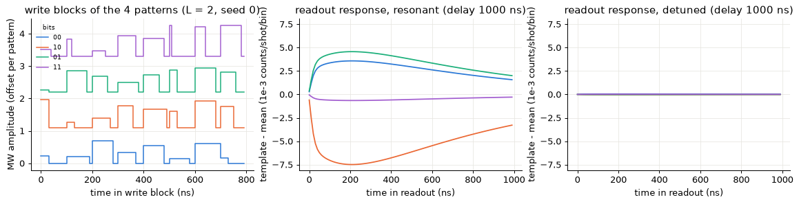
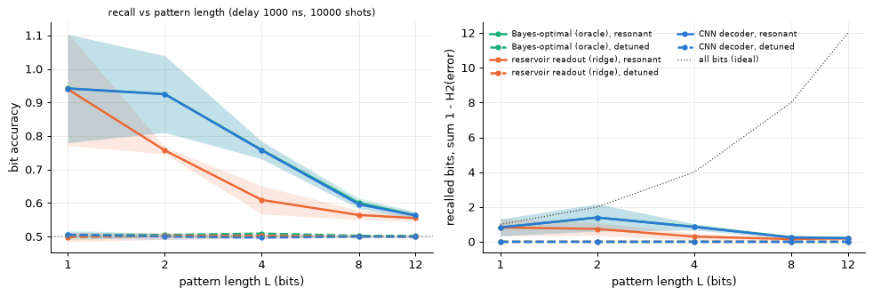
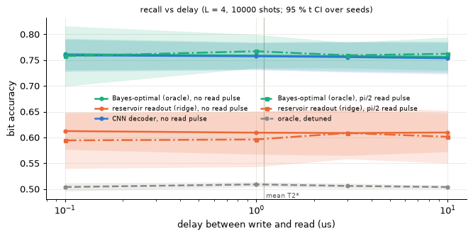
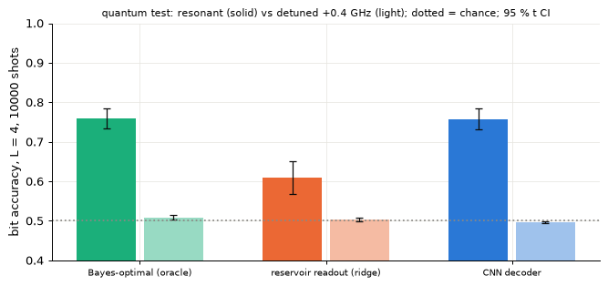
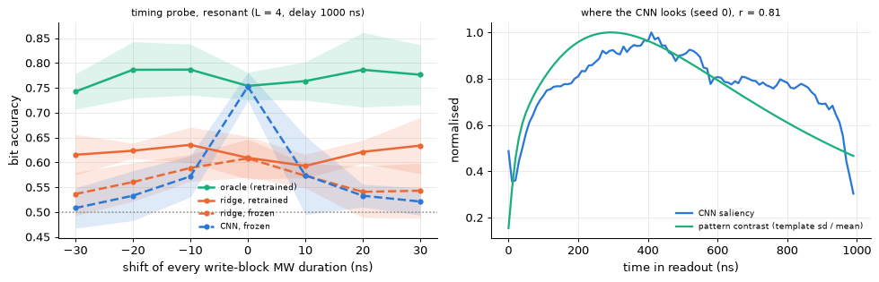

# Milestone 3, Task 2: store a bit pattern in the pulse response and recall it

Task 2 of the brief: store a short bit pattern in the pulse response and recall it. A fixed random pulse encoder writes the bits into a block of MW segments, the NV ensemble holds them through a dark delay, and the bits are recalled from the time-resolved fluorescence of one readout. Three readouts of the same signal (a linear reservoir readout, a CNN decoder and the Bayes-optimal oracle), 5 seeds, all on the fast surrogate, the headline re-checked on the QuTiP reference; and the quantum test.

## Protocol

- **Device** (one per seed): static field (0.0012, 0.0007, 0.0025) T (known, eight lines), nuisance drawn per seed from the milestone-2 ranges (T2* 0.5-2 µs log-uniform, Rabi full scale 8-12 MHz, beta 0.07-0.13, collection 2e-3-4e-3, background 5e3-2e4 counts/s, E 0-0.3 MHz); seed 0 has T2* = 0.94 µs, Rabi full scale 9.94 MHz. T2* quadrature: M = 32 quantile nodes.
- **Shot**: 1500 ns init laser, 1000 ns dark, the write block (8 slots of 100 ns), a dark delay, optionally a read pulse (line 0, amplitude 0.5, 60 ns: ~pi/2 at the nominal full scale), then 1000 ns of readout laser recorded in 10 ns bins. The write block has the same length for every L.
- **Encoder** (`RandomPulseEncoder`, fixed per seed and L, never trained): u = 2 b - 1; per segment amplitude in [0.05, 1.0], phase in (-pi, pi), frequency within ±4 MHz of one of the eight lines (fixed random choice), MW duration 10-100 ns on the grid, each a sigmoid / tanh of a random affine map of u (gain 1.5). Every segment depends on every bit.
  Over the seeds' headline encoders (L = 4, all patterns): median segment area 0.35 pi, 61 % of segments between pi/4 and 4 pi (Rabi-scale pulses), median MW duration 50 ns.
- **Codebook**: every one of the 2^L patterns (L <= 12) is simulated (noiseless mean counts per shot per readout bin, its template). Training and test draws pick patterns uniformly and add Poisson noise for the given number of shots (the pattern written and read that many times); test noise is fresh. So every readout is calibrated on all patterns, and recall is limited by shot noise and by how distinct the templates are.

## Readouts

- **Oracle** (`bitwise_map`): exact templates, Poisson likelihood, uniform prior over patterns, posterior marginal per bit, threshold 1/2. Bayes-optimal bit decisions: an upper bound for any readout of this protocol and encoder.
- **Reservoir readout** (`RidgeReadout`): ridge regression from counts per shot (standardised) to u, one model per shot level, 8192 training draws, penalty by generalised cross-validation; decision = sign. The reservoir is encoder + spins + this linear map; nothing else is trained.
- **CNN decoder** (`ConvDecoder`, one logit per bit, BCE): input = counts per shot relative to the codebook's mean template (`LevelDecoder`: the level is kept, since each seed is one device and the pattern changes the level), conditioned on log10(shots); trained 2500 steps of 256 on fresh Poisson noise, shots log-uniform in [300, 300000], best validation loss kept. Trained on the no-read-pulse arm at (L, delay) = (1, 1000 ns), (2, 1000 ns), (4, 1000 ns), (8, 1000 ns), (12, 1000 ns), (4, 100 ns), (4, 3000 ns), (4, 10000 ns).
- Metrics: bit accuracy, pattern accuracy (all L bits right), and recalled bits = sum over bits of 1 - H2(e_i) (the capacity of L binary symmetric channels with the measured per-bit error rates e_i; 0 at chance, L when perfect).

## Recall vs pattern length

Delay 1000 ns, no read pulse, mean over 5 seeds with a 95 % Student-t CI over seeds; 'sep' is the median distance of a template to its nearest neighbour in Poisson standard deviations (seed mean).

| L | shots | sep | oracle bit acc | ridge bit acc | cnn bit acc | oracle recalled bits | ridge recalled bits | cnn recalled bits |
| --- | --- | --- | --- | --- | --- | --- | --- | --- |
| 1 | 1000 | 5.5 | 0.905 [0.67, 1.14] | 0.903 [0.66, 1.15] | 0.904 [0.668, 1.14] | 0.744 [0.23, 1.26] | 0.743 [0.227, 1.26] | 0.741 [0.228, 1.25] |
| 1 | 10000 | 17 | 0.942 [0.781, 1.1] | 0.94 [0.772, 1.11] | 0.942 [0.78, 1.1] | 0.826 [0.343, 1.31] | 0.823 [0.332, 1.31] | 0.826 [0.343, 1.31] |
| 1 | 100000 | 55 | 0.991 [0.965, 1.02] | 0.991 [0.964, 1.02] | 0.991 [0.965, 1.02] | 0.946 [0.796, 1.1] | 0.945 [0.793, 1.1] | 0.946 [0.795, 1.1] |
| 2 | 1000 | 1.7 | 0.841 [0.716, 0.966] | 0.736 [0.716, 0.757] | 0.839 [0.714, 0.965] | 0.872 [0.227, 1.52] | 0.528 [0.281, 0.774] | 0.866 [0.22, 1.51] |
| 2 | 10000 | 5.5 | 0.925 [0.811, 1.04] | 0.757 [0.747, 0.768] | 0.925 [0.81, 1.04] | 1.4 [0.614, 2.18] | 0.739 [0.367, 1.11] | 1.39 [0.608, 2.18] |
| 2 | 100000 | 17 | 0.969 [0.885, 1.05] | 0.736 [0.7, 0.771] | 0.969 [0.886, 1.05] | 1.75 [1.07, 2.42] | 0.752 [0.33, 1.17] | 1.75 [1.07, 2.42] |
| 4 | 1000 | 0.19 | 0.655 [0.626, 0.683] | 0.589 [0.553, 0.626] | 0.652 [0.624, 0.68] | 0.339 [0.237, 0.441] | 0.195 [0.0789, 0.31] | 0.329 [0.228, 0.429] |
| 4 | 10000 | 0.6 | 0.759 [0.733, 0.785] | 0.609 [0.567, 0.651] | 0.757 [0.731, 0.783] | 0.865 [0.688, 1.04] | 0.297 [0.0987, 0.496] | 0.854 [0.678, 1.03] |
| 4 | 100000 | 1.9 | 0.879 [0.861, 0.897] | 0.609 [0.568, 0.65] | 0.877 [0.858, 0.895] | 1.91 [1.71, 2.11] | 0.316 [0.0952, 0.536] | 1.89 [1.69, 2.09] |
| 8 | 1000 | 0.015 | 0.574 [0.558, 0.589] | 0.558 [0.542, 0.573] | 0.572 [0.557, 0.588] | 0.165 [0.0919, 0.239] | 0.128 [0.0568, 0.199] | 0.162 [0.0889, 0.235] |
| 8 | 10000 | 0.047 | 0.601 [0.585, 0.616] | 0.564 [0.55, 0.579] | 0.596 [0.583, 0.61] | 0.264 [0.182, 0.345] | 0.154 [0.0812, 0.227] | 0.247 [0.172, 0.322] |
| 8 | 100000 | 0.15 | 0.655 [0.631, 0.679] | 0.564 [0.546, 0.583] | 0.617 [0.607, 0.627] | 0.59 [0.402, 0.778] | 0.159 [0.0741, 0.243] | 0.35 [0.287, 0.413] |
| 12 | 1000 | 0.0021 | 0.557 [0.545, 0.569] | 0.547 [0.54, 0.554] | 0.557 [0.546, 0.568] | 0.171 [0.105, 0.236] | 0.151 [0.0992, 0.202] | 0.171 [0.108, 0.234] |
| 12 | 10000 | 0.0065 | 0.564 [0.553, 0.574] | 0.555 [0.546, 0.564] | 0.563 [0.552, 0.574] | 0.211 [0.145, 0.277] | 0.192 [0.124, 0.259] | 0.209 [0.139, 0.278] |
| 12 | 100000 | 0.021 | 0.573 [0.562, 0.585] | 0.556 [0.545, 0.568] | 0.564 [0.553, 0.575] | 0.244 [0.167, 0.321] | 0.194 [0.116, 0.271] | 0.21 [0.136, 0.284] |

At 10000 shots the recalled bits are: Bayes-optimal (oracle) 0.83 of 1, 1.40 of 2, 0.86 of 4, 0.26 of 8, 0.21 of 12; reservoir readout (ridge) 0.82 of 1, 0.74 of 2, 0.30 of 4, 0.15 of 8, 0.19 of 12; CNN decoder 0.83 of 1, 1.39 of 2, 0.85 of 4, 0.25 of 8, 0.21 of 12. The oracle's recall peaks at L = 2 (1.40 bits) and falls for longer patterns: they crowd the same readout signal.

## Recall vs delay

L = 4, 10000 shots, bit accuracy (95 % t CI over seeds); 'none' reads populations only, 'pi2' applies the read pulse first.

| delay (ns) | none oracle | none ridge | none cnn | pi2 oracle | pi2 ridge | pi2 cnn |
| --- | --- | --- | --- | --- | --- | --- |
| 100 | 0.761 [0.731, 0.792] | 0.612 [0.577, 0.648] | 0.759 [0.728, 0.79] | 0.758 [0.699, 0.816] | 0.594 [0.54, 0.649] |  |
| 1000 | 0.759 [0.733, 0.785] | 0.609 [0.567, 0.651] | 0.757 [0.731, 0.783] | 0.767 [0.735, 0.8] | 0.596 [0.543, 0.649] |  |
| 3000 | 0.758 [0.729, 0.787] | 0.609 [0.565, 0.652] | 0.756 [0.727, 0.785] | 0.759 [0.734, 0.784] | 0.609 [0.558, 0.659] |  |
| 10000 | 0.756 [0.726, 0.786] | 0.61 [0.572, 0.647] | 0.754 [0.723, 0.784] | 0.762 [0.73, 0.794] | 0.601 [0.55, 0.652] |  |

- Oracle bit accuracy at 100 ns minus at 10000 ns, arm none: 0.00507 [-0.0027, 0.0128] (paired over seeds).
- Oracle bit accuracy at 100 ns minus at 10000 ns, arm pi2: -0.00452 [-0.0446, 0.0355] (paired over seeds).
- `memory_uses_coherence` = **False** (criterion: with the read pulse, recall changes between the shortest and longest delay beyond the CI; populations alone do not decay on this scale, T1 = 5 ms, so a change is the stored coherence dephasing on the T2* scale).

## Quantum test

Every readout retrained and re-evaluated with every MW frequency (write block and read pulse) shifted by +400 MHz (nearest line 254 MHz away from any MW frequency; `check_no_line_driven`), same devices, encoders and noise seeds (paired). Headline: L = 4, delay 1000 ns, 10000 shots, no read pulse (pi2_* rows: with the read pulse). 95 % Student-t CIs over the 5 seeds; gap > 0 means better on resonance.

| metric | resonant | detuned | gap (better on resonance > 0) | per seed (resonant / detuned) |
| --- | --- | --- | --- | --- |
| oracle_bit_acc | 0.759 [0.733, 0.785] | 0.509 [0.504, 0.514] | 0.25 [0.223, 0.277] | 0.781, 0.767, 0.751, 0.726, 0.767; 0.514, 0.507, 0.509, 0.512, 0.504 |
| oracle_recalled_bits | 0.865 [0.688, 1.04] | 0.00183 [-2.24e-05, 0.00368] | 0.863 [0.685, 1.04] | 1, 0.985, 0.798, 0.656, 0.885; 0.00233, 0.000927, 0.0011, 0.00421, 0.000562 |
| oracle_pattern_acc | 0.418 [0.361, 0.474] | 0.0667 [0.0609, 0.0724] | 0.351 [0.298, 0.403] | 0.478, 0.426, 0.349, 0.418, 0.417; 0.0745, 0.0652, 0.0632, 0.0632, 0.0671 |
| ridge_bit_acc | 0.609 [0.567, 0.651] | 0.503 [0.498, 0.508] | 0.107 [0.0665, 0.147] | 0.615, 0.608, 0.657, 0.603, 0.563; 0.501, 0.509, 0.504, 0.5, 0.5 |
| ridge_recalled_bits | 0.297 [0.0987, 0.496] | 0.000735 [0.000241, 0.00123] | 0.297 [0.0984, 0.495] | 0.271, 0.487, 0.429, 0.198, 0.101; 0.000942, 0.00111, 0.00102, 0.000248, 0.000364 |
| ridge_pattern_acc | 0.122 [0.0945, 0.15] | 0.0639 [0.0582, 0.0696] | 0.0582 [0.0339, 0.0824] | 0.0925, 0.143, 0.139, 0.131, 0.105; 0.0605, 0.0718, 0.0637, 0.061, 0.0625 |
| cnn_bit_acc | 0.757 [0.731, 0.783] | 0.497 [0.495, 0.499] | 0.26 [0.236, 0.285] | 0.779, 0.767, 0.752, 0.724, 0.764; 0.499, 0.496, 0.496, 0.496, 0.499 |
| cnn_recalled_bits | 0.854 [0.678, 1.03] | 0.000194 [9.12e-05, 0.000297] | 0.854 [0.678, 1.03] | 0.985, 0.979, 0.8, 0.643, 0.863; 0.000341, 0.000172, 0.000147, 0.000155, 0.000155 |
| cnn_pattern_acc | 0.42 [0.366, 0.474] | 0.0619 [0.0587, 0.0651] | 0.358 [0.303, 0.413] | 0.472, 0.425, 0.352, 0.416, 0.433; 0.0627, 0.0605, 0.0642, 0.0581, 0.064 |
| pi2_oracle_bit_acc | 0.767 [0.735, 0.8] | 0.502 [0.496, 0.508] | 0.265 [0.228, 0.302] | 0.799, 0.735, 0.76, 0.753, 0.788; 0.5, 0.51, 0.5, 0.502, 0.499 |
| pi2_ridge_bit_acc | 0.596 [0.543, 0.649] | 0.499 [0.493, 0.505] | 0.0971 [0.0387, 0.156] | 0.608, 0.549, 0.643, 0.627, 0.554; 0.5, 0.503, 0.49, 0.499, 0.502 |

Outcome (bit accuracy): Bayes-optimal (oracle) gap 0.25 [0.223, 0.277] (significant; detuned 0.509 [0.504, 0.514]); reservoir readout (ridge) gap 0.107 [0.0665, 0.147] (significant; detuned 0.503 [0.498, 0.508]); CNN decoder gap 0.26 [0.236, 0.285] (significant; detuned 0.497 [0.495, 0.499]). Detuned, no MW frequency drives a line, the readout no longer depends on the pattern and every readout falls to chance (0.5).

### Does the strategy use microsecond-scale timing?

Nothing that sets timing is learned in Task 2: the encoder is a fixed random map and the readouts only weight readout bins, so `strategy_learns_timing` = **False**. What the log records is whether the fixed reservoir and the readouts *depend* on spin timing:

- **Pulse areas** (timing probe, every seed, resonant; every write-block MW duration shifted, clipped to [10, 100] ns; L = 4, delay 1000 ns, 10000 shots). Bit accuracy at shift 0 minus at the largest shifts (paired over seeds):
  - oracle, retrained: -30 ns: 0.0115 [-0.0135, 0.0365]; +30 ns: -0.0225 [-0.0671, 0.0222]
  - ridge, retrained: -30 ns: -0.00603 [-0.0661, 0.0541]; +30 ns: -0.0246 [-0.117, 0.0681]
  - ridge, frozen: -30 ns: 0.0719 [0.00917, 0.135]; +30 ns: 0.0653 [-0.0157, 0.146]
  - CNN, frozen: -30 ns: 0.244 [0.201, 0.288]; +30 ns: 0.231 [0.185, 0.277]

  A frozen readout that degrades means it relies on the exact pulse areas the encoder produced at calibration (Rabi-scale structure: the Rabi period is ~120 ns at full amplitude and longer below, so a 30 ns change is up to a quarter of a period); a retrained readout that does not degrade means the shifted encoding is just another random encoding, equally informative. Verdicts: `readout_relies_on_pulse_timing` = **True**, `information_needs_exact_timing` = **False**.
- **Storage time scale** (delay table above): `memory_uses_coherence` = **False**.
- **Readout weighting** (seed 0 CNN): saliency per readout bin vs the pattern contrast per bin, r = 0.81; 28 % of the saliency in the first 300 ns of the readout.

## Reference check (QuTiP)

The first 8 patterns of the seed-0 headline codebook (L = 4, delay 1000 ns) re-simulated as full sequences (absolute-time phases, `full_sequence`) on the QuTiP reference with the same quadrature nodes, and fed to the surrogate-trained readouts (18 s on the CPU pool):

| read arm | max template diff / peak | / max pattern signal | ridge decisions agree (noiseless) | bit acc ref / surrogate (64 draws each), oracle | ridge | CNN |
| --- | --- | --- | --- | --- | --- | --- |
| none | 8.6e-06 | 2.1e-04 | 1.000 | 0.770 / 0.770 | 0.534 / 0.532 | 0.768 / 0.768 |
| pi2 | 1.0e-05 | 2.8e-04 | 1.000 | 0.824 / 0.827 | 0.564 / 0.562 |  |

## Notes and open issues

- One readout per shot sees only the total ms = 0 population of all four axes (plus the singlet), a nearly one-dimensional signal: the readout's time shape adds little. That caps how much of a pattern one readout can return, whatever the readout: the oracle column is the cap for this encoder. A random encoding also spreads the 2^L patterns unevenly along that one dimension (many near-collisions); a designed encoding (e.g. binary-weighted pulse areas, or an encoder trained through the differentiable surrogate, the next phase-2 item) should do better.
- The codebook contains every pattern, so the CNN is calibrated on all of them (a classifier under shot noise), not asked to generalise to unseen patterns; the ridge readout is linear, so it cannot memorise.
- Model limits (docs/physics.md section 10): no hyperfine, no charge dynamics, no excited-state mixing; the T2* node set revives after ~2 M T2* (>= 32 µs here, longer than every sequence).
- No claim of quantum advantage: the gap shows only that recall needs the driven spin resonance.











## Provenance

- run id: `20261126-051553-m3-bit-memory-331a`
- git: `ed4db1d85043c9ae1961ff675477edc349e5d40c`
- seed: 20261127
- device: cuda NVIDIA GeForce RTX 5070 Ti
- python 3.12.14, glowbox 0.1.0, torch 2.11.0+cu128, qutip 5.3.1, numpy 2.5.5, scipy 1.18.1, pyarrow 26.0.1
- started 2026-11-26T05:15:53+00:00, finished 2026-11-26T06:49:04+00:00

## Config

```yaml
cnn:
  batch: 256
  eval_every: 250
  lr: 0.001
  n_val: 2048
  pairs:
  - - 1
    - 1000
  - - 2
    - 1000
  - - 4
    - 1000
  - - 8
    - 1000
  - - 12
    - 1000
  - - 4
    - 100
  - - 4
    - 3000
  - - 4
    - 10000
  shots_max: 300000
  shots_min: 300
  steps: 2500
  weight_decay: 0.0001
decoder:
  channels:
  - 32
  - 64
  - 128
  hidden: 256
  kernel: 7
  mix_channels: 8
detuned_offset_hz: 400000000.0
device:
  bias_field_t:
  - 0.0012
  - 0.0007
  - 0.0025
  n_detuning: 32
  prior:
    background_cps:
    - 5000.0
    - 20000.0
    collection_efficiency:
    - 0.002
    - 0.004
    e_hz:
    - 0.0
    - 300000.0
    optical_beta_full_scale:
    - 0.07
    - 0.13
    rabi_full_scale_hz:
    - 8000000.0
    - 12000000.0
    t2_star_s:
    - 5.0e-07
    - 2.0e-06
encoder:
  amp_hi: 1.0
  amp_lo: 0.05
  freq_span_hz: 4000000.0
  gain: 1.5
  max_ns: 100
  min_ns: 10
  n_segments: 8
  slot_ns: 100
grid:
  bits:
  - 1
  - 2
  - 4
  - 8
  - 12
  delays_ns:
  - 100
  - 1000
  - 3000
  - 10000
  read_arms:
  - none
  - pi2
  shots:
  - 1000
  - 10000
  - 100000
headline:
  bits: 4
  delay_ns: 1000
  read: none
  shots: 10000
name: m3-bit-memory
protocol:
  init_ns: 1500
  read_amplitude: 0.5
  read_line: 0
  read_ns: 60
  readout_ns: 1000
  settle_ns: 1000
reference:
  n_patterns: 8
  workers: 16
ridge:
  n_test: 4096
  n_train: 8192
seed: 20261127
seeds:
- 0
- 1
- 2
- 3
- 4
timing:
  duration_shifts_ns:
  - -30
  - -20
  - -10
  - 0
  - 10
  - 20
  - 30
```

## Final metrics

| metric | value |
| --- | --- |
| oracle_bit_acc_resonant | 0.758789 |
| oracle_bit_acc_detuned | 0.509094 |
| oracle_bit_acc_gap | 0.249695 |
| oracle_bit_acc_gap_lo | 0.22284 |
| oracle_bit_acc_gap_hi | 0.276549 |
| oracle_recalled_bits_resonant | 0.8649 |
| oracle_recalled_bits_detuned | 0.00182631 |
| oracle_recalled_bits_gap | 0.863074 |
| oracle_recalled_bits_gap_lo | 0.685063 |
| oracle_recalled_bits_gap_hi | 1.04108 |
| oracle_pattern_acc_resonant | 0.417529 |
| oracle_pattern_acc_detuned | 0.0666504 |
| oracle_pattern_acc_gap | 0.350879 |
| oracle_pattern_acc_gap_lo | 0.29849 |
| oracle_pattern_acc_gap_hi | 0.403268 |
| ridge_bit_acc_resonant | 0.609351 |
| ridge_bit_acc_detuned | 0.502673 |
| ridge_bit_acc_gap | 0.106677 |
| ridge_bit_acc_gap_lo | 0.066503 |
| ridge_bit_acc_gap_hi | 0.146851 |
| ridge_recalled_bits_resonant | 0.297241 |
| ridge_recalled_bits_detuned | 0.000735465 |
| ridge_recalled_bits_gap | 0.296505 |
| ridge_recalled_bits_gap_lo | 0.0984193 |
| ridge_recalled_bits_gap_hi | 0.494591 |
| ridge_pattern_acc_resonant | 0.12207 |
| ridge_pattern_acc_detuned | 0.063916 |
| ridge_pattern_acc_gap | 0.0581543 |
| ridge_pattern_acc_gap_lo | 0.0338724 |
| ridge_pattern_acc_gap_hi | 0.0824362 |
| cnn_bit_acc_resonant | 0.757288 |
| cnn_bit_acc_detuned | 0.497192 |
| cnn_bit_acc_gap | 0.260095 |
| cnn_bit_acc_gap_lo | 0.235531 |
| cnn_bit_acc_gap_hi | 0.28466 |
| cnn_recalled_bits_resonant | 0.853937 |
| cnn_recalled_bits_detuned | 0.000194073 |
| cnn_recalled_bits_gap | 0.853743 |
| cnn_recalled_bits_gap_lo | 0.678021 |
| cnn_recalled_bits_gap_hi | 1.02947 |
| cnn_pattern_acc_resonant | 0.419678 |
| cnn_pattern_acc_detuned | 0.0619141 |
| cnn_pattern_acc_gap | 0.357764 |
| cnn_pattern_acc_gap_lo | 0.302972 |
| cnn_pattern_acc_gap_hi | 0.412556 |
| pi2_oracle_bit_acc_resonant | 0.767139 |
| pi2_oracle_bit_acc_detuned | 0.502209 |
| pi2_oracle_bit_acc_gap | 0.264929 |
| pi2_oracle_bit_acc_gap_lo | 0.227859 |
| pi2_oracle_bit_acc_gap_hi | 0.302 |
| pi2_ridge_bit_acc_resonant | 0.596143 |
| pi2_ridge_bit_acc_detuned | 0.499023 |
| pi2_ridge_bit_acc_gap | 0.0971191 |
| pi2_ridge_bit_acc_gap_lo | 0.0386969 |
| pi2_ridge_bit_acc_gap_hi | 0.155541 |
| ref_none_max_rel_template_diff | 8.62953e-06 |
| ref_pi2_max_rel_template_diff | 1.03579e-05 |
| memory_uses_coherence | 0 |
| readout_relies_on_pulse_timing | 1 |
| information_needs_exact_timing | 0 |
| strategy_learns_timing | 0 |
| no_line_margin_mhz | 253.589 |
| codebook_seconds | 114.447 |
| cnn_seconds | 5312.02 |
| wall_seconds | 5591.07 |
