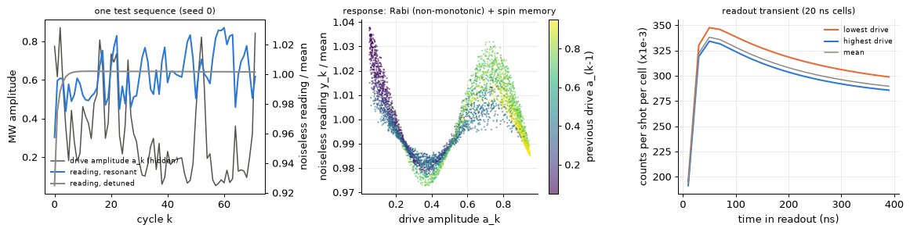
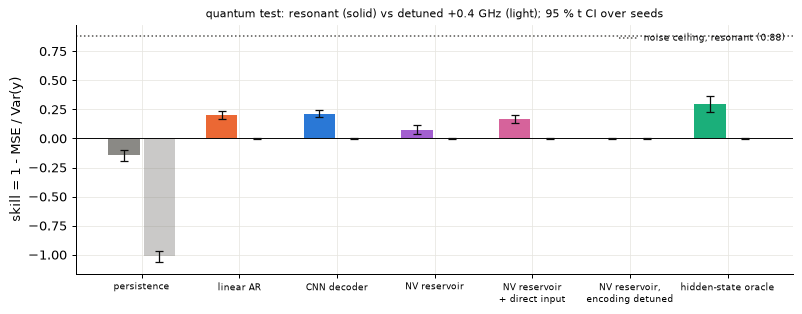
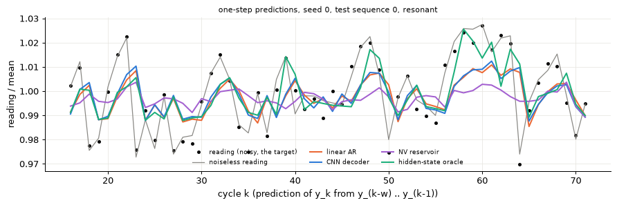
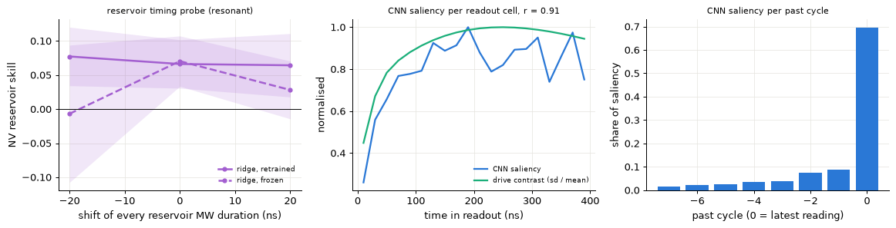

# Milestone 3, Task 3: predict the next fluorescence reading

Task 3 of the brief: predict the next fluorescence reading. The NV ensemble is driven by a hidden, correlated random MW amplitude, one pulse per cycle, each followed by a short readout; the readings form a time series, and every predictor sees only past readings. Trivial baselines, linear AR, a CNN decoder and the NV reservoir (fixed random pulse encoding + ridge) against two upper references, over 5 seeds on the fast surrogate, re-checked on the QuTiP reference; and the quantum test.

## The series

- **Device** per seed as in Task 2 (static field (0.0012, 0.0007, 0.0025) T, nuisance from the milestone-2 ranges; seed 0: T2* 0.59 µs, Rabi full scale 8.29 MHz, beta 0.130). M = 32 quantile nodes.
- **Sequence**: 2000 ns init laser, then 8 burn-in + 64 cycles of [200 ns MW on line 0 at amplitude a_k | 400 ns readout laser | 100 ns dark] (52.4 µs). The reading y_k is the photon count of cycle k's readout summed over 10000 shots (the whole sequence repeated).
- **Drive** (hidden): z_k stationary AR(1), correlation 0.8, a_k = 0.5 + 0.45 tanh(z_k) (pulse areas 0.28-3.16 pi, 5-95 %, median over seeds). The response is non-monotonic in a_k (Rabi), and the 400 ns readout repolarises the spins only partly, so y_k also depends on earlier cycles.
- **Data** per seed: 384 training / 64 validation / 64 test sequences, independent drives; predictions of y_(k+1) from the last 8 readings (cycles after the burn-in). Test noise: one fixed Poisson realisation shared by every predictor.

## Predictors

- **mean** (skill 0 by definition) and **persistence** (y_hat_(k+1) = y_k).
- **linear AR**: ridge (GCV penalty) on the last 8 readings, fitted on 4 noise draws of the training set.
- **CNN decoder** (`ConvDecoder`, T = 20 readout cells of 20 ns, F = 8 past cycles, Gaussian NLL): 3000 steps of 256 windows with fresh Poisson noise, best validation NLL kept.
- **NV reservoir**: the past readings, standardised, are the input u (8 numbers) of a fixed random pulse encoder (16 segments of 100 ns, as in Task 2) that writes them into a separate sequence on the same diamond (1500 ns init, 1000 ns dark, then the block split into 8 groups, each followed by a 300 ns readout: time multiplexing, every readout a virtual node that sees the spins part-way through the encoding, the next group acting on a partly repolarised state; 10000 shots); ridge on all readout counts, trained on 4096 windows. Variants: + direct input (ridge on [reservoir counts, u]), and in the resonant arm the reservoir with only its encoding detuned by the quantum-test offset.
- **Hidden-state oracle**: E[y_(k+1) | true z_k and spin state after cycle k], a 16-node Gauss-Hermite average over the drive innovation, simulated from the exact state (`DrivenSeries.oracle_next_mean`). Bayes-optimal for anyone who knew everything hidden; a predictor that sees only noisy past readings cannot beat it on average. **Noise ceiling**: 1 - E[Poisson variance] / Var(y), what knowing the next noiseless reading would give.
- Skill = 1 - MSE / Var(y) on the noisy test readings.

## Quantum test and results

Every predictor retrained and re-evaluated with every MW frequency (the system's drive and the reservoir's encoding) shifted by +400 MHz (nearest line 254 MHz from any MW frequency), same devices, drives and noise seeds (paired). 95 % Student-t CIs over the 5 seeds; gap > 0 means better on resonance.

| metric | resonant | detuned | gap (better on resonance > 0) | per seed (resonant / detuned) |
| --- | --- | --- | --- | --- |
| persistence_skill | -0.142 [-0.19, -0.0951] | -1.01 [-1.06, -0.964] | 0.872 [0.844, 0.899] | -0.12, -0.147, -0.144, -0.201, -0.0999; -0.981, -1.02, -1.05, -1.05, -0.964 |
| ar_skill | 0.202 [0.171, 0.233] | -0.000434 [-0.00103, 0.000163] | 0.203 [0.172, 0.234] | 0.194, 0.216, 0.207, 0.165, 0.23; -3.47e-05, -6.24e-05, -0.000473, -0.000376, -0.00122 |
| cnn_skill | 0.212 [0.181, 0.243] | -0.000901 [-0.00291, 0.00111] | 0.213 [0.183, 0.242] | 0.198, 0.227, 0.215, 0.178, 0.241; -0.000183, -4.06e-05, -0.000478, -0.00378, -2.23e-05 |
| reservoir_skill | 0.0759 [0.038, 0.114] | -0.000244 [-0.00103, 0.000538] | 0.0762 [0.038, 0.114] | 0.0415, 0.115, 0.049, 0.0813, 0.0931; -7.55e-05, -3.82e-05, 8.25e-05, 0.000168, -0.00136 |
| reservoir_direct_skill | 0.171 [0.136, 0.205] | -0.000171 [-0.00109, 0.000752] | 0.171 [0.136, 0.206] | 0.158, 0.187, 0.174, 0.132, 0.204; -5.29e-05, -4.36e-05, 6.85e-05, 0.000588, -0.00141 |
| reservoir_offres_skill | -0.00048 [-0.00139, 0.000433] | -0.000244 [-0.00103, 0.000538] | -0.000236 [-0.0016, 0.00113] | -0.00172, 2.28e-05, -9.78e-05, -0.000595, -1.32e-05; -7.55e-05, -3.82e-05, 8.25e-05, 0.000168, -0.00136 |
| oracle_skill | 0.296 [0.23, 0.361] | 0.000983 [-0.000872, 0.00284] | 0.295 [0.231, 0.359] | 0.25, 0.34, 0.311, 0.231, 0.347; 9.61e-05, 0.00352, 0.00105, -0.00023, 0.000483 |
| ceiling_skill | 0.88 [0.843, 0.917] | -0.0061 [-0.0484, 0.0362] | 0.886 [0.829, 0.944] | 0.919, 0.845, 0.899, 0.876, 0.861; 0.0199, 0.0256, -0.0439, 0.00994, -0.0419 |

CNN uncertainty calibration on resonance: RMS of standardised errors 1.01 [0.998, 1.02] (1 = calibrated).

Outcome (skill): linear AR gap 0.203 [0.172, 0.234] (significant; detuned -0.000434 [-0.00103, 0.000163]); CNN decoder gap 0.213 [0.183, 0.242] (significant; detuned -0.000901 [-0.00291, 0.00111]); NV reservoir gap 0.0762 [0.038, 0.114] (significant; detuned -0.000244 [-0.00103, 0.000538]); NV reservoir + direct input gap 0.171 [0.136, 0.206] (significant; detuned -0.000171 [-0.00109, 0.000752]). Detuned, the drive moves no spin and the readings are (almost) a constant plus shot noise: the best detuned skill is 0.000983 (hidden-state oracle); persistence scores -1.01 (on white noise it doubles the error variance: -1). What is left on the detuned side is MW-independent (the laser-only repolarisation transient along the sequence) or off-resonant transfer, ~(f_R / 260 MHz)^2.

Paired differences on resonance (95 % t CI over seeds): cnn - ar: 0.00945 [0.00482, 0.0141] (better); reservoir - ar: -0.126 [-0.167, -0.0856] (worse); reservoir_direct - ar: -0.0314 [-0.0363, -0.0266] (worse); reservoir - reservoir_offres: 0.0764 [0.0391, 0.114] (better); oracle - cnn: 0.0841 [0.048, 0.12] (better).

### Does the strategy use microsecond-scale timing?

No predictor chooses any timing (the system's protocol is fixed, the reservoir's encoding is a fixed random map): `strategy_learns_timing` = **False**. Logged dependence on spin timing:

- NV reservoir skill at shift 0 minus with every reservoir MW duration shifted, ridge retrained: -20 ns: -0.0111 [-0.0371, 0.015]; +20 ns: 0.00188 [-0.0165, 0.0203].
- NV reservoir skill at shift 0 minus with every reservoir MW duration shifted, ridge frozen: -20 ns: 0.0773 [0.00508, 0.149]; +20 ns: 0.0423 [0.0208, 0.0637].
  (On the first 2048 training and test windows; the frozen ridge is the one trained on all training windows at shift 0.)
  Verdicts: `reservoir_readout_relies_on_pulse_timing` = **True** (frozen readout), `reservoir_information_needs_exact_timing` = **False** (retrained).
- Reservoir encoder pulse areas: median 0.37 pi, 64 % of segments between pi/4 and 4 pi (Rabi-scale).
- CNN (seed 0): saliency per readout cell vs the drive-induced contrast per cell r = 0.91; 70 % of the saliency on the latest reading, the rest on older cycles (uniform: 12 %).
- The system's own dynamics carry microsecond structure (the Rabi response to the 200 ns pulse, the partial repolarisation within the 400 ns readout); the predictors exploit it only through the readings.

## Reference check (QuTiP)

Seed 0, resonant: 2 full system test sequence(s) and 8 reservoir sequences re-simulated on the QuTiP reference (same quadrature nodes; 25 s on the CPU pool):

| quantity | value |
| --- | --- |
| system: max readout-cell diff / peak | 2.94e-04 |
| system: max reading diff / max drive-induced deviation | 4.99e-03 |
| AR prediction diff (noiseless inputs) / sd(y) | 8.79e-03 |
| CNN prediction diff (noiseless inputs) / sd(y) | 2.31e-02 |
| reservoir: max feature diff / peak | 9.88e-06 |
| reservoir: max feature diff / max input-induced deviation | 2.50e-04 |
| reservoir prediction diff / sd(y) | 6.98e-05 |

## Notes and open issues

- The hidden-state oracle bounds what is predictable: most of the variance of y_(k+1) comes from the next drive innovation (1 - rho^2 of the drive variance), which no past reading carries.
- The drive process, its range and the cycle timing are assumptions of the task, chosen so the response is non-monotonic (room for nonlinear predictors) and has spin memory; other choices change every number.
- The reservoir sees the readings through a fixed random encoding and a single readout per input (nearly one number, see Task 2); a trained encoder (next phase-2 item) is the natural follow-up.
- No claim of quantum advantage: the gap shows only that the predictable structure comes from the driven spins.









## Provenance

- run id: `20261126-031408-m3-forecast-e1ee`
- git: `a4949ffa97b437c6dd52b8aa469c2fc9fe5b183e`
- seed: 20261128
- device: cuda NVIDIA GeForce RTX 5070 Ti
- python 3.12.14, glowbox 0.1.0, torch 2.11.0+cu128, qutip 5.3.1, numpy 2.5.5, scipy 1.18.1, pyarrow 26.0.1
- started 2026-11-26T03:14:08+00:00, finished 2026-11-26T03:40:39+00:00

## Config

```yaml
cnn:
  batch: 256
  eval_every: 250
  lr: 0.001
  steps: 3000
  weight_decay: 0.0001
data:
  ar_draws: 4
  n_test_seq: 64
  n_train_seq: 384
  n_val_seq: 64
  shots: 10000
  window: 8
decoder:
  channels:
  - 32
  - 64
  - 128
  hidden: 256
  kernel: 3
  mix_channels: 8
detuned_offset_hz: 400000000.0
device:
  bias_field_t:
  - 0.0012
  - 0.0007
  - 0.0025
  n_detuning: 32
  prior:
    background_cps:
    - 5000.0
    - 20000.0
    collection_efficiency:
    - 0.002
    - 0.004
    e_hz:
    - 0.0
    - 300000.0
    optical_beta_full_scale:
    - 0.07
    - 0.13
    rabi_full_scale_hz:
    - 8000000.0
    - 12000000.0
    t2_star_s:
    - 5.0e-07
    - 2.0e-06
name: m3-forecast
oracle:
  n_quad: 16
reference:
  n_reservoir: 8
  n_series: 2
  workers: 16
reservoir:
  delay_ns: 0
  encoder:
    amp_hi: 1.0
    amp_lo: 0.05
    freq_span_hz: 4000000.0
    gain: 1.5
    max_ns: 100
    min_ns: 10
    n_segments: 16
    slot_ns: 100
  init_ns: 1500
  n_groups: 8
  n_train: 4096
  readout_ns: 300
  settle_ns: 1000
  shots: 10000
seed: 20261128
seeds:
- 0
- 1
- 2
- 3
- 4
series:
  amp_center: 0.5
  amp_scale: 0.45
  burn_in: 8
  gap_ns: 100
  init_ns: 2000
  line_index: 0
  mw_ns: 200
  n_cycles: 64
  readout_ns: 400
  rebin: 2
  rho: 0.8
timing:
  duration_shifts_ns:
  - -20
  - 0
  - 20
  n_windows: 2048
```

## Final metrics

| metric | value |
| --- | --- |
| persistence_skill_resonant | -0.142375 |
| persistence_skill_detuned | -1.01414 |
| persistence_skill_gap | 0.871766 |
| persistence_skill_gap_lo | 0.844202 |
| persistence_skill_gap_hi | 0.89933 |
| ar_skill_resonant | 0.202277 |
| ar_skill_detuned | -0.000433558 |
| ar_skill_gap | 0.202711 |
| ar_skill_gap_lo | 0.171541 |
| ar_skill_gap_hi | 0.233881 |
| cnn_skill_resonant | 0.211728 |
| cnn_skill_detuned | -0.00090066 |
| cnn_skill_gap | 0.212629 |
| cnn_skill_gap_lo | 0.183226 |
| cnn_skill_gap_hi | 0.242032 |
| reservoir_skill_resonant | 0.0759402 |
| reservoir_skill_detuned | -0.000244296 |
| reservoir_skill_gap | 0.0761845 |
| reservoir_skill_gap_lo | 0.037984 |
| reservoir_skill_gap_hi | 0.114385 |
| reservoir_direct_skill_resonant | 0.170858 |
| reservoir_direct_skill_detuned | -0.000170987 |
| reservoir_direct_skill_gap | 0.171029 |
| reservoir_direct_skill_gap_lo | 0.135889 |
| reservoir_direct_skill_gap_hi | 0.20617 |
| reservoir_offres_skill_resonant | -0.00048049 |
| reservoir_offres_skill_detuned | -0.000244296 |
| reservoir_offres_skill_gap | -0.000236194 |
| reservoir_offres_skill_gap_lo | -0.00160345 |
| reservoir_offres_skill_gap_hi | 0.00113106 |
| oracle_skill_resonant | 0.2958 |
| oracle_skill_detuned | 0.000982694 |
| oracle_skill_gap | 0.294817 |
| oracle_skill_gap_lo | 0.230694 |
| oracle_skill_gap_hi | 0.358941 |
| ceiling_skill_resonant | 0.880134 |
| ceiling_skill_detuned | -0.00609664 |
| ceiling_skill_gap | 0.88623 |
| ceiling_skill_gap_lo | 0.828843 |
| ceiling_skill_gap_hi | 0.943618 |
| ref_series_max_rel_cell_diff | 0.000294461 |
| ref_reservoir_max_rel_feature_diff | 9.87842e-06 |
| strategy_learns_timing | 0 |
| reservoir_readout_relies_on_pulse_timing | 1 |
| reservoir_information_needs_exact_timing | 0 |
| no_line_margin_mhz | 253.588 |
| series_seconds | 92.393 |
| reservoir_seconds | 678.521 |
| cnn_seconds | 734.64 |
| oracle_seconds | 35.909 |
| wall_seconds | 1591.3 |
