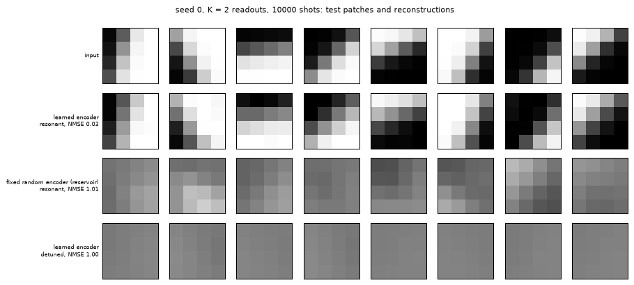
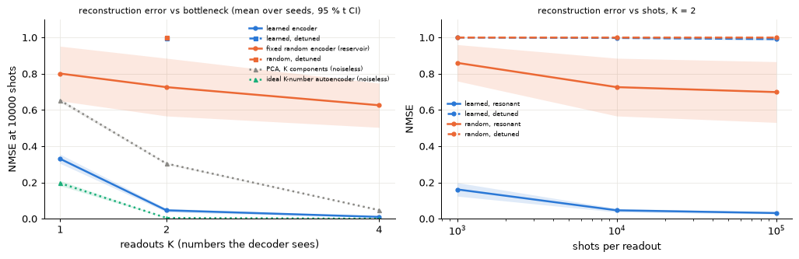
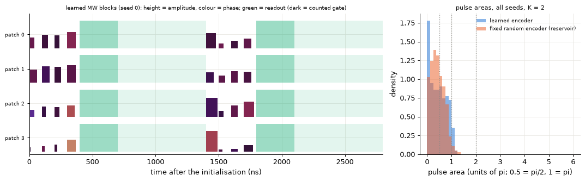
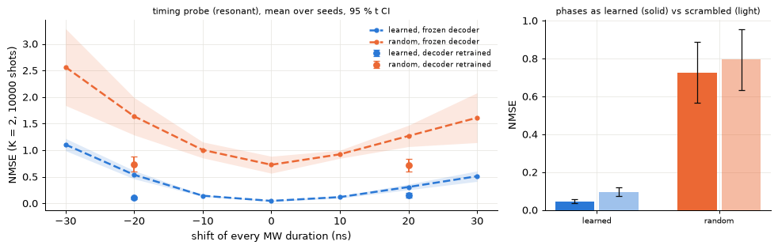

# Milestone 4, Task 4: compress-and-reconstruct through the NV ensemble (learned encoder)

**Task 4, compress-and-reconstruct**: a learned pulse encoder writes 4x4 image patches (soft edges, two latent parameters) into MW blocks; the NV ensemble's gated readouts are the bottleneck (K photon counts, averaged over the shots); a decoder reconstructs the patch. Encoder and decoder are trained end to end through the differentiable surrogate. Simulation only; no claim of quantum advantage: a gap between the resonant and detuned arms only says that the performance depends on driving the spin resonance.

## Result

- Headline (K = 2 readouts, 10000 shots, mean over 5 seeds, 95 % Student-t CI): the learned encoder reconstructs with NMSE 0.0466 [0.0364, 0.0567]; the fixed random encoder (milestone-3 reservoir parametrisation, same decoder recipe) 0.726 [0.567, 0.886]. Paired difference random - learned 0.68 [0.514, 0.845].
- References at K = 2 (noiseless numbers): PCA 0.305 [0.3, 0.309], ideal K-number autoencoder 0.00443 [0.00374, 0.00512].
- **Quantum test**: with every MW frequency shifted by 400 MHz (no line within 254 MHz of any MW frequency), learned NMSE 0.998 [0.996, 0.999], random 1 [0.999, 1]. Gaps (detuned - resonant): learned 0.951 [0.94, 0.962] (significant), random 0.274 [0.114, 0.433] (significant).
- Timing: learned strategy uses microsecond-scale (Rabi-scale) timing: **yes** (details below).

## Interpretation

- **The diamond is a usable nonlinear bottleneck once the encoding is learned.** With two gated readouts at 10^4
  shots the learned system reconstructs to NMSE 0.047, 6.5x better than linear PCA with two *noiseless* numbers
  (0.305), and it closes most of the gap to a noiseless nonlinear two-number autoencoder (0.0044). The decoder sees
  only two photon counts, so the encoder must place the patch manifold onto two spin-population readouts in a way
  that survives Poisson noise. One readout (K = 1) already beats two PCA components and approaches the ideal
  one-number code (0.33 vs 0.20). The same parametrisation fixed at random (the milestone-3 reservoir) reaches only
  0.73 [0.57, 0.89]: its pulses move the readouts by ~1 % where the learned ones use the ~7 % spin contrast.
- **The learned strategy is Rabi-scale timing, not brightness.** Detuned, every arm falls to the mean patch (NMSE
  0.998): there is no MW-independent channel. On resonance the code lives in the exact pulse areas and phases:
  shifting every duration by 20 ns (a fraction of the ~120-250 ns Rabi period) raises the NMSE 9-fold with the
  decoder frozen and still 2.8-fold with a decoder retrained on the shifted pulses, and scrambling the segment phases
  doubles it. Phases matter because several segments drive the same transitions within T2*: the populations read
  out depend on the coherent sum of rotations, not on each pulse alone. The learned pulse areas spread from 0 to
  about pi with a peak near 0 (histogram): the input switches segments between weak and up-to-pi rotations and sets
  their phases. The random encoder is only mildly timing-sensitive (+104 % frozen, nothing once
  retrained).
- **Caveat: quadrature.** Trained and evaluated with 8 T2* quadrature nodes. The frozen seed-0 system at 32 nodes
  changes its counts by up to 1.3 % (15 % of the input-dependent signal) and its NMSE from 0.035 to 0.042 with the
  8-node decoder: the code is robust to the finer broadening model, but part of its precision relies on details of
  the node set. A run at more nodes (or a decoder retrained at 32 nodes) is the next check before hardware.
- The QuTiP reference reproduces the learned sequences' gated counts to 1e-5 (1.2e-4 of the signal): the
  sim-to-reference gap is negligible against shot noise.

## Task, bottleneck and training

- Data: 4x4 patches tanh(3.0 (x cos theta + y sin theta - o)), theta uniform, |o| <= 0.6; 8192 train / 512 val / 2048 test patches per seed. NMSE = MSE / mean per-pixel variance (1 = mean patch).
- Sequence: init laser 1500 ns, dark 1000 ns, then K x [4 MW segments in 100 ns slots, a 1000 ns readout laser of which the first 300 ns are counted (one number per readout)]. Each segment: amplitude in [0, 1], phase, frequency within +-4 MHz of a device line (segment j of block k on line (4k + j) mod 8 of the known bias field [0.0012, 0.0007, 0.0025] T), duration 0-100 ns on the 10 ns grid (straight-through rounding; the surrogate's run-length path gives exact duration gradients).
- Device per seed: nuisance draw (T2*, Rabi full scale, beta, collection, background, strain) from the milestone-3 prior; T2* quadrature 8 quantile nodes.
- Phase 1: Adam, 1000 steps, batch 128, Gaussian shot noise (Poisson variance), shots log-uniform [1000.0, 100000.0]. Phase 2: fresh decoder, 3000 steps on a bank with Poisson noise. Wall time: phase 1 82 min, phase 2 15.3 min, timing probes 5.7 min.

## Error vs bottleneck and noise

NMSE at 10000 shots, resonant, mean [95 % t CI] over seeds:

| K | learned | random | PCA (noiseless) | ideal K-number AE (noiseless) |
| --- | --- | --- | --- | --- |
| 1 | 0.331 [0.306, 0.356] | 0.801 [0.65, 0.952] | 0.653 [0.644, 0.663] | 0.197 [0.182, 0.211] |
| 2 | 0.0466 [0.0364, 0.0567] | 0.726 [0.567, 0.886] | 0.305 [0.3, 0.309] | 0.00443 [0.00374, 0.00512] |
| 4 | 0.0103 [0.00716, 0.0134] | 0.626 [0.504, 0.749] | 0.0476 [0.0471, 0.0481] | 0.000288 [0.000251, 0.000324] |

NMSE vs shots at K = 2:

| shots | learned, resonant | learned, detuned | random, resonant | random, detuned |
| --- | --- | --- | --- | --- |
| 1000 | 0.162 [0.125, 0.199] | 1 [0.998, 1] | 0.86 [0.76, 0.961] | 1 [1, 1] |
| 10000 | 0.0466 [0.0364, 0.0567] | 0.998 [0.996, 0.999] | 0.726 [0.567, 0.886] | 1 [0.999, 1] |
| 100000 | 0.0316 [0.0259, 0.0372] | 0.992 [0.985, 0.998] | 0.699 [0.531, 0.867] | 1 [0.999, 1] |

## Quantum test

| metric | resonant | detuned | gap (better on resonance > 0) | per seed (resonant / detuned) |
| --- | --- | --- | --- | --- |
| learned_nmse | 0.04655 [0.03642, 0.05668] | 0.9977 [0.9962, 0.9992] | 0.9511 [0.9398, 0.9624] | 0.03447, 0.05309, 0.04632, 0.04395, 0.05495; 0.9994, 0.9968, 0.9985, 0.9967, 0.997 |
| learned_skill | 0.9534 [0.9433, 0.9636] | 0.002314 [0.0008272, 0.0038] | 0.9511 [0.9398, 0.9624] | 0.9655, 0.9469, 0.9537, 0.9561, 0.945; 0.0006301, 0.003178, 0.001468, 0.003304, 0.002987 |
| random_nmse | 0.7264 [0.567, 0.8858] | 1 [0.9992, 1.001] | 0.2736 [0.1144, 0.4328] | 0.9013, 0.8158, 0.6745, 0.6525, 0.5879; 1, 1, 1, 0.9989, 1 |
| random_skill | 0.2736 [0.1142, 0.433] | 9.882e-06 [-0.0007681, 0.0007878] | 0.2736 [0.1144, 0.4328] | 0.09873, 0.1842, 0.3255, 0.3475, 0.4121; -0.0003242, -1.407e-05, -0.0003191, 0.0011, -0.0003928 |

## Learned strategies and timing

Pulse areas are the resonant rotation angle 2 f_R a d (f_R the seed's full-scale Rabi frequency on a [100] MW field; units of pi). Probes (resonant, K = headline, every seed): every MW duration shifted with the decoder frozen (the harness's `timing_sensitivity`) and with a decoder retrained on the shifted encoding; every segment's phase replaced by an independent random phase (frozen decoder). Relative NMSE increase, mean [95 % t CI] over seeds:

| encoder | median area (pi) | fraction of segments at 0.25-4 pi | fraction off | median duration (ns) | +-20 ns, frozen | +-20 ns, retrained | phases scrambled |
| --- | --- | --- | --- | --- | --- | --- | --- |
| learned | 0.435 [0.427, 0.443] | 0.66 [0.62, 0.70] | 0.01 [-0.00, 0.02] | 58 [52, 64] | +8.40 [+5.46, +11.33] | +1.77 [+1.46, +2.07] | +1.05 [+0.92, +1.17] |
| random | 0.421 [0.226, 0.615] | 0.72 [0.54, 0.89] | 0.00 [-0.00, 0.00] | 54 [43, 65] | +1.04 [+0.63, +1.45] | +0.00 [-0.06, +0.07] | +0.10 [+0.02, +0.18] |

- Learned encoder relies on its pulse timing (frozen NMSE up > 10 % at +-20 ns, CI): yes; the information needs the exact timing (retrained decoder still worse > 10 %): yes; it uses coherent phase relations between segments (scrambling costs > 10 %): yes; its pulse areas are Rabi-scale (median 0.25-4 pi): yes. `strategy_learns_timing` = relies on pulse timing and Rabi-scale areas = **yes**.
- The same probes on the random encoder show what an unlearned encoding of the same family does.

## Checks

- QuTiP reference (seed 0, resonant, K = 2, 16 learned test sequences run as full PulseSequences, 8 quadrature nodes): gated counts within 9.7e-06 (relative) of the surrogate, 0.00012 of the input-dependent signal; frozen decoder NMSE at 10000 shots 0.0315 on reference counts vs 0.0315 on surrogate counts (64 noise draws per patch, same draws); noiseless reconstructions differ by 3.8e-05 of the pixel sd (12 s).
- Quadrature: the frozen seed-0 system at 32 nodes: counts within 0.013 (relative), 0.15 of the signal; NMSE 0.0345 -> 0.0415 with the decoder trained at 8 nodes.

## Assumptions and limits

- One known device per seed (calibrated lines); the encoder's frequencies are tied to those lines. The readout is a gated photon count; only the counted gates reach the decoder (the rest of each laser pulse re-polarises).
- Training uses Gaussian shot noise with the Poisson variance (at >= 10^3 shots the gated counts are > 10^3 photons); evaluation draws Poisson counts.
- Durations are rounded to the 10 ns grid in the forward pass (straight-through gradient), so every learned sequence is a valid PulseSequence; the QuTiP check runs them as such.
- The detuned arm is trained exactly like the resonant one (its encoder still learns, but its MW drives nothing).










## Provenance

- run id: `20261126-080522-m4-autoencoder-129b`
- git: `899e5bf619ac383e4dd2d5b39c19ae127033628e`
- seed: 20261128
- device: cuda NVIDIA GeForce RTX 5070 Ti
- python 3.12.14, glowbox 0.1.0, torch 2.11.0+cu128, qutip 5.3.1, numpy 2.5.5, scipy 1.18.1, pyarrow 26.0.1
- started 2026-11-26T08:05:22+00:00, finished 2026-11-26T09:48:30+00:00

## Config

```yaml
bank_decoder:
  batch: 256
  lr: 0.001
  steps: 3000
data:
  n_test: 2048
  n_train: 8192
  n_val: 512
  offset_max: 0.6
  sharpness: 3.0
  size: 4
decoder:
  hidden:
  - 128
  - 128
detuned_offset_hz: 400000000.0
device:
  bias_field_t:
  - 0.0012
  - 0.0007
  - 0.0025
  n_detuning: 8
  prior:
    background_cps:
    - 5000.0
    - 20000.0
    collection_efficiency:
    - 0.002
    - 0.004
    e_hz:
    - 0.0
    - 300000.0
    optical_beta_full_scale:
    - 0.07
    - 0.13
    rabi_full_scale_hz:
    - 8000000.0
    - 12000000.0
    t2_star_s:
    - 5.0e-07
    - 2.0e-06
encoder:
  hidden:
  - 64
  - 64
  init_amplitude: 0.5
  init_duration_ns: 50.0
  out_scale: 1.0
  random_gain: 1.5
grid:
  blocks:
  - 1
  - 2
  - 4
  shots:
  - 1000
  - 10000
  - 100000
headline:
  blocks: 2
  shots: 10000
ideal:
  batch: 256
  lr: 0.001
  steps: 4000
layout:
  amp_hi: 1.0
  amp_lo: 0.0
  gap_ns: 0
  gate_ns: 300
  max_ns: 100.0
  min_ns: 0.0
  n_segments: 4
  readout_ns: 1000
  slot_ns: 100
  span_hz: 4000000.0
name: m4-autoencoder
quadrature_check:
  n_detuning: 32
reference:
  n_patterns: 16
  workers: 16
seed: 20261128
seeds:
- 0
- 1
- 2
- 3
- 4
system:
  init_ns: 1500
  settle_ns: 1000
timing:
  duration_shifts_ns:
  - -30
  - -20
  - -10
  - 0
  - 10
  - 20
  - 30
  retrain_shifts_ns:
  - -20
  - 20
train:
  batch: 128
  lr_decoder: 0.001
  lr_encoder: 0.003
  shots:
  - 1000.0
  - 100000.0
  steps: 1000
  val_every: 100
```

## Final metrics

| metric | value |
| --- | --- |
| learned_nmse_resonant | 0.0465542 |
| learned_nmse_detuned | 0.997686 |
| learned_nmse_gap | 0.951132 |
| learned_nmse_gap_lo | 0.939846 |
| learned_nmse_gap_hi | 0.962418 |
| learned_skill_resonant | 0.953446 |
| learned_skill_detuned | 0.00231352 |
| learned_skill_gap | 0.951132 |
| learned_skill_gap_lo | 0.939846 |
| learned_skill_gap_hi | 0.962418 |
| random_nmse_resonant | 0.726391 |
| random_nmse_detuned | 0.99999 |
| random_nmse_gap | 0.273599 |
| random_nmse_gap_lo | 0.114361 |
| random_nmse_gap_hi | 0.432838 |
| random_skill_resonant | 0.273609 |
| random_skill_detuned | 9.88245e-06 |
| random_skill_gap | 0.273599 |
| random_skill_gap_lo | 0.114361 |
| random_skill_gap_hi | 0.432838 |
| ref_max_rel_diff | 9.73696e-06 |
| quad_max_rel_diff | 0.0130999 |
| strategy_learns_timing | 1 |
| learned_relies_on_pulse_timing | 1 |
| learned_uses_phase_coherence | 1 |
| no_line_margin_mhz | 253.588 |
| phase1_seconds | 4893.34 |
| wall_seconds | 6188.07 |
