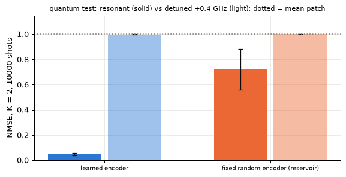

# Milestone 4, Task 4: compress-and-reconstruct through the NV ensemble (learned encoder)

**Task 4, compress-and-reconstruct**: a learned pulse encoder writes 4x4 image patches (soft edges, two latent parameters) into MW blocks; the NV ensemble's gated readouts are the bottleneck (K photon counts, averaged over the shots); a decoder reconstructs the patch. Encoder and decoder are trained end to end through the differentiable surrogate. Simulation only; no claim of quantum advantage: a gap between the resonant and detuned arms only says that the performance depends on driving the spin resonance.

## Result

- Headline (K = 2 readouts, 10000 shots, mean over 5 seeds, 95 % Student-t CI): the learned encoder reconstructs with NMSE 0.0474 [0.0372, 0.0576]; the fixed random encoder (milestone-3 reservoir parametrisation, same decoder recipe) 0.722 [0.561, 0.884]. Paired difference random - learned 0.675 [0.508, 0.842].
- References at K = 2 (noiseless numbers): PCA 0.305 [0.3, 0.309], ideal K-number autoencoder 0.00443 [0.00374, 0.00512].
- **Quantum test**: with every MW frequency shifted by 400 MHz (no line within 254 MHz of any MW frequency), learned NMSE 0.998 [0.996, 0.999], random 1 [0.999, 1]. Gaps (detuned - resonant): learned 0.95 [0.939, 0.962] (significant), random 0.278 [0.116, 0.439] (significant).
- Detuned residual: the frozen detuned learned encoders with every MW frequency 2x as far off (800 MHz), fresh decoder: NMSE 1000 shots 1 [0.998, 1] -> 1 [0.999, 1]; 10000 shots 0.998 [0.996, 0.999] -> 1 [0.999, 1]; 100000 shots 0.992 [0.986, 0.998] -> 1 [0.999, 1].
- Training numerics note: the same frozen encoders banked and decoded at the phase-1 node count (8) give learned 0.0458 [0.0358, 0.0559], random 0.726 [0.566, 0.886] (resonant; detuned 0.998 [0.996, 1] / 1 [0.999, 1]).
- Timing: learned strategy uses microsecond-scale (Rabi-scale) timing: **yes** (details below).

## Interpretation

- **The learned encoder plus the NV readouts form a usable two-number channel.** With two gated readouts at 10^4
  shots the learned system reconstructs to NMSE 0.047, 6.4x better than linear PCA with two *noiseless* numbers
  (0.305), and well short of a noiseless nonlinear two-number autoencoder (0.0044). The nonlinearity that beats PCA
  is in the encoder MLP (and the decoder MLP); the diamond acts as a noisy channel that carries K numbers, the
  ms = 0 populations read by the gates. One readout (K = 1, 0.332) beats one PCA component (0.653) but not two
  (0.305), and sits above the ideal one-number code (0.197). The same parametrisation fixed at random (the
  milestone-3 reservoir) reaches only 0.72 [0.56, 0.88]: its pulses move the readouts by ~1 % where the learned
  ones use the ~7 % spin contrast.
- **Converged numerics.** Every number above is at 32 T2* quadrature nodes (banks, decoders, evaluation, probes,
  QuTiP check); training used 8. At 64 nodes the seed-0 counts move by 0.5 % (6 % of the input-dependent signal)
  and the NMSE by < 0.001 (0.0362 -> 0.0361), so 32 nodes is converged for this task. Banked and decoded at 8
  nodes instead, the NMSE is 0.046 [0.036, 0.056], within the seed spread of the 32-node 0.047: the earlier
  "0.035 -> 0.042" came from feeding 32-node counts to a decoder trained on 8-node counts (a decoder mismatch),
  not from an unconverged result.
- **The learned strategy relies on Rabi rotation angles and coherent phases.** On resonance the code lives in the
  exact pulse areas and phases: shifting every duration by 20 ns (a fraction of the ~120-250 ns Rabi period) raises
  the NMSE 9-fold with the decoder frozen and still 2.7-fold with a decoder retrained on the shifted pulses, and
  scrambling the segment phases doubles it. Changing every pulse's area by the same amount through its amplitude
  instead (durations kept) costs as much as the duration shift (+10.0 vs +8.1, frozen): what matters is the
  rotation angle, i.e. pulse area on the Rabi scale, not timing as such. Phases matter because several segments
  drive the same transitions within T2*: the populations read out depend on the coherent sum of rotations. The
  random encoder is only mildly sensitive (+105 % frozen, nothing once retrained).
- **Quantum test.** Detuned by 400 MHz every arm falls to the mean patch (learned 0.998, random 1.000). The learned
  detuned arm keeps a small but significant residual (skill 0.0022 [0.0008, 0.0037] at 10^4 shots, NMSE 0.992 at
  10^5): off-resonant spin excitation, of order (Omega / Delta)^2 ~ 1e-3 at the 254 MHz margin. It is still spin
  physics, not a MW-independent channel: with the frozen detuned encoders at twice the offset (800 MHz) the
  residual vanishes (NMSE 1.000 [0.999, 1] at 10^5 shots).
- The QuTiP reference reproduces the learned sequences' gated counts to 1e-5 (1.2e-4 of the signal) at the
  evaluation's 32 nodes; the noisy NMSE is identical on reference and surrogate counts.

## Task, bottleneck and training

- Data: 4x4 patches tanh(3.0 (x cos theta + y sin theta - o)), theta uniform, |o| <= 0.6; 8192 train / 512 val / 2048 test patches per seed. NMSE = MSE / mean per-pixel variance (1 = mean patch).
- Sequence: init laser 1500 ns, dark 1000 ns, then K x [4 MW segments in 100 ns slots, a 1000 ns readout laser of which the first 300 ns are counted (one number per readout)]. Each segment: amplitude in [0, 1], phase, frequency within +-4 MHz of a device line (segment j of block k on line (4k + j) mod 8 of the known bias field [0.0012, 0.0007, 0.0025] T), duration 0-100 ns on the 10 ns grid (straight-through rounding; the surrogate's run-length path gives exact duration gradients).
- Device per seed: nuisance draw (T2*, Rabi full scale, beta, collection, background, strain) from the milestone-3 prior. T2* quadrature (quantile rule): 8 nodes for phase-1 training, 32 nodes for every bank, decoder, evaluation, timing probe and the QuTiP check (every number in this report unless marked otherwise).
- Phase 1: Adam, 1000 steps, batch 128, Gaussian shot noise (Poisson variance), shots log-uniform [1000.0, 100000.0]. Phase 2: fresh decoder, 3000 steps on a bank with Poisson noise. Wall time: phase 1 82 min, phase 2 28.0 min, timing probes 9.3 min.

## Error vs bottleneck and noise

NMSE at 10000 shots, resonant, mean [95 % t CI] over seeds:

| K | learned | random | PCA (noiseless) | ideal K-number AE (noiseless) |
| --- | --- | --- | --- | --- |
| 1 | 0.332 [0.307, 0.357] | 0.804 [0.653, 0.954] | 0.653 [0.644, 0.663] | 0.197 [0.182, 0.211] |
| 2 | 0.0474 [0.0372, 0.0576] | 0.722 [0.561, 0.884] | 0.305 [0.3, 0.309] | 0.00443 [0.00374, 0.00512] |
| 4 | 0.0103 [0.00718, 0.0135] | 0.619 [0.5, 0.737] | 0.0476 [0.0471, 0.0481] | 0.000288 [0.000251, 0.000324] |

NMSE vs shots at K = 2:

| shots | learned, resonant | learned, detuned | random, resonant | random, detuned |
| --- | --- | --- | --- | --- |
| 1000 | 0.166 [0.127, 0.204] | 1 [0.998, 1] | 0.861 [0.76, 0.963] | 1 [1, 1] |
| 10000 | 0.0474 [0.0372, 0.0576] | 0.998 [0.996, 0.999] | 0.722 [0.561, 0.884] | 1 [0.999, 1] |
| 100000 | 0.032 [0.0265, 0.0374] | 0.992 [0.986, 0.998] | 0.693 [0.523, 0.863] | 1 [0.999, 1] |

## Quantum test

| metric | resonant | detuned | gap (better on resonance > 0) | per seed (resonant / detuned) |
| --- | --- | --- | --- | --- |
| learned_nmse | 0.04744 [0.03724, 0.05764] | 0.9978 [0.9963, 0.9992] | 0.9503 [0.9391, 0.9616] | 0.03617, 0.05469, 0.04621, 0.04393, 0.05619; 0.9994, 0.997, 0.9986, 0.9967, 0.9971 |
| learned_skill | 0.9526 [0.9424, 0.9628] | 0.00223 [0.0008043, 0.003656] | 0.9503 [0.9391, 0.9616] | 0.9638, 0.9453, 0.9538, 0.9561, 0.9438; 0.0006223, 0.002963, 0.001419, 0.003265, 0.00288 |
| learned_nmse_train_quad | 0.04584 [0.0358, 0.05588] | 0.9979 [0.996, 0.9998] | 0.952 [0.9403, 0.9638] | 0.03298, 0.05069, 0.04564, 0.04555, 0.05434; 0.9998, 0.996, 0.9987, 0.9982, 0.9967 |
| random_nmse | 0.7222 [0.5607, 0.8837] | 1 [0.9992, 1.001] | 0.2778 [0.1164, 0.4391] | 0.9007, 0.8137, 0.6629, 0.6467, 0.5872; 1, 1, 1, 0.9989, 1 |
| random_skill | 0.2778 [0.1163, 0.4393] | 9.954e-06 [-0.0007683, 0.0007882] | 0.2778 [0.1164, 0.4391] | 0.09933, 0.1863, 0.3371, 0.3533, 0.4128; -0.0003242, -1.192e-05, -0.0003206, 0.0011, -0.0003932 |
| random_nmse_train_quad | 0.7261 [0.5662, 0.886] | 0.9998 [0.9987, 1.001] | 0.2737 [0.114, 0.4334] | 0.9042, 0.8113, 0.6759, 0.6525, 0.5867; 1, 1, 1, 0.9982, 1 |

## Learned strategies and timing

Pulse areas are the resonant rotation angle 2 f_R a d (f_R the seed's full-scale Rabi frequency on a [100] MW field; units of pi). Probes (resonant, K = headline, every seed): every MW duration shifted with the decoder frozen (the harness's `timing_sensitivity`) and with a decoder retrained on the shifted encoding; every segment's amplitude scaled so that its area changes as under the shift, durations kept (equal-area control, frozen decoder); every segment's phase replaced by an independent random phase (frozen decoder). Relative NMSE increase, mean [95 % t CI] over seeds:

| encoder | median area (pi) | fraction of segments at 0.25-4 pi | fraction off | median duration (ns) | +-20 ns, frozen | +-20 ns, retrained | equal area by amplitude, frozen | phases scrambled |
| --- | --- | --- | --- | --- | --- | --- | --- | --- |
| learned | 0.435 [0.427, 0.443] | 0.66 [0.62, 0.70] | 0.01 [-0.00, 0.02] | 58 [52, 64] | +8.11 [+5.48, +10.73] | +1.70 [+1.41, +1.99] | +10.02 [+7.17, +12.87] | +0.99 [+0.87, +1.12] |
| random | 0.421 [0.226, 0.615] | 0.72 [0.54, 0.89] | 0.00 [-0.00, 0.00] | 54 [43, 65] | +1.05 [+0.58, +1.53] | +0.01 [-0.06, +0.07] | +1.59 [+0.78, +2.40] | +0.09 [+0.02, +0.17] |

- Learned encoder relies on its pulse timing (frozen NMSE up > 10 % at +-20 ns, CI): yes; the information needs the exact timing (retrained decoder still worse > 10 %): yes; it uses coherent phase relations between segments (scrambling costs > 10 %): yes; its pulse areas are Rabi-scale (median 0.25-4 pi): yes. The same area change made with the amplitude (durations kept) costs at least half as much as the duration shift: yes (if yes, the probe measures reliance on the pulse areas, i.e. the Rabi rotation angles, rather than on timing as such). `strategy_learns_timing` = relies on pulse timing and Rabi-scale areas = **yes**.
- The same probes on the random encoder show what an unlearned encoding of the same family does.

## Checks

- QuTiP reference (seed 0, resonant, K = 2, 16 learned test sequences run as full PulseSequences, 32 quadrature nodes): gated counts within 9.3e-06 (relative) of the surrogate, 0.00012 of the input-dependent signal; frozen decoder NMSE at 10000 shots 0.0328 on reference counts vs 0.0328 on surrogate counts (64 noise draws per patch, same draws); noiseless reconstructions differ by 4.1e-05 of the pixel sd (35 s).
- Quadrature: the frozen seed-0 system at 64 nodes: counts within 0.0054 (relative), 0.06 of the signal; NMSE 0.0362 -> 0.0361 with the decoder trained at 32 nodes.

## Assumptions and limits

- One known device per seed (calibrated lines); the encoder's frequencies are tied to those lines. The readout is a gated photon count; only the counted gates reach the decoder (the rest of each laser pulse re-polarises).
- Training uses Gaussian shot noise with the Poisson variance (at >= 10^3 shots the gated counts are > 10^3 photons); evaluation draws Poisson counts.
- Durations are rounded to the 10 ns grid in the forward pass (straight-through gradient), so every learned sequence is a valid PulseSequence; the QuTiP check runs them as such.
- The detuned arm is trained exactly like the resonant one (its encoder still learns, but its MW drives nothing).





## Provenance

- run id: `20261126-130613-m4-autoencoder-62a5`
- git: `4b1b1431c4075de907c32e94a471eb8d77409ad1`
- seed: 20261128
- device: cuda NVIDIA GeForce RTX 5070 Ti
- python 3.12.14, glowbox 0.1.0, torch 2.11.0+cu128, qutip 5.3.1, numpy 2.5.5, scipy 1.18.1, pyarrow 26.0.1
- started 2026-11-26T13:06:13+00:00, finished 2026-11-26T15:04:53+00:00

## Config

```yaml
bank_decoder:
  batch: 256
  lr: 0.001
  steps: 3000
data:
  n_test: 2048
  n_train: 8192
  n_val: 512
  offset_max: 0.6
  sharpness: 3.0
  size: 4
decoder:
  hidden:
  - 128
  - 128
detuned_offset_hz: 400000000.0
device:
  bias_field_t:
  - 0.0012
  - 0.0007
  - 0.0025
  eval_n_detuning: 32
  n_detuning: 8
  prior:
    background_cps:
    - 5000.0
    - 20000.0
    collection_efficiency:
    - 0.002
    - 0.004
    e_hz:
    - 0.0
    - 300000.0
    optical_beta_full_scale:
    - 0.07
    - 0.13
    rabi_full_scale_hz:
    - 8000000.0
    - 12000000.0
    t2_star_s:
    - 5.0e-07
    - 2.0e-06
encoder:
  hidden:
  - 64
  - 64
  init_amplitude: 0.5
  init_duration_ns: 50.0
  out_scale: 1.0
  random_gain: 1.5
far_detuned_factor: 2.0
grid:
  blocks:
  - 1
  - 2
  - 4
  shots:
  - 1000
  - 10000
  - 100000
headline:
  blocks: 2
  shots: 10000
ideal:
  batch: 256
  lr: 0.001
  steps: 4000
layout:
  amp_hi: 1.0
  amp_lo: 0.0
  gap_ns: 0
  gate_ns: 300
  max_ns: 100.0
  min_ns: 0.0
  n_segments: 4
  readout_ns: 1000
  slot_ns: 100
  span_hz: 4000000.0
name: m4-autoencoder
quadrature_check:
  n_detuning: 64
reference:
  n_patterns: 16
  workers: 16
seed: 20261128
seeds:
- 0
- 1
- 2
- 3
- 4
system:
  init_ns: 1500
  settle_ns: 1000
timing:
  duration_shifts_ns:
  - -30
  - -20
  - -10
  - 0
  - 10
  - 20
  - 30
  retrain_shifts_ns:
  - -20
  - 20
train:
  batch: 128
  lr_decoder: 0.001
  lr_encoder: 0.003
  shots:
  - 1000.0
  - 100000.0
  steps: 1000
  val_every: 100
```

## Final metrics

| metric | value |
| --- | --- |
| learned_nmse_resonant | 0.0474386 |
| learned_nmse_detuned | 0.99777 |
| learned_nmse_gap | 0.950331 |
| learned_nmse_gap_lo | 0.939084 |
| learned_nmse_gap_hi | 0.961579 |
| learned_skill_resonant | 0.952561 |
| learned_skill_detuned | 0.00222994 |
| learned_skill_gap | 0.950331 |
| learned_skill_gap_lo | 0.939084 |
| learned_skill_gap_hi | 0.961579 |
| learned_nmse_train_quad_resonant | 0.0458405 |
| learned_nmse_train_quad_detuned | 0.997861 |
| learned_nmse_train_quad_gap | 0.95202 |
| learned_nmse_train_quad_gap_lo | 0.940263 |
| learned_nmse_train_quad_gap_hi | 0.963778 |
| random_nmse_resonant | 0.722236 |
| random_nmse_detuned | 0.99999 |
| random_nmse_gap | 0.277754 |
| random_nmse_gap_lo | 0.116422 |
| random_nmse_gap_hi | 0.439086 |
| random_skill_resonant | 0.277764 |
| random_skill_detuned | 9.95398e-06 |
| random_skill_gap | 0.277754 |
| random_skill_gap_lo | 0.116422 |
| random_skill_gap_hi | 0.439086 |
| random_nmse_train_quad_resonant | 0.726096 |
| random_nmse_train_quad_detuned | 0.999804 |
| random_nmse_train_quad_gap | 0.273708 |
| random_nmse_train_quad_gap_lo | 0.114047 |
| random_nmse_train_quad_gap_hi | 0.433369 |
| ref_max_rel_diff | 9.28929e-06 |
| quad_max_rel_diff | 0.00542957 |
| strategy_learns_timing | 1 |
| learned_relies_on_pulse_timing | 1 |
| learned_uses_phase_coherence | 1 |
| no_line_margin_mhz | 253.588 |
| phase1_seconds | 4922.12 |
| wall_seconds | 7117.08 |
