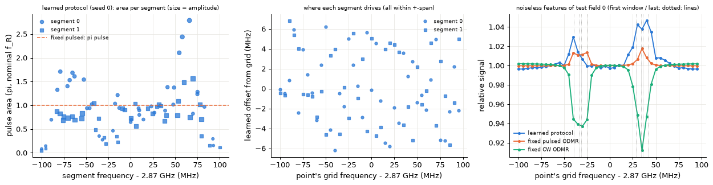

# Milestone 4, Task 1 re-run: a learned sensor protocol for the hidden field

**Task 1 with a learned sensor protocol**: the encoder chooses the pulses of every measurement point, trained end to end with a CNN decoder through the differentiable surrogate, and compared with milestone 2's fixed CW and pulsed ODMR on the same frequency grid, shots and decoder recipe. Simulation only; no claim of quantum advantage: a gap only says that the performance depends on driving the spin resonance.

## Result

RMS error of the folded field (|B| 0.5-3 mT, any direction) with 40 points, mean over 5 seeds [95 % Student-t CI]:

| protocol | resonant, 1000 shots/point | detuned | gap (detuned - resonant) | resonant, 5000 shots/point (= M2's total shots) |
| --- | --- | --- | --- | --- |
| learned protocol | 75.7 [71.8, 79.6] | 833 [822, 844] | 758 [744, 771] | 47.1 [45.1, 49.1] |
| fixed pulsed ODMR | 364 [348, 379] | 834 [823, 844] | 470 [459, 481] | 219 [203, 235] |
| fixed CW ODMR | 60.1 [50.8, 69.5] | 834 [823, 844] | 773 [767, 780] | 37.6 [32.7, 42.5] |

- Learned vs fixed pulsed (its starting point), paired difference pulsed - learned at 1000 shots: 288 [272, 304] uT; learned vs CW, CW - learned: -15.6 [-27, -4.13] uT.
- Context: milestone 2's CNN on its 200-point sweeps (1 MHz steps, 6000 training steps) reached 11.9 uT (CW) and 26.4 uT (pulsed) at 1000 shots per point; at equal total shots (5000 per point here) compare with the last column.
- **Quantum test**: with every MW frequency shifted by 400 MHz (no line within 217 MHz) every protocol falls to the prior; the gaps are learned significant, pulsed significant, cw significant.
- Timing: the learned strategy uses microsecond-scale (Rabi-scale) timing: **yes** (details below).

## Interpretation

- **The encoder redesigned the pulsed sensor.** Starting from milestone 2's pulsed ODMR (one 310 ns pi pulse at
  amplitude 0.2 per grid point), end-to-end training cut the field error 4.8x at equal points, shots and decoder
  recipe (75.7 vs 364 uT at 1000 shots/point). It did so with spin physics a person would also try: about twice the
  drive amplitude (0.43 vs 0.2, power-broadened excitation that covers the 5 MHz grid spacing instead of missing
  lines between points), two segments per point split by ~5 MHz (a composite pulse that covers two neighbouring
  frequencies, with total areas around 2 pi), and it switched off the points the field prior never needs: segments
  more than 88 MHz from D (beyond every line of |B| <= 3 mT) kept a median area of 0.15 pi against 0.92 pi
  elsewhere, and half of those points are nearly off (total area < 0.3 pi).
- **It depends on Rabi-scale timing and on coherent phases.** With the decoder frozen, shifting every duration by
  20 ns costs +49 % in error and by 50 ns +330 %; the fixed pulsed protocol, whose pi pulse sits at the flat top of a
  Rabi oscillation, loses only 1-3 %. Scrambling the phases of the two segments doubles the error: the two pulses
  act coherently on lines they both reach.
- **CW is still better at high shots, and the learned protocol wins at low shots.** At this 40-point budget the
  fixed CW sweep reaches 60 uT at 1000 shots (learned minus CW: +15.6 [4.1, 27] uT) and stays ahead up to 10^4
  shots. The learned protocol is better at <= 100 shots (292 vs 331 uT at 100) and equal at 300. CW integrates for
  the whole 3 us of each shot; the pulsed family reads 600 ns per shot, which no choice of pulses can change. The
  learned protocol only controls the MW (laser timing fixed), so it could not discover CW-like continuous readout.
  Giving the encoder the laser too is the obvious next step.
- **Quantum test:** detuned 400 MHz, every protocol (learned included, trained detuned) falls to the prior, 833 uT;
  the gaps are 758 [744, 771] uT (learned), 470 (pulsed), 773 (CW).
- The QuTiP reference reproduces the learned protocol's features to 6e-5 of the peak; noisy RMSE identical
  (102.0 uT on two fields).

## Protocols and training

- Grid: 40 points, 5 MHz apart over 2.77-2.97 GHz. Every point: init laser 1500 ns, dark 1000 ns, MW, readout 600 ns; features: readout counts in 100 ns windows (6 per point; the fixed pulsed protocol's 10 ns bins summed into the same windows); CW: one steady-state count per 3000 ns shot.
- Learned protocol: per point 2 segments in 200 ns slots (amplitude 0-1, phase, frequency within +-7.5 MHz of the point's grid frequency, duration 0-200 ns on the grid); initialised at the fixed pulsed protocol (amplitude 0.2, 310.0 ns). Phase 1: 1000 Adam steps, 16 fresh fields of one nuisance draw per step, Gaussian shot noise (shots log-uniform [10, 10000]), 8 uniform quadrature nodes. Phase 2 and the fixed protocols: banks with milestone 2's numerics (32 uniform nodes, spacing 2.0), 3000 / 512 / 1000 fields per seed, CNN 2500 steps with Poisson noise at shots 10-10000.
- Wall time: phase 1 81 min, banks 35 min, CNNs 33 min, timing probes 6.1 min.

## Error vs shots

| shots/point | learned, resonant | pulsed, resonant | cw, resonant | prior |
| --- | --- | --- | --- | --- |
| 30 | 515 [499, 531] | 788 [777, 800] | 569 [560, 578] | 834 |
| 100 | 292 [280, 303] | 712 [704, 720] | 331 [319, 342] | 834 |
| 300 | 147 [141, 153] | 556 [539, 572] | 141 [129, 154] | 834 |
| 1000 | 75.7 [71.8, 79.6] | 364 [348, 379] | 60.1 [50.8, 69.5] | 834 |
| 3000 | 52.6 [50.3, 54.9] | 244 [229, 258] | 39.6 [37, 42.2] | 834 |
| 5000 | 47.1 [45.1, 49.1] | 219 [203, 235] | 37.6 [32.7, 42.5] | 834 |
| 10000 | 42 [39.6, 44.4] | 200 [186, 214] | 35.6 [31.3, 39.8] | 834 |

## Quantum test

| metric | resonant | detuned | gap (better on resonance > 0) | per seed (resonant / detuned) |
| --- | --- | --- | --- | --- |
| learned_rmse_ut | 75.7 [71.8, 79.6] | 833.3 [822.2, 844.4] | 757.6 [743.8, 771.4] | 79.81, 75.05, 77.79, 71.84, 74.02; 823.8, 841.4, 833.2, 843, 825 |
| learned_skill | 0.9092 [0.9037, 0.9146] | 0.0002798 [-0.0006028, 0.001162] | 0.9089 [0.9027, 0.915] | 0.9033, 0.9108, 0.9067, 0.9148, 0.9103; 0.001493, -0.0003258, 0.000274, -4.159e-05, -8.433e-07 |
| learned_rmse_ut_budget | 47.14 [45.14, 49.13] | 833.3 [822.2, 844.4] | 786.1 [773.2, 799.1] | 48.09, 45.99, 47.95, 44.92, 48.73; 823.8, 841.4, 833.2, 843, 825 |
| pulsed_rmse_ut | 363.8 [348.1, 379.5] | 833.5 [822.9, 844.2] | 469.7 [458.8, 480.7] | 358.3, 365.6, 376.4, 373.6, 345.1; 825, 841.2, 833.4, 843, 825.1 |
| pulsed_skill | 0.5636 [0.5482, 0.579] | -1.806e-05 [-0.0001521, 0.000116] | 0.5636 [0.5482, 0.5791] | 0.5658, 0.5653, 0.5483, 0.5568, 0.5817; 0.0001312, -0.0001078, 5.224e-05, -4.457e-05, -0.0001214 |
| pulsed_rmse_ut_budget | 219.1 [203.5, 234.8] | 833.5 [822.9, 844.2] | 614.4 [603.4, 625.4] | 207.9, 217.7, 233, 231.1, 206; 825, 841.2, 833.4, 843, 825.1 |
| cw_rmse_ut | 60.11 [50.75, 69.47] | 833.6 [822.9, 844.3] | 773.5 [767.1, 779.9] | 57.56, 70.85, 54, 64.82, 53.34; 825.1, 841.2, 833.4, 843.2, 825 |
| cw_skill | 0.9279 [0.9175, 0.9384] | -8.309e-05 [-0.0002202, 5.398e-05] | 0.928 [0.9177, 0.9384] | 0.9302, 0.9158, 0.9352, 0.9231, 0.9353; -3.801e-05, -0.0001678, 4.812e-05, -0.0002241, -3.368e-05 |
| cw_rmse_ut_budget | 37.6 [32.68, 42.52] | 833.6 [822.9, 844.3] | 796 [787.7, 804.3] | 36.6, 35.94, 36.68, 44.47, 34.29; 825.1, 841.2, 833.4, 843.2, 825 |

## What the protocol learned, and timing

- Pulse areas at the nominal Rabi full scale (10 MHz, MW along [100]): per point (both segments) median 1.88 [1.84, 1.91] pi (the fixed protocol: 1.01 pi); median amplitude 0.43 [0.41, 0.46] (fixed: 0.2); median total MW time per point 284 [277, 291] ns (fixed: 310).
- Fraction of points whose two segments are both on and > 0.5 MHz apart: 0.93 [0.90, 0.97]; median split 5.3 [4.6, 5.9] MHz.
- Timing probe (frozen CNN, every MW duration shifted; resonant, first test fields, every seed), relative RMSE increase [95 % t CI]: learned +-20 ns +0.49 [+0.41, +0.58], +-50 ns +3.30 [+2.71, +3.89]; fixed pulsed +-20 ns +0.01 [+0.00, +0.01], +-50 ns +0.03 [+0.02, +0.04]. Learned phases scrambled: +1.00 [+0.77, +1.24].
- Relies on its pulse timing (> 10 % worse at +-50 ns, CI): yes; uses coherent phases between its segments (> 10 % worse scrambled): yes; Rabi-scale areas: yes. `strategy_learns_timing` = **yes**.

## Reference check

- The seed-0 learned protocol for 2 test fields as full PulseSequences on the QuTiP reference (bank numerics): features within 5.7e-05 of the peak; frozen CNN estimates differ by at most 0.156 uT (noiseless, 1000 shots); noisy RMSE 102.0 (reference) vs 102.0 uT (surrogate), 64 draws per field (21 s).

## Assumptions and limits

- Fewer points (40) than milestone 2's sweeps (200), and fewer CNN steps, to fit end-to-end training into the GPU budget: the absolute errors are not milestone 2's; the comparison between protocols is at equal points, shots, time per shot (within 3 %) and decoder recipe.
- The learned protocol is trained with fewer quadrature nodes than its banks use; phase 2 retrains the CNN on the bank numerics, so the reported errors are consistent with the banks.
- Segment frequencies are tied to the grid (+-span): a frequency far from every line has no gradient.
- Field target and symmetry as in milestone 2 (fold into the wedge Bx >= By >= Bz >= 0).




## Provenance

- run id: `20261126-094940-m4-learned-sensor-e120`
- git: `1b8b45eff7c2ba2a4744f1117ed8c86d79887a98`
- seed: 20261129
- device: cuda NVIDIA GeForce RTX 5070 Ti
- python 3.12.14, glowbox 0.1.0, torch 2.11.0+cu128, qutip 5.3.1, numpy 2.5.5, scipy 1.18.1, pyarrow 26.0.1
- started 2026-11-26T09:49:41+00:00, finished 2026-11-26T12:25:34+00:00

## Config

```yaml
bank:
  detuning_rule: uniform
  detuning_spacing: 2.0
  fields_per_env: 8
  n_detuning: 32
  n_test: 1000
  n_train: 3000
  n_val: 512
  workers: 4
decoder:
  channels:
  - 32
  - 64
  - 128
  hidden: 256
  kernel: 7
  mix_channels: 8
detuned_offset_hz: 400000000.0
eval:
  budget_shots: 5000
  headline_shots: 1000
  shots:
  - 30
  - 100
  - 300
  - 1000
  - 3000
  - 5000
  - 10000
fixed:
  cw_amplitude: 0.1
  cw_shot_ns: 3000
  pi_ns: 310
  pulsed_amplitude: 0.2
name: m4-learned-sensor
prior:
  b_max_t: 0.003
  b_min_t: 0.0005
  background_cps:
  - 5000.0
  - 20000.0
  collection_efficiency:
  - 0.002
  - 0.004
  e_hz:
  - 0.0
  - 300000.0
  optical_beta_full_scale:
  - 0.07
  - 0.13
  rabi_full_scale_hz:
  - 8000000.0
  - 12000000.0
  t2_star_s:
  - 5.0e-07
  - 2.0e-06
protocol_train:
  detuning_rule: uniform
  detuning_spacing: 2.0
  fields_per_step: 16
  lr_decoder: 0.001
  lr_protocol: 0.03
  n_detuning: 8
  shots:
  - 10
  - 10000
  steps: 1000
reference:
  n_fields: 2
  workers: 16
seed: 20261129
seeds:
- 0
- 1
- 2
- 3
- 4
sensor:
  f_start_hz: 2770000000.0
  f_stop_hz: 2970000000.0
  init_amplitude: 0.2
  init_ns: 1500
  init_pi_ns: 310.0
  layout:
    amp_hi: 1.0
    amp_lo: 0.0
    gate_ns: 0
    max_ns: 200.0
    min_ns: 0.0
    n_blocks: 1
    n_segments: 2
    readout_ns: 600
    slot_ns: 200
    span_hz: 7500000.0
    window_ns: 100
  n_points: 40
  settle_ns: 1000
timing:
  duration_shifts_ns:
  - -100
  - -50
  - -20
  - 0
  - 20
  - 50
  - 100
  n_fields: 200
train:
  batch: 256
  eval_every: 250
  lr: 0.001
  shots_max: 10000
  shots_min: 10
  steps: 2500
  weight_decay: 0.0001
```

## Final metrics

| metric | value |
| --- | --- |
| learned_rmse_ut_resonant | 75.7026 |
| learned_rmse_ut_detuned | 833.276 |
| learned_gap | 757.573 |
| learned_gap_lo | 743.787 |
| learned_gap_hi | 771.359 |
| pulsed_rmse_ut_resonant | 363.788 |
| pulsed_rmse_ut_detuned | 833.521 |
| pulsed_gap | 469.733 |
| pulsed_gap_lo | 458.772 |
| pulsed_gap_hi | 480.694 |
| cw_rmse_ut_resonant | 60.1126 |
| cw_rmse_ut_detuned | 833.576 |
| cw_gap | 773.463 |
| cw_gap_lo | 767.054 |
| cw_gap_hi | 779.872 |
| ref_max_rel_feature_diff | 5.72963e-05 |
| strategy_learns_timing | 1 |
| learned_relies_on_pulse_timing | 1 |
| no_line_margin_mhz | 216.799 |
| phase1_seconds | 4875.46 |
| wall_seconds | 9353.46 |
