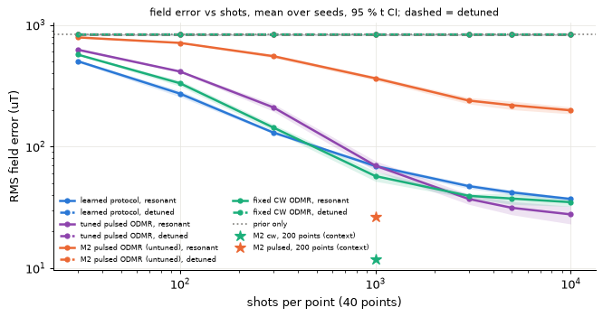
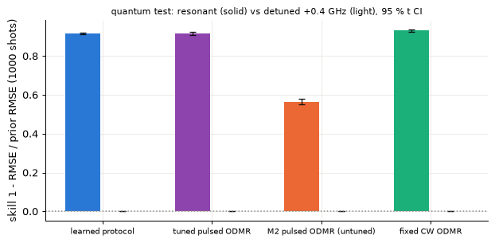
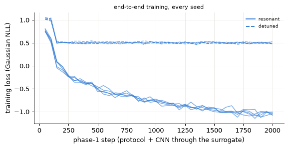
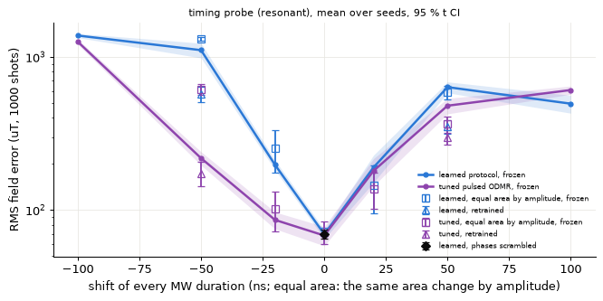

# Milestone 4, Task 1 re-run: a learned sensor protocol for the hidden field

**Task 1 with a learned sensor protocol**: the encoder chooses the pulses of every measurement point, trained end to end with a CNN decoder through the differentiable surrogate, and compared with fixed protocols on the same frequency grid, shots and decoder recipe: a pulsed ODMR sweep whose pulse is tuned for this grid, milestone 2's untuned pulsed ODMR and fixed CW ODMR. Simulation only; no claim of quantum advantage: a gap only says that the performance depends on driving the spin resonance.

## Result

RMS error of the folded field (|B| 0.5-3 mT, any direction) with 40 points, mean over 5 seeds [95 % Student-t CI]:

| protocol | shot (ns) | resonant, 1000 shots/point | detuned | gap (detuned - resonant) | resonant, 5000 shots/point (= M2's total shots) |
| --- | --- | --- | --- | --- | --- |
| learned protocol | 3500 | 69.1 [66.6, 71.7] | 834 [823, 844] | 764 [752, 777] | 42 [40.1, 43.9] |
| tuned pulsed ODMR | 3200 | 69.7 [63.2, 76.2] | 834 [823, 844] | 764 [754, 773] | 31.4 [27.5, 35.2] |
| M2 pulsed ODMR (untuned) | 3410 | 364 [350, 378] | 834 [823, 844] | 470 [458, 482] | 219 [201, 236] |
| fixed CW ODMR | 3000 | 57.2 [51.9, 62.5] | 833 [823, 844] | 776 [771, 782] | 37.4 [33.5, 41.2] |

- Tuned pulse (validation sweep below): amplitude 0.6, 100 ns (nominal area 0.98 pi); milestone 2's: amplitude 0.2, 310 ns.
- Paired differences at 1000 shots/point (positive = the second is better): tuned - learned 0.536 [-8.53, 9.61] uT; CW - learned -12 [-18.8, -5.15] uT; CW - tuned -12.5 [-19.3, -5.76] uT; untuned - tuned 294 [281, 307] uT. At 5000 shots: tuned - learned -10.6 [-15.4, -5.87] uT; CW - learned -4.63 [-9.25, -0.0188] uT.
- Context: milestone 2's CNN on its 200-point sweeps (1 MHz steps, 6000 training steps) reached 11.9 uT (CW) and 26.4 uT (pulsed) at 1000 shots per point; at equal total shots (5000 per point here) compare with the last column.
- **Quantum test**: with every MW frequency shifted by 400 MHz (no line within 216 MHz) every protocol falls to the prior; the gaps are learned significant, tuned significant, pulsed significant, cw significant.
- Timing: the learned strategy uses microsecond-scale (Rabi-scale) timing: **yes** (details below).

## Interpretation

- **Tuning the fixed pulse explains the earlier "4.8x".** Milestone 2's pi pulse (amplitude 0.2, 310 ns) was set for
  a 1 MHz grid; on this 5 MHz grid its narrow excitation misses lines between points. A validation sweep of the
  pulse amplitude alone (each with its nominal pi pulse) cuts the error 5.2x (364 -> 69.7 uT at 1000 shots; best
  amplitude 0.6, 100 ns). The previous version of this report credited that gain to learning; it was a
  one-parameter retune.
- **Learning from the tuned pulse adds nothing at the headline and changes the trade-off across shots.** Started at
  the tuned pulse and trained for 2000 steps, the learned protocol ties it at 1000 shots (tuned - learned 0.5
  [-8.5, 9.6] uT), is clearly better at low shots (272 vs 414 uT at 100, 130 vs 210 at 300) and clearly worse at
  high shots (42.0 vs 31.4 uT at 5000: tuned - learned -10.6 [-15.4, -5.9]). Phase 1 samples shots
  log-uniformly over 10-10^4, so most of its training weight sits at the low-shot end, where it wins. What it
  changed is spin physics a person would also try: a stronger, shorter, slightly under-pi pulse (first segment
  median amplitude 0.93, 60 ns, 0.81 pi), per-point frequency offsets of a few MHz, the second segment left
  essentially off (median amplitude 0.03, area 0.01 pi; the "two frequencies" fraction below counts it as on), and
  points beyond every line of |B| <= 3 mT turned down (median 0.30 pi per point more than 88 MHz from D vs 0.84 pi
  elsewhere). Stronger drive broadens the excitation, which helps coverage at few shots and blurs line positions
  at many.
- **CW vs pulsed.** At 1000 shots per point fixed CW is best (57.2 uT; CW - learned -12.0 [-18.8, -5.2], CW -
  tuned -12.5 [-19.3, -5.8]). At 5000 shots the tuned pulse beats CW (31.4 vs 37.4 uT), and it still does at equal
  wall time per point (30.5 vs 36.4 uT at 17.5 ms; CW's 3000 ns shots are 6-14 % shorter than the pulsed and learned
  shots, which the equal-time table corrects for). So neither family wins everywhere; the earlier claim that no
  choice of pulses can catch CW was wrong. The learned protocol only controls the MW (laser timing fixed).
- **Timing: it relies on pulse area (the Rabi rotation angle), like the tuned pulse.** Shifting every duration by
  50 ns raises the learned error 12.6-fold with the CNN frozen and 6.4-fold with a CNN retrained on the shifted
  protocol; the tuned pulse loses less (5.2-fold frozen, 3.3-fold retrained) because its pulse is longer relative to
  the shift. Making the same area change through the amplitude, durations kept, costs as much or more (learned +12.8
  vs +11.6 at +-50 ns), so these probes measure reliance on pulse area on the Rabi scale, not on timing as such.
  With its second segment off, the learned protocol no longer uses coherent phases between segments (scrambling
  them costs nothing).
- **Quantum test:** detuned 400 MHz, every protocol (learned included, trained detuned) falls to the prior, ~834
  uT; gaps 764 [752, 777] uT (learned), 764 [754, 773] (tuned), 470 (untuned), 776 (CW).
- The QuTiP reference reproduces the learned protocol's features to 6e-5 of the peak; noisy RMSE identical (70.7
  uT on two fields).

## Equal wall time per point

The protocols' shots differ in length (column `shot (ns)` above; CW counts photons for its whole shot, the pulsed and learned protocols for their 600 ns readout). RMSE at equal wall time per point, the learned protocol's shots converted by shot length, resonant:

| wall time per point (us) | learned protocol | tuned pulsed ODMR | M2 pulsed ODMR (untuned) | fixed CW ODMR |
| --- | --- | --- | --- | --- |
| 3500 | 69.1 [66.6, 71.7] (1000 shots) | 67 [63.3, 70.8] (1094 shots) | 354 [338, 370] (1026 shots) | 55 [49.8, 60.3] (1167 shots) |
| 17500 | 42 [40.1, 43.9] (5000 shots) | 30.5 [28.6, 32.3] (5469 shots) | 217 [208, 227] (5132 shots) | 36.4 [33.3, 39.4] (5833 shots) |

## Tuning the fixed pulsed baseline

Seed 0, its train / validation fields (test fields unseen), the CNN recipe below, validation RMSE at 1000 shots/point. Stage 1: amplitudes with their nominal pi pulse; stage 2: pulse areas at the best amplitude.

| stage | amplitude | pulse (ns) | nominal area (pi) | validation RMSE (uT) |
| --- | --- | --- | --- | --- |
| amplitude | 0.2 | 310 | 1.01 | 372.4 |
| amplitude | 0.3 | 200 | 0.98 | 158.0 |
| amplitude | 0.4 | 150 | 0.98 | 82.3 |
| amplitude | 0.5 | 120 | 0.98 | 64.1 |
| amplitude | 0.6 | 100 | 0.98 | 58.1 |
| amplitude | 0.8 | 80 | 1.05 | 64.8 |
| amplitude | 1 | 60 | 0.98 | 73.6 |
| area | 0.6 | 60 | 0.59 | 110.2 |
| area | 0.6 | 80 | 0.78 | 68.2 |
| area | 0.6 | 120 | 1.18 | 93.8 |
| area | 0.6 | 150 | 1.47 | 268.8 |

## Protocols and training

- Grid: 40 points, 5 MHz apart over 2.77-2.97 GHz. Every point: init laser 1500 ns, dark 1000 ns, MW, readout 600 ns; features: readout counts in 100 ns windows (6 per point; the fixed pulsed protocols' 10 ns bins summed into the same windows); CW: one steady-state count per 3000 ns shot.
- Learned protocol: per point 2 segments in 200 ns slots (amplitude 0-1, phase, frequency within +-7.5 MHz of the point's grid frequency, duration 0-200 ns on the grid); initialised at the tuned pulse (amplitude 0.6, 100 ns; unused segments at amplitude 0.05, 20.0 ns). Phase 1: 2000 Adam steps (lr 0.03, cosine), 16 fresh fields of one nuisance draw per step, Gaussian shot noise (shots log-uniform [10, 10000]), 8 uniform quadrature nodes. Phase 2 and the fixed protocols: banks with milestone 2's numerics (32 uniform nodes, spacing 2.0), 3000 / 512 / 1000 fields per seed, CNN 2500 steps with Poisson noise at shots 10-10000.
- Wall time: tuning 21 min, phase 1 185 min, banks 55 min, CNNs 107 min, timing probes 62.9 min.

## Error vs shots

| shots/point | learned, resonant | tuned, resonant | pulsed, resonant | cw, resonant | prior |
| --- | --- | --- | --- | --- | --- |
| 30 | 503 [492, 514] | 625 [611, 639] | 789 [778, 800] | 570 [565, 575] | 834 |
| 100 | 272 [256, 288] | 414 [407, 421] | 711 [706, 715] | 331 [314, 349] | 834 |
| 300 | 130 [127, 133] | 210 [195, 225] | 553 [536, 571] | 143 [135, 152] | 834 |
| 1000 | 69.1 [66.6, 71.7] | 69.7 [63.2, 76.2] | 364 [350, 378] | 57.2 [51.9, 62.5] | 834 |
| 3000 | 47.3 [45.1, 49.5] | 37.1 [33.5, 40.6] | 239 [224, 253] | 39.4 [37.7, 41] | 834 |
| 5000 | 42 [40.1, 43.9] | 31.4 [27.5, 35.2] | 219 [201, 236] | 37.4 [33.5, 41.2] | 834 |
| 10000 | 37.1 [35.8, 38.3] | 27.7 [23.1, 32.3] | 199 [186, 212] | 34.9 [32.2, 37.6] | 834 |

## Quantum test

| metric | resonant | detuned | gap (better on resonance > 0) | per seed (resonant / detuned) |
| --- | --- | --- | --- | --- |
| learned_rmse_ut | 69.14 [66.56, 71.73] | 833.6 [823, 844.2] | 764.4 [752.3, 776.5] | 71.84, 70.21, 68.92, 66.23, 68.5; 825.3, 841.4, 833.2, 843, 825 |
| learned_skill | 0.917 [0.9133, 0.9208] | -6.064e-05 [-0.0003642, 0.0002429] | 0.9171 [0.9135, 0.9207] | 0.9129, 0.9165, 0.9173, 0.9214, 0.917; -0.0002642, -0.0003238, 0.0002877, -3.548e-07, -2.505e-06 |
| learned_rmse_ut_budget | 41.99 [40.12, 43.85] | 833.6 [823, 844.2] | 791.6 [780.4, 802.8] | 44.48, 42, 41.56, 41.42, 40.46; 825.3, 841.4, 833.2, 843, 825 |
| learned_rmse_ut_eqtime | 69.14 [66.56, 71.73] | 833.6 [823, 844.2] | 764.4 [752.3, 776.5] | 71.84, 70.21, 68.92, 66.23, 68.5; 825.3, 841.4, 833.2, 843, 825 |
| tuned_rmse_ut | 69.68 [63.15, 76.2] | 833.5 [822.9, 844.2] | 763.8 [754.2, 773.5] | 64.16, 66.21, 68.84, 77.67, 71.5; 825, 841.2, 833.4, 843, 825.1 |
| tuned_skill | 0.9164 [0.909, 0.9238] | -1.548e-05 [-0.0001548, 0.0001239] | 0.9164 [0.9091, 0.9238] | 0.9222, 0.9213, 0.9174, 0.9079, 0.9133; 0.000132, -0.0001116, 6.92e-05, -4.504e-05, -0.000122 |
| tuned_rmse_ut_budget | 31.36 [27.5, 35.21] | 833.5 [822.9, 844.2] | 802.2 [792.8, 811.5] | 29.77, 28.92, 30.82, 36.76, 30.52; 825, 841.2, 833.4, 843, 825.1 |
| tuned_rmse_ut_eqtime | 67.04 [63.28, 70.8] | 833.5 [822.9, 844.2] | 766.5 [755.2, 777.8] | 69.78, 63.6, 66.07, 70.62, 65.16; 825, 841.2, 833.4, 843, 825.1 |
| pulsed_rmse_ut | 363.7 [349.6, 377.9] | 833.5 [822.9, 844.1] | 469.8 [457.9, 481.7] | 351.9, 361.4, 379.4, 370.9, 355.1; 825.1, 841.2, 833.4, 843, 825 |
| pulsed_skill | 0.5636 [0.5491, 0.5781] | -4.37e-05 [-0.0001271, 3.97e-05] | 0.5637 [0.5491, 0.5782] | 0.5735, 0.5703, 0.5447, 0.56, 0.5695; -6.016e-05, -0.0001442, 3.71e-05, -9.797e-06, -4.15e-05 |
| pulsed_rmse_ut_budget | 218.6 [201, 236.1] | 833.5 [822.9, 844.1] | 615 [593.8, 636.2] | 200.3, 211, 234, 216.2, 231.4; 825.1, 841.2, 833.4, 843, 825 |
| pulsed_rmse_ut_eqtime | 354 [338.2, 369.8] | 833.5 [822.9, 844.1] | 479.6 [461.8, 497.4] | 354.7, 336.3, 358.4, 371.1, 349.4; 825.1, 841.2, 833.4, 843, 825 |
| cw_rmse_ut | 57.17 [51.85, 62.48] | 833.5 [822.9, 844] | 776.3 [770.8, 781.8] | 53.11, 62.1, 55.83, 61.31, 53.48; 825.1, 840.9, 833.3, 843, 825 |
| cw_skill | 0.9314 [0.9259, 0.937] | 6.291e-05 [-7.457e-05, 0.0002004] | 0.9314 [0.9258, 0.937] | 0.9356, 0.9262, 0.933, 0.9273, 0.9352; 1.223e-05, 0.0002231, 0.0001309, -4.039e-05, -1.131e-05 |
| cw_rmse_ut_budget | 37.35 [33.48, 41.22] | 833.4 [822.9, 844] | 796.1 [789.1, 803.1] | 34.97, 38.72, 36.7, 42.02, 34.34; 825.1, 840.8, 833.3, 843, 825 |
| cw_rmse_ut_eqtime | 55.05 [49.79, 60.31] | 833.5 [822.9, 844] | 778.4 [766.4, 790.4] | 61.42, 56.16, 51.7, 55.25, 50.72; 825.1, 840.9, 833.3, 843, 825 |

## What the protocol learned, and timing

- Pulse areas at the nominal Rabi full scale (10 MHz, MW along [100]): per point (both segments) median 0.836 [0.816, 0.855] pi (its start: 0.98 pi; tuned: 0.98 pi); median amplitude 0.13 [0.06, 0.19] (start 0.60); median total MW time per point 74 [67, 81] ns (start 100).
- Fraction of points whose two segments are both on and > 0.5 MHz apart: 0.89 [0.85, 0.94]; median split 4.0 [2.5, 5.5] MHz.

Timing probes (resonant, every seed, the first test fields), relative RMSE increase at 1000 shots [95 % t CI]: every MW duration shifted (frozen CNN); the same area change made with the amplitude, durations kept (equal-area control, frozen CNN); a CNN retrained on a reduced bank of the shifted protocol (1000 train fields, relative to the same recipe unshifted):

| protocol | +-20 ns, frozen | +-50 ns, frozen | equal area +-20, frozen | equal area +-50, frozen | +-50 ns, retrained | phases scrambled |
| --- | --- | --- | --- | --- | --- | --- |
| learned | +1.80 [+1.39, +2.21] | +11.58 [+10.39, +12.76] | +1.87 [+1.23, +2.51] | +12.78 [+11.42, +14.14] | +5.39 [+5.02, +5.77] | +0.00 [-0.00, +0.01] |
| tuned pulsed | +0.97 [+0.64, +1.30] | +4.20 [+3.19, +5.21] | +0.77 [+0.41, +1.13] | +6.26 [+5.19, +7.33] | +2.32 [+1.76, +2.89] | |

- Learned: relies on its pulse timing (> 10 % worse at +-50 ns, frozen, CI): yes; the information needs it (retrained CNN still > 10 % worse): yes; the equal-area control costs at least half as much (the probe measures pulse area, the Rabi rotation angle, rather than timing as such): yes; coherent phases between its segments (> 10 % worse scrambled): no; Rabi-scale areas: yes. `strategy_learns_timing` = **yes**.
- Tuned pulsed: relies on its pulse timing (frozen): yes; retrained: yes; area explains it: yes.

## Reference check

- The seed-0 learned protocol for 2 test fields as full PulseSequences on the QuTiP reference (bank numerics): features within 6.1e-05 of the peak; frozen CNN estimates differ by at most 0.071 uT (noiseless, 1000 shots); noisy RMSE 70.7 (reference) vs 70.7 uT (surrogate), 64 draws per field (43 s).

## Assumptions and limits

- Fewer points (40) than milestone 2's sweeps (200), and fewer CNN steps, to fit end-to-end training into the GPU budget: the absolute errors are not milestone 2's; the protocols are compared at equal points, decoder recipe and shots per point (shot lengths in the table above; equal wall time in its own table).
- The tuned baseline is tuned on one seed's validation fields with the same CNN recipe; the learned protocol starts from it. Both tunings are coarse (a handful of candidates, one phase-1 schedule).
- The learned protocol is trained with fewer quadrature nodes than its banks use; phase 2 retrains the CNN on the bank numerics, so the reported errors are consistent with the banks.
- Segment frequencies are tied to the grid (+-span): a frequency far from every line has no gradient.
- Field target and symmetry as in milestone 2 (fold into the wedge Bx >= By >= Bz >= 0).










## Provenance

- run id: `20261126-150535-m4-learned-sensor-57bf`
- git: `711b86cb7713b65058c46cd0347fe98d97214c07`
- seed: 20261129
- device: cuda NVIDIA GeForce RTX 5070 Ti
- python 3.12.14, glowbox 0.1.0, torch 2.11.0+cu128, qutip 5.3.1, numpy 2.5.5, scipy 1.18.1, pyarrow 26.0.1
- started 2026-11-26T15:05:35+00:00, finished 2026-11-26T21:28:42+00:00

## Config

```yaml
bank:
  detuning_rule: uniform
  detuning_spacing: 2.0
  fields_per_env: 8
  n_detuning: 32
  n_test: 1000
  n_train: 3000
  n_val: 512
  workers: 4
decoder:
  channels:
  - 32
  - 64
  - 128
  hidden: 256
  kernel: 7
  mix_channels: 8
detuned_offset_hz: 400000000.0
eval:
  budget_shots: 5000
  headline_shots: 1000
  shots:
  - 30
  - 100
  - 300
  - 1000
  - 3000
  - 5000
  - 10000
fixed:
  cw_amplitude: 0.1
  cw_shot_ns: 3000
  pi_ns: 310
  pulsed_amplitude: 0.2
name: m4-learned-sensor
prior:
  b_max_t: 0.003
  b_min_t: 0.0005
  background_cps:
  - 5000.0
  - 20000.0
  collection_efficiency:
  - 0.002
  - 0.004
  e_hz:
  - 0.0
  - 300000.0
  optical_beta_full_scale:
  - 0.07
  - 0.13
  rabi_full_scale_hz:
  - 8000000.0
  - 12000000.0
  t2_star_s:
  - 5.0e-07
  - 2.0e-06
protocol_train:
  detuning_rule: uniform
  detuning_spacing: 2.0
  fields_per_step: 16
  lr_decoder: 0.001
  lr_protocol: 0.03
  n_detuning: 8
  shots:
  - 10
  - 10000
  steps: 2000
reference:
  n_fields: 2
  workers: 16
seed: 20261129
seeds:
- 0
- 1
- 2
- 3
- 4
sensor:
  f_start_hz: 2770000000.0
  f_stop_hz: 2970000000.0
  init: tuned
  init_amp_cap: 0.95
  init_amplitude: 0.2
  init_ns: 1500
  init_pi_ns: 310.0
  init_rest_amplitude: 0.05
  init_rest_ns: 20.0
  layout:
    amp_hi: 1.0
    amp_lo: 0.0
    gate_ns: 0
    max_ns: 200.0
    min_ns: 0.0
    n_blocks: 1
    n_segments: 2
    readout_ns: 600
    slot_ns: 200
    span_hz: 7500000.0
    window_ns: 100
  n_points: 40
  settle_ns: 1000
timing:
  area_shifts_ns:
  - -50
  - -20
  - 20
  - 50
  duration_shifts_ns:
  - -100
  - -50
  - -20
  - 0
  - 20
  - 50
  - 100
  n_fields: 200
  retrain_n_train: 1000
  retrain_n_val: 256
  retrain_shifts_ns:
  - -50
  - 50
train:
  batch: 256
  eval_every: 250
  lr: 0.001
  shots_max: 10000
  shots_min: 10
  steps: 2500
  weight_decay: 0.0001
tune:
  amplitudes:
  - 0.2
  - 0.3
  - 0.4
  - 0.5
  - 0.6
  - 0.8
  - 1.0
  area_factors:
  - 0.6
  - 0.8
  - 1.25
  - 1.5
  seed: 0
  shots: 1000
```

## Final metrics

| metric | value |
| --- | --- |
| learned_rmse_ut_resonant | 69.1412 |
| learned_rmse_ut_detuned | 833.557 |
| learned_gap | 764.415 |
| learned_gap_lo | 752.3 |
| learned_gap_hi | 776.53 |
| tuned_rmse_ut_resonant | 69.6772 |
| tuned_rmse_ut_detuned | 833.519 |
| tuned_gap | 763.842 |
| tuned_gap_lo | 754.189 |
| tuned_gap_hi | 773.495 |
| pulsed_rmse_ut_resonant | 363.744 |
| pulsed_rmse_ut_detuned | 833.542 |
| pulsed_gap | 469.798 |
| pulsed_gap_lo | 457.892 |
| pulsed_gap_hi | 481.704 |
| cw_rmse_ut_resonant | 57.1668 |
| cw_rmse_ut_detuned | 833.453 |
| cw_gap | 776.286 |
| cw_gap_lo | 770.777 |
| cw_gap_hi | 781.796 |
| tuned_amplitude | 0.6 |
| tuned_pi_ns | 100 |
| ref_max_rel_feature_diff | 6.05027e-05 |
| strategy_learns_timing | 1 |
| learned_relies_on_pulse_timing | 1 |
| no_line_margin_mhz | 216.482 |
| phase1_seconds | 11096.1 |
| wall_seconds | 22987.4 |
