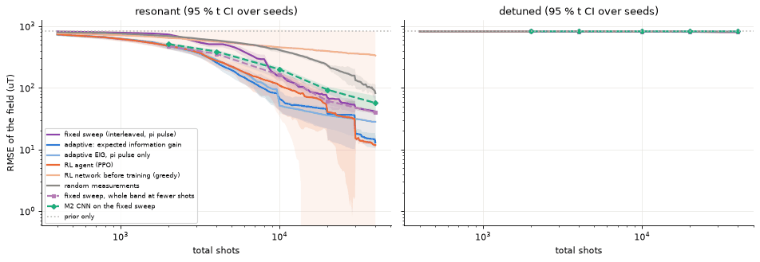
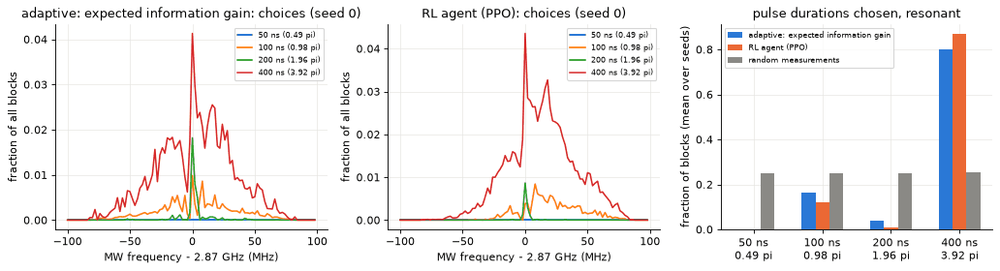
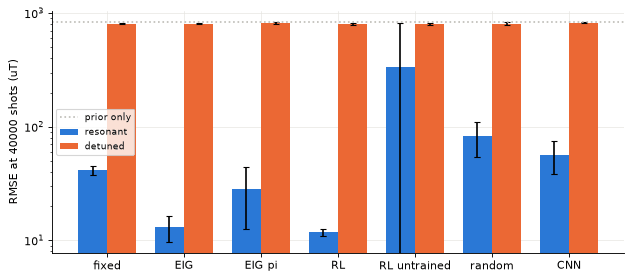
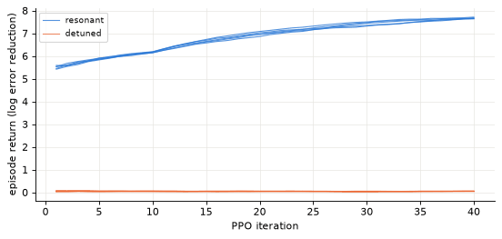
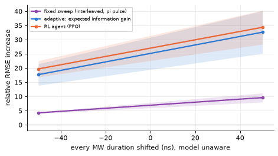

# Milestone 5, Task 1: adaptive measurement and an RL agent choose the measurements

**Task 1, the learner picks the measurements.** Each step is a block of 400 shots of one pulsed-ODMR measurement (MW frequency on a 2 MHz grid x pulse duration 50, 100, 200, 400 ns at amplitude 0.6); 100 steps = 40000 shots. Every policy updates the same particle posterior over the folded field; the estimate is its mean. Simulation only; no claim of quantum advantage: a gap only says that the performance depends on driving the spin resonance.

## Result

RMSE of the folded field after 40000 shots, mean over 5 seeds [95 % Student-t CI]:

| policy | resonant | detuned | gap (detuned - resonant) | gap significant |
| --- | --- | --- | --- | --- |
| fixed sweep (interleaved, pi pulse) | 41.3 [37.7, 44.9] | 806 [798, 814] | 765 [755, 775] | yes |
| adaptive: expected information gain | 13.1 [9.77, 16.4] | 809 [801, 817] | 796 [786, 805] | yes |
| adaptive EIG, pi pulse only | 28.2 [12.5, 43.9] | 818 [803, 832] | 789 [776, 802] | yes |
| RL agent (PPO) | 11.8 [10.9, 12.7] | 806 [794, 818] | 794 [781, 807] | yes |
| RL network before training (greedy) | 334 [-154, 822] | 805 [792, 817] | 471 [-14, 955] | no |
| random measurements | 82.2 [53.9, 111] | 809 [783, 835] | 727 [693, 761] | yes |
| M2 CNN on the fixed sweep | 56.9 [38.5, 75.2] | 823 [812, 834] | 766 [744, 788] | yes |
| prior only | 829 | 829 | | |

- Paired differences, resonant (positive = the second is better), uT: fixed - EIG 28.2 [27.7, 28.7]; fixed - RL 29.5 [26.4, 32.6]; RL - EIG -1.3 [-4.22, 1.61]; RL before training - RL 322 [-166, 811]; EIG pi only - EIG 15.1 [-1.65, 31.9]; CNN - fixed 15.6 [0.713, 30.5]; random - fixed 40.9 [11.3, 70.6].
- **Quantum test**: with every MW frequency shifted by 400 MHz (no line within 218 MHz of any MW frequency; the agent and the CNN retrained there) the detuned skill (1 - RMSE / prior RMSE) is between 0.00736 and 0.0294; the gap is significant for 6 of 7 learners (fixed, eig, eig_pi, rl, random, cnn).
- Timing: the RL agent's strategy uses microsecond-scale (Rabi-scale) timing: **yes** (details below).

## Interpretation

- **Choosing the measurement pays about 3x at 40000 shots.** On the same posterior, the information-greedy design
  (13.1 uT) and the PPO agent (11.8 uT) beat the fixed interleaved pi-pulse sweep (41.3 uT): fixed - EIG 28.2
  [27.7, 28.7], fixed - RL 29.5 [26.4, 32.6] uT. The agent and the greedy design tie (RL - EIG -1.3 [-4.2, 1.6]
  uT); the agent's spread over seeds is smaller (CI width 1.9 vs 6.6 uT). Random measurements (82.2 uT) are worse
  than the fixed sweep, so the gain comes from choosing, not from varying.
- **Shots to accuracy.** The greedy design reaches 200 and 100 uT first (4960 and 8080 shots vs 8880 and 14100 for
  the fixed sweep); the agent catches up by 50 uT (18700 vs 18800 for EIG, 28800 for the fixed sweep). At small
  budgets the whole band at fewer shots per point beats the interleaved sweep (473 vs 733 uT at 2000 shots), and
  at 10000 shots the greedy design restricted to the pi pulse is as good as the full one (51.4 vs 66.4 uT).
- **What they learned: search, then a long pulse.** Both adaptive learners spend 80-87 % of their blocks on the
  400 ns pulse (3.92 pi at the nominal Rabi scale) and most of the rest on the 100 ns pi pulse. The long pulse has
  a narrower excitation profile, so once a line is located it pins its position more sharply; a fixed sweep at 400
  ns is poor (205 uT) because it has no search phase. Restricting the greedy design to the pi pulse costs 15.1
  [-1.7, 31.9] uT (28.2 vs 13.1, one seed at 50.8), so choosing the duration matters as well as the frequency.
- **What PPO adds.** The same network before training, run greedily on its features (which include the predictive
  spread), is bimodal over seeds: 25-71 uT on three, ~765 uT (stuck, never leaves the prior) on two. Trained, every
  seed lands at 10.9-12.8 uT. The agent did not see the information gain; it learned an equivalent choice from
  the predictive features and the error reward.
- **Comparison with the earlier learners.** Milestone 2's CNN on the fixed sweep reaches 56.9 uT on the same
  shots, worse than the posterior on the same data (CNN - fixed 15.6 [0.7, 30.5] uT): with a calibrated device the
  model-based posterior extracts more from a sweep than the trained decoder. Milestone 4's learned sensor protocol
  (69.1 uT at 40 points x 1000 shots, the same total) marginalised over unknown device parameters, which this
  milestone does not (below), so the numbers are not directly comparable.
- **Timing.** The adaptive strategies depend on calibrated pulse areas much more than the fixed sweep: shifting
  every MW duration by 50 ns while the learners' model keeps the nominal ones multiplies their error 19-35 fold
  (fixed sweep: 5-11 fold). They work on line flanks with the long pulse, where a wrong rotation angle shifts the
  predicted response most. This is reliance on the Rabi rotation angle (microsecond-scale timing on the Rabi
  scale); no echo structure is available in this action set.
- **Quantum test.** Detuned by 400 MHz (no line within 218 MHz of any MW frequency; agent and CNN retrained there),
  every policy stays at the prior (~806-823 uT vs 829); the gaps are large and significant for every learner except
  the untrained network (whose resonant result is itself unreliable): RL 794 [781, 807] uT, EIG 796 [786, 805] uT.
- **Reference.** Through `Simulator.run()` with the QuTiP reference as the device, the measured means of every
  action the seed-0 agent and design chose agree with the surrogate to 6.4e-4 of the signal spread. The noisy
  RMSEs on the two reference fields (RL 13.5 vs 9.4 uT, EIG 8.7 vs 11.3 uT) are within the per-field noise.

## Assumptions and limits

- The device is calibrated: every learner knows the device parameters and only the field is hidden. Milestones 2-4
  marginalised over nuisance parameters; a nuisance-aware posterior (more particle dimensions) is left for later.
- The learners' model is the emulator table, not the surrogate itself (RMS error 0.23 % of the signal spread, max
  62 %, i.e. 0.048 counts per shot against a block shot noise of 0.092).
- The agent's reward uses the true field (simulation only); `reward="variance"` (the posterior's own width) is
  implemented for hardware but not used here. 40 PPO iterations per seed and condition (RL training is 156 of the
  270 min wall time); the agent is trained with 256 particles and no restarts, evaluated with 512 and restarts.
- Discrete actions (2 MHz frequency grid x four durations at one amplitude), one MW pulse per shot; the design is
  greedy (one step ahead) with a Gaussian approximation to the information gain.
- Field target and folding as in milestone 2 (wedge Bx >= By >= Bz >= 0). Design notes:
  [docs/notes/adaptive-rl.md](../notes/adaptive-rl.md).

## Shots to accuracy

RMSE (uT) vs total shots, resonant, mean [95 % t CI] over seeds:

| total shots | fixed sweep (interleaved, pi pulse) | fixed sweep, whole band at fewer shots | adaptive: expected information gain | adaptive EIG, pi pulse only | RL agent (PPO) | random measurements | M2 CNN on the fixed sweep |
| --- | --- | --- | --- | --- | --- | --- | --- |
| 2000 | 733 [709, 757] | 473 [440, 506] | 476 [428, 523] | 477 [431, 524] | 480 [423, 537] | 692 [682, 703] | 513 [484, 543] |
| 4000 | 509 [460, 557] | 356 [335, 376] | 257 [217, 298] | 285 [264, 307] | 276 [222, 330] | 588 [556, 620] | 388 [357, 418] |
| 10000 | 156 [132, 180] | 162 [140, 184] | 66.4 [43.6, 89.2] | 51.4 [39, 63.7] | 109 [42.7, 176] | 410 [379, 441] | 199 [180, 219] |
| 20000 | 69.2 [50.1, 88.3] | 61.6 [54, 69.2] | 38.1 [14.3, 61.8] | 36 [22.1, 49.9] | 40.7 [13.9, 67.5] | 230 [210, 249] | 93.3 [81.2, 105] |
| 40000 | 41.3 [37.7, 44.9] | 40.1 [38.2, 42] | 13.1 [9.77, 16.4] | 28.2 [12.5, 43.9] | 11.8 [10.9, 12.7] | 82.2 [53.9, 111] | 56.9 [38.5, 75.2] |

Shots until the RMSE over the test fields first falls below a threshold (mean over seeds; n/a = not within the budget):

| policy | <= 200 uT | <= 100 uT | <= 50 uT |
| --- | --- | --- | --- |
| fixed sweep (interleaved, pi pulse) | 8.88e+03 | 1.41e+04 | 2.88e+04 |
| adaptive: expected information gain | 4.96e+03 | 8.08e+03 | 1.88e+04 |
| adaptive EIG, pi pulse only | 5.68e+03 | 8.48e+03 | 1.01e+04 (4/5 seeds) |
| RL agent (PPO) | 6.4e+03 | 1.26e+04 | 1.87e+04 |
| RL network before training (greedy) | 1.27e+04 (3/5 seeds) | 1.95e+04 (3/5 seeds) | 3.7e+04 (2/5 seeds) |
| random measurements | 2.42e+04 | 3.42e+04 (4/5 seeds) | n/a (0/5 seeds) |

## Fixed sweeps at each duration

The interleaved fixed sweep at every pulse duration (resonant, full budget):

| duration (ns) | area (pi) | RMSE (uT) |
| --- | --- | --- |
| 50 | 0.49 | 120 [109, 132] |
| 100 | 0.98 | 41.3 [37.7, 44.9] |
| 200 | 1.96 | 250 [208, 292] |
| 400 | 3.92 | 205 [186, 224] |

## Timing

Durations (pulse areas at the nominal Rabi scale) chosen, fraction of all blocks, resonant [t CI over seeds]:

| policy | 50 ns (0.49 pi) | 100 ns (0.98 pi) | 200 ns (1.96 pi) | 400 ns (3.92 pi) |
| --- | --- | --- | --- | --- |
| adaptive: expected information gain | 0.00 [-0.00, 0.00] | 0.16 [0.15, 0.17] | 0.04 [0.03, 0.05] | 0.80 [0.79, 0.81] |
| RL agent (PPO) | 0.00 [-0.00, 0.00] | 0.12 [0.10, 0.15] | 0.01 [0.00, 0.02] | 0.87 [0.84, 0.89] |

Every MW duration shifted in the device while the learners' model assumes the nominal durations; relative RMSE increase [t CI]:

| policy | -50 ns | +50 ns |
| --- | --- | --- |
| fixed sweep (interleaved, pi pulse) | +4.24 [+3.95, +4.52] | +9.60 [+8.00, +11.20] |
| adaptive: expected information gain | +17.68 [+13.88, +21.48] | +32.63 [+25.12, +40.14] |
| RL agent (PPO) | +19.69 [+16.84, +22.54] | +34.35 [+28.38, +40.32] |

- fixed sweep (interleaved, pi pulse): relies on its pulse timing (> 10 % worse at the largest shift, CI): yes.
- adaptive: expected information gain: relies on its pulse timing (> 10 % worse at the largest shift, CI): yes; most chosen duration 400 ns (3.92 pi), preferred beyond uniform: yes.
- RL agent (PPO): relies on its pulse timing (> 10 % worse at the largest shift, CI): yes; most chosen duration 400 ns (3.92 pi), preferred beyond uniform: yes.
- `strategy_learns_timing` (RL: relies on pulse timing and prefers a pulse area) = **True**.

## Emulator and reference check

- Emulator (the learners' model) vs the full surrogate (the truth) on the test fields, resonant: RMS error 0.00234 of the signal spread over actions, max 0.617 (0.0478 counts per shot; the shot noise of a block of 400 shots is ~0.0922 counts per shot).
- QuTiP reference as the device through `Simulator.run()` (`SimulatorBackend`), seed-0 agent and EIG, 2 test fields: RL RMSE 13.5 (reference) vs 9.4 uT (surrogate truth), EIG 8.7 vs 11.3 uT; noiseless means of every action measured within 0.00064 (RL) and 0.00064 (EIG) of the signal spread (78 reference runs, 183 s).

## Quantum test

| metric | resonant | detuned | gap (better on resonance > 0) | per seed (resonant / detuned) |
| --- | --- | --- | --- | --- |
| fixed_rmse_ut | 41.29 [37.72, 44.86] | 806 [797.7, 814.3] | 764.7 [754.6, 774.9] | 41.37, 39.4, 46.23, 39.52, 39.91; 800, 810.7, 803.1, 801, 815.3 |
| eig_rmse_ut | 13.08 [9.773, 16.4] | 808.7 [800.9, 816.6] | 795.7 [786.3, 805] | 13.46, 11.32, 17.55, 11.01, 12.09; 812.4, 805.9, 802.9, 804.4, 818 |
| eig_pi_rmse_ut | 28.21 [12.52, 43.9] | 817.5 [803.4, 831.6] | 789.3 [776.5, 802.1] | 23.63, 23.03, 21.64, 21.98, 50.77; 814.2, 808.6, 805.8, 828.4, 830.5 |
| rl_rmse_ut | 11.78 [10.85, 12.71] | 805.8 [793.7, 817.9] | 794 [781.1, 806.9] | 10.91, 12.25, 12.81, 11.52, 11.43; 817.8, 794, 797.8, 809.6, 809.8 |
| rl_init_rmse_ut | 334.1 [-154, 822.3] | 804.8 [792.5, 817.1] | 470.7 [-13.96, 955.3] | 761.6, 45.05, 70.99, 767.2, 25.71; 795.9, 795.9, 805.6, 820, 806.5 |
| random_rmse_ut | 82.24 [53.94, 110.5] | 809 [783.3, 834.8] | 726.8 [693, 760.6] | 65, 65.3, 74.07, 119.7, 87.12; 830.5, 786.3, 788.7, 813, 826.7 |
| cnn_rmse_ut | 56.88 [38.52, 75.25] | 823 [811.9, 834.1] | 766.2 [743.8, 788.5] | 61.11, 49.19, 81.04, 47.02, 46.05; 832.4, 811, 818.7, 821.8, 831.3 |
| fixed_skill | 0.9502 [0.9459, 0.9545] | 0.02789 [0.01789, 0.03789] | 0.9223 [0.9101, 0.9345] | 0.9501, 0.9525, 0.9442, 0.9523, 0.9519; 0.03518, 0.02224, 0.03138, 0.03396, 0.01669 |
| eig_skill | 0.9842 [0.9802, 0.9882] | 0.0246 [0.01511, 0.0341] | 0.9596 [0.9483, 0.9709] | 0.9838, 0.9863, 0.9788, 0.9867, 0.9854; 0.02013, 0.028, 0.03162, 0.02986, 0.0134 |
| eig_pi_skill | 0.966 [0.9471, 0.9849] | 0.01402 [-0.002987, 0.03102] | 0.952 [0.9365, 0.9674] | 0.9715, 0.9722, 0.9739, 0.9735, 0.9388; 0.018, 0.02476, 0.02815, 0.0008396, -0.001657 |
| rl_skill | 0.9858 [0.9847, 0.9869] | 0.02814 [0.0136, 0.04268] | 0.9576 [0.9421, 0.9732] | 0.9868, 0.9852, 0.9846, 0.9861, 0.9862; 0.01372, 0.04241, 0.03774, 0.02354, 0.02331 |
| rl_init_skill | 0.597 [0.008283, 1.186] | 0.02936 [0.01451, 0.04421] | 0.5677 [-0.01683, 1.152] | 0.0814, 0.9457, 0.9144, 0.07471, 0.969; 0.04006, 0.04008, 0.02834, 0.01098, 0.02734 |
| random_skill | 0.9008 [0.8667, 0.9349] | 0.02424 [-0.00681, 0.05529] | 0.8766 [0.8358, 0.9174] | 0.9216, 0.9212, 0.9107, 0.8556, 0.8949; -0.001645, 0.0517, 0.04874, 0.01948, 0.002926 |
| cnn_skill | 0.9314 [0.9092, 0.9535] | 0.007359 [-0.006044, 0.02076] | 0.924 [0.8971, 0.951] | 0.9263, 0.9407, 0.9023, 0.9433, 0.9445; -0.003934, 0.02189, 0.01254, 0.008866, -0.002561 |

## Setup

- Device: `EnvParams()` defaults (T2* 1 us, Rabi full scale 10 MHz, beta 0.1, collection 3e-3, background 1e4 counts/s, E = 0, 1000 NVs), calibrated (known). Hidden field: |B| uniform in [0.5, 3] mT, isotropic, folded into the wedge.
- Shot: init laser 1500 ns, dark 1000 ns, MW pulse, readout windows (300, 300) ns. Truths: surrogate, 32 uniform T2* nodes (spacing 2).
- Posterior: 512 particles, adaptive tempering, resample + 3 MH moves when ESS < 0.5 N, annealed restarts from the prior after blocks [10, 25, 50, 75, 100] (adopted when 1 nat better); EIG from 64 posterior draws (gaussian approximation).
- RL: PPO, 256 parallel episodes per iteration, 40 iterations, lr 0.001, 4 epochs x 16 minibatches, clip 0.2, entropy 0.003, GAE lambda 0.95, gamma 1; per-action set policy (hidden 64); 256 posterior particles and no restarts while training; training fields from the seed's pool of 3000, test fields unseen.
- CNN: milestone 2's ConvDecoder on the fixed sweep (both windows per frequency), 2500 steps of 256, shots per point log-uniform [10, 2000], bank = the training pool, evaluated with the whole band at the budget's shots per point.
- 200 test fields per seed. Wall time: tables 0 min, truths 18 min, episodes 76 min, RL training 156 min, CNN 18 min.











## Provenance

- run id: `20261127-121226-m5-adaptive-field-3fac`
- git: `8c9495867763bbfc14bcb9232195d608b3726029`
- seed: 20261127
- device: cuda NVIDIA GeForce RTX 5070 Ti
- python 3.12.14, glowbox 0.1.0, torch 2.11.0+cu128, qutip 5.3.1, numpy 2.5.5, scipy 1.18.1, pyarrow 26.0.1
- started 2026-11-27T12:12:27+00:00, finished 2026-11-27T16:42:37+00:00

## Config

```yaml
budget:
  curve_steps:
  - 5
  - 10
  - 25
  - 50
  - 100
  n_steps: 100
  shots: 400
  thresholds_ut:
  - 200
  - 100
  - 50
cnn:
  batch: 256
  channels:
  - 32
  - 64
  - 128
  eval_every: 250
  hidden: 256
  kernel: 7
  lr: 0.001
  mix_channels: 8
  shots_max: 2000
  shots_min: 10
  steps: 2500
  weight_decay: 0.0001
data:
  n_pool: 3000
  n_test: 200
  n_val: 512
detuned_offset_hz: 400000000.0
measurement:
  amplitude: 0.6
  durations_ns:
  - 50
  - 100
  - 200
  - 400
  f_start_hz: 2770000000.0
  f_stop_hz: 2970000000.0
  init_ns: 1500
  settle_ns: 1000
  step_hz: 2000000.0
  windows_ns:
  - 300
  - 300
name: m5-adaptive-field
numerics:
  detuning_rule: uniform
  detuning_spacing: 2.0
  n_detuning: 32
  table_b_max_t: 0.0031
  table_d_par_t: 1.0e-05
  table_d_perp_t: 0.0001
  table_n_az: 8
policies:
  eig_method: gaussian
  fixed_dur_index: 1
posterior:
  ess_frac: 0.5
  mh_scale: 0.6
  mh_steps: 3
  n_particles: 512
  n_predict: 64
  restart_at:
  - 10
  - 25
  - 50
  - 75
  - 100
  restart_margin: 1.0
prior:
  b_max_t: 0.003
  b_min_t: 0.0005
reference:
  n_fields: 2
rl:
  clip: 0.2
  ent_coef: 0.003
  epochs: 4
  gae_lambda: 0.95
  hidden: 64
  iterations: 40
  lr: 0.001
  minibatches: 16
  num_envs: 256
  target_kl: 0.05
  train_particles: 256
seed: 20261127
seeds:
- 0
- 1
- 2
- 3
- 4
timing:
  shifts_ns:
  - -50
  - 50
```

## Final metrics

| metric | value |
| --- | --- |
| fixed_rmse_ut_resonant | 41.2863 |
| fixed_rmse_ut_detuned | 806.011 |
| fixed_gap | 764.725 |
| fixed_gap_lo | 754.588 |
| fixed_gap_hi | 774.862 |
| eig_rmse_ut_resonant | 13.0843 |
| eig_rmse_ut_detuned | 808.739 |
| eig_gap | 795.655 |
| eig_gap_lo | 786.261 |
| eig_gap_hi | 805.048 |
| eig_pi_rmse_ut_resonant | 28.2121 |
| eig_pi_rmse_ut_detuned | 817.515 |
| eig_pi_gap | 789.303 |
| eig_pi_gap_lo | 776.463 |
| eig_pi_gap_hi | 802.144 |
| rl_rmse_ut_resonant | 11.7814 |
| rl_rmse_ut_detuned | 805.802 |
| rl_gap | 794.021 |
| rl_gap_lo | 781.109 |
| rl_gap_hi | 806.932 |
| rl_init_rmse_ut_resonant | 334.12 |
| rl_init_rmse_ut_detuned | 804.797 |
| rl_init_gap | 470.677 |
| rl_init_gap_lo | -13.9561 |
| rl_init_gap_hi | 955.31 |
| random_rmse_ut_resonant | 82.2359 |
| random_rmse_ut_detuned | 809.039 |
| random_gap | 726.803 |
| random_gap_lo | 692.995 |
| random_gap_hi | 760.612 |
| cnn_rmse_ut_resonant | 56.8819 |
| cnn_rmse_ut_detuned | 823.037 |
| cnn_gap | 766.155 |
| cnn_gap_lo | 743.838 |
| cnn_gap_hi | 788.471 |
| strategy_learns_timing | 1 |
| no_line_margin_mhz | 218.462 |
| wall_seconds | 16207 |
