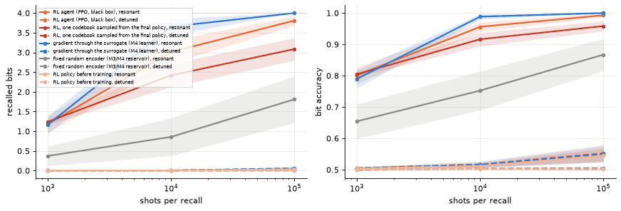
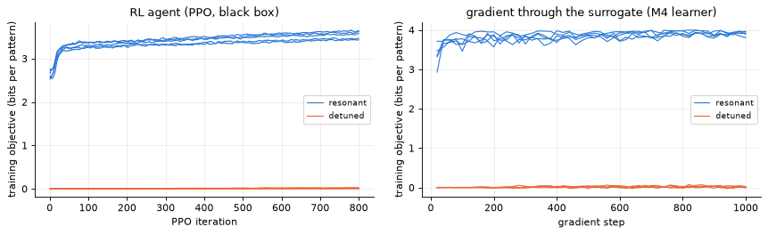
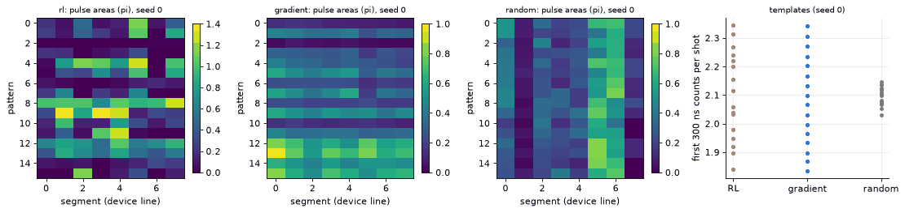
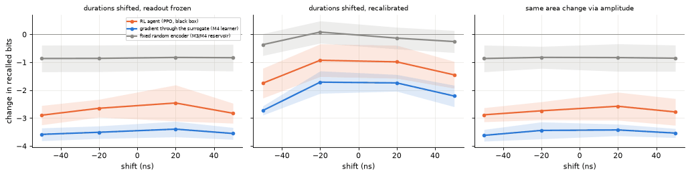

# Milestone 5, Task 2: an RL agent learns the write pulses of a bit pattern

**Task 2 with a learned write.** 4-bit patterns are written by 8 MW segments (one per device line, 100 ns slots), held for a 1000 ns dark delay and recalled from a 1000 ns time-resolved readout by the Bayes-optimal readout of the codebook. The write of every pattern is chosen by a PPO agent (gradient-free; its reward decodes with exact templates), by gradient through the differentiable surrogate, or fixed at random. Simulation only; no claim of quantum advantage: a gap only says that the performance depends on driving the spin resonance.

## Result

Recalled bits (of 4) at 10000 shots per recall, mean over 5 seeds [95 % t CI]:

| write | resonant | detuned | gap (resonant - detuned) | gap significant | bit accuracy, resonant | pattern information (bits), resonant |
| --- | --- | --- | --- | --- | --- | --- |
| RL agent (PPO, gradient-free) | 3.01 [2.72, 3.3] | 0.0053 [0.000965, 0.00964] | 3.01 [2.72, 3.3] | yes | 0.956 [0.941, 0.971] | 3.68 [3.57, 3.78] |
| RL, one codebook sampled from the final policy | 2.42 [2.13, 2.71] | 0.0038 [0.000991, 0.0066] | 2.42 [2.12, 2.71] | yes | 0.916 [0.895, 0.938] | 3.44 [3.3, 3.57] |
| gradient through the surrogate (M4 learner) | 3.65 [3.44, 3.86] | 0.00618 [0.0019, 0.0105] | 3.65 [3.44, 3.86] | yes | 0.988 [0.98, 0.997] | 3.91 [3.85, 3.96] |
| fixed random encoder (M3/M4 reservoir) | 0.856 [0.378, 1.33] | 0.000581 [4.17e-05, 0.00112] | 0.855 [0.377, 1.33] | yes | 0.752 [0.69, 0.815] | 2.17 [1.81, 2.53] |
| RL policy before training | 0.00293 [-9.26e-05, 0.00596] | 0.000271 [0.000164, 0.000379] | 0.00266 [-0.000334, 0.00566] | no | 0.512 [0.504, 0.52] | 0.00596 [0.000848, 0.0111] |

- Paired differences in recalled bits, resonant: RL - random 2.16 [1.62, 2.69]; gradient - RL 0.642 [0.346, 0.937]; RL - RL before training 3.01 [2.72, 3.3]; RL mean - RL sampled codebook 0.593 [0.26, 0.926].
- **Quantum test**: with every MW frequency shifted by 400 MHz (no line within 325 MHz of any segment's frequency range; the learners retrained there) the recalled bits are between 0.000271 and 0.00618; the gap is significant for 4 of 5 writes (rl, rl_sample, gradient, random).
- Timing: the RL agent's strategy uses microsecond-scale (Rabi-scale) timing: **yes** (details below).

## Interpretation

- **A gradient-free agent learns a good write.** PPO, seeing only the reward (bits recovered by the Bayes-optimal
  readout), reaches 3.01 [2.72, 3.30] recalled bits of 4 at 10000 shots: 3.5x the fixed random encoder of
  milestones 3-4 (RL - random 2.16 [1.62, 2.69] bits) and 82 % of the white-box write trained by gradient through
  the differentiable surrogate (3.65; gradient - RL 0.64 [0.35, 0.94] bits). Bit accuracy 0.956 vs 0.988
  (gradient) and 0.752 (random).
- **Where the gap to the gradient is.** At 1000 shots the agent ties the gradient (1.18 vs 1.17 bits); at 100000
  it is close (3.81 vs 4.00). The gap sits at the training budget of 10000 shots, where its templates are less
  separated (3.4 vs 4.4 Poisson standard deviations to the nearest other pattern). One codebook sampled from the
  final policy recalls 0.59 [0.26, 0.93] bits less than the policy mean: the Gaussian policy has not collapsed,
  and the mean write is the one reported as the agent's.
- **Timing: rotation angles and coherent phases.** The agent's write uses Rabi-scale pulse areas (median 0.39 pi
  per segment). Shifting every segment duration by 50 ns loses 2.86 [2.52, 3.20] bits with the readout frozen and
  1.60 [1.24, 1.96] with it recalibrated on the shifted write, so the information itself needs the timing; the
  same area change through the amplitude costs as much, so it is the rotation angle that matters. Scrambling the
  segment phases costs 1.92 bits frozen and 0.39 recalibrated: the write relies on coherent rotations between
  segments within T2*, like the gradient-trained one (which relies on both more strongly).
- **Quantum test.** Detuned by 400 MHz (no line within 325 MHz of any segment's frequency range; every learner
  retrained there), every write recalls < 0.01 bits; gaps RL 3.01 [2.72, 3.30], gradient 3.65 [3.44, 3.86],
  random 0.86 [0.38, 1.33] bits, all significant. The untrained policy recalls nothing in either condition.
- **Reference.** The seed-0 agent's 16 write sequences run on the QuTiP reference give templates within 6.8e-4 of
  the spread between patterns and the same recall (2.982 bits on both).

## Assumptions and limits

- One static field per run (eight lines), nuisance drawn per seed and known to the readout (calibrated device);
  4-bit patterns, 1 us storage delay.
- The task is a one-step contextual bandit (context = the bit pattern): PPO's advantage estimation is trivial here;
  the agent is a gradient-free optimiser of the same objective the gradient learner uses.
- The agent is gradient-free, not model-free in its reward: each sampled write's readout templates are its exact
  noiseless means from the simulator (`CodebookEnv.step`: the recalls are drawn from those means and decoded with
  them), so calibrating the templates of every candidate write is assumed free. On hardware each candidate would
  first need its templates estimated from noisy calibration shots; that cost is not counted here.
- Training uses 8 T2* quadrature nodes, evaluation 32 (the reference check confirms the evaluated templates).
- PPO budget: 800 iterations x 16 codebooks per seed and condition (63 of 94 min wall time).

## Recall vs shots

Recalled bits, resonant / detuned, mean [95 % t CI]:

| shots | RL agent (PPO, gradient-free) | RL, one codebook sampled from the final policy | gradient through the surrogate (M4 learner) | fixed random encoder (M3/M4 reservoir) | RL policy before training |
| --- | --- | --- | --- | --- | --- |
| 1000 | 1.18 [0.969, 1.39] / 0.00106 [0.000226, 0.00189] | 1.24 [1.17, 1.31] / 0.000932 [0.00017, 0.00169] | 1.17 [0.936, 1.4] / 0.000886 [0.000212, 0.00156] | 0.373 [0.125, 0.621] / 0.000118 [-3.74e-05, 0.000273] | 0.000736 [-0.000171, 0.00164] / 0.000211 [-5.23e-05, 0.000474] |
| 10000 | 3.01 [2.72, 3.3] / 0.0053 [0.000965, 0.00964] | 2.42 [2.13, 2.71] / 0.0038 [0.000991, 0.0066] | 3.65 [3.44, 3.86] / 0.00618 [0.0019, 0.0105] | 0.856 [0.378, 1.33] / 0.000581 [4.17e-05, 0.00112] | 0.00293 [-9.26e-05, 0.00596] / 0.000271 [0.000164, 0.000379] |
| 100000 | 3.81 [3.69, 3.93] / 0.052 [0.00468, 0.0993] | 3.08 [2.8, 3.37] / 0.0402 [0.00172, 0.0787] | 4 [4, 4] / 0.0572 [0.0176, 0.0967] | 1.81 [1.22, 2.4] / 0.000752 [-4.46e-05, 0.00155] | 0.0359 [0.00268, 0.0691] / 0.000216 [-4.47e-05, 0.000477] |

Template separation at 10000 shots (median distance to the nearest other pattern in Poisson standard deviations, resonant): rl 3.37 [2.81, 3.93]; rl_sample 2.47 [1.41, 3.53]; gradient 4.41 [4, 4.82]; random 0.474 [0.133, 0.814]; rl_init 0.0073 [0.00207, 0.0125].

## Timing

Change in recalled bits at the largest shift (+-50 ns, mean of both signs) [t CI over seeds]: durations shifted with the readout calibrated on the unshifted write (frozen), recalibrated on the shifted write, the same area change through the amplitude (frozen), and every segment phase scrambled; 'bits' is the unperturbed recall:

| write | bits | frozen | recalibrated | equal area (frozen) | equal area (recal.) | phases scrambled (frozen) | phases scrambled (recal.) | median area (pi) | areas in (pi/4, 4 pi) |
| --- | --- | --- | --- | --- | --- | --- | --- | --- | --- |
| RL agent (PPO, gradient-free) | 3.01 | -2.86 [-3.20, -2.52] | -1.60 [-1.96, -1.24] | -2.83 [-3.19, -2.47] | -1.71 [-2.35, -1.06] | -1.92 [-2.46, -1.38] | -0.39 [-0.62, -0.16] | 0.39 [0.32, 0.45] | 0.60 [0.56, 0.64] |
| gradient through the surrogate (M4 learner) | 3.66 | -3.57 [-3.78, -3.35] | -2.47 [-2.73, -2.21] | -3.58 [-3.76, -3.39] | -2.77 [-3.11, -2.43] | -2.59 [-3.03, -2.15] | -1.37 [-1.87, -0.88] | 0.36 [0.35, 0.37] | 0.66 [0.64, 0.67] |
| fixed random encoder (M3/M4 reservoir) | 0.865 | -0.85 [-1.33, -0.37] | -0.31 [-0.70, +0.08] | -0.86 [-1.33, -0.38] | -0.34 [-0.73, +0.05] | -0.60 [-0.92, -0.28] | +0.04 [-0.31, +0.38] | 0.33 [0.19, 0.46] | 0.66 [0.45, 0.88] |

- RL agent (PPO, gradient-free): relies on its pulse timing (frozen, > 10 % fewer bits, CI): yes; the information needs it (recalibrated still > 10 % fewer): yes; the equal-area control costs at least half as much (pulse area, not timing as such): yes (recalibrated: yes); coherent phases matter (frozen, scrambled): yes.
- gradient through the surrogate (M4 learner): relies on its pulse timing (frozen, > 10 % fewer bits, CI): yes; the information needs it (recalibrated still > 10 % fewer): yes; the equal-area control costs at least half as much (pulse area, not timing as such): yes (recalibrated: yes); coherent phases matter (frozen, scrambled): yes.
- `strategy_learns_timing` (RL relies on its pulse timing, Rabi-scale areas) = **True**.

## Reference check

- The seed-0 RL codebook (16 patterns) as full PulseSequences on the QuTiP reference: templates within 3.3e-05 counts per shot (0.00068 of the spread between patterns); recalled bits at 10000 shots: reference 2.982, surrogate 2.982, reference recalls decoded with the surrogate calibration 2.989 (24 s).

## Quantum test

| metric | resonant | detuned | gap (better on resonance > 0) | per seed (resonant / detuned) |
| --- | --- | --- | --- | --- |
| rl_bits | 3.012 [2.724, 3.3] | 0.005305 [0.0009651, 0.009644] | 3.007 [2.716, 3.298] | 2.987, 2.937, 3.401, 2.958, 2.777; 0.002581, 0.008694, 0.001361, 0.009068, 0.004819 |
| rl_sample_bits | 2.419 [2.126, 2.712] | 0.003797 [0.0009905, 0.006604] | 2.415 [2.123, 2.708] | 2.051, 2.342, 2.63, 2.603, 2.47; 0.002018, 0.006921, 0.001732, 0.005379, 0.002936 |
| gradient_bits | 3.654 [3.444, 3.864] | 0.00618 [0.001905, 0.01046] | 3.647 [3.438, 3.856] | 3.408, 3.835, 3.758, 3.703, 3.564; 0.002396, 0.007815, 0.0026, 0.008268, 0.009821 |
| random_bits | 0.856 [0.3776, 1.334] | 0.0005815 [4.171e-05, 0.001121] | 0.8555 [0.3766, 1.334] | 0.4394, 0.7236, 0.9102, 1.476, 0.7311; 0.0007704, 0.001192, 0.0003716, 3.225e-05, 0.000541 |
| rl_init_bits | 0.002934 [-9.263e-05, 0.00596] | 0.0002714 [0.0001642, 0.0003786] | 0.002662 [-0.0003339, 0.005658] | 0.0003672, 0.0059, 0.001798, 0.001456, 0.005147; 0.0002735, 0.0002107, 0.0002107, 0.0002434, 0.0004185 |
| rl_bitacc | 0.956 [0.9412, 0.9709] | 0.5169 [0.5075, 0.5263] | 0.4391 [0.4165, 0.4618] | 0.9548, 0.9505, 0.9756, 0.9557, 0.9435; 0.5113, 0.5236, 0.5067, 0.5234, 0.5195 |
| rl_sample_bitacc | 0.9164 [0.895, 0.9378] | 0.5151 [0.5091, 0.521] | 0.4013 [0.3814, 0.4212] | 0.8894, 0.9106, 0.9295, 0.9318, 0.9205; 0.5092, 0.5213, 0.5119, 0.5179, 0.515 |
| gradient_bitacc | 0.9885 [0.98, 0.9969] | 0.5164 [0.5064, 0.5264] | 0.4721 [0.4644, 0.4797] | 0.9785, 0.9955, 0.9927, 0.9908, 0.9848; 0.5041, 0.5233, 0.5123, 0.5209, 0.5212 |
| random_bitacc | 0.7524 [0.6901, 0.8148] | 0.5037 [0.4999, 0.5074] | 0.2488 [0.1836, 0.3139] | 0.6914, 0.7375, 0.7577, 0.8302, 0.7455; 0.5057, 0.5078, 0.5025, 0.5002, 0.5021 |
| rl_init_bitacc | 0.5121 [0.5039, 0.5203] | 0.5023 [0.4996, 0.5051] | 0.009735 [0.0006598, 0.01881] | 0.5032, 0.5175, 0.5108, 0.5093, 0.5195; 0.5042, 0.4997, 0.5006, 0.5024, 0.5048 |
| rl_info | 3.675 [3.572, 3.779] | 0.01264 [0.001003, 0.02427] | 3.662 [3.56, 3.765] | 3.616, 3.72, 3.741, 3.74, 3.558; 0.00433, 0.02729, 0.004536, 0.0132, 0.01382 |
| rl_sample_info | 3.437 [3.302, 3.572] | 0.009663 [0.0002253, 0.0191] | 3.428 [3.293, 3.562] | 3.303, 3.459, 3.601, 3.392, 3.432; 0.003672, 0.02233, 0.004221, 0.01054, 0.007555 |
| gradient_info | 3.906 [3.851, 3.961] | 0.01288 [0.003877, 0.02189] | 3.893 [3.839, 3.947] | 3.858, 3.956, 3.938, 3.916, 3.861; 0.003564, 0.01974, 0.007441, 0.01403, 0.01963 |
| random_info | 2.169 [1.809, 2.529] | 0.0003152 [3.4e-06, 0.000627] | 2.169 [1.808, 2.529] | 1.929, 2.033, 2.077, 2.67, 2.136; 0.0002997, 0.0006764, 0.000207, -5.595e-06, 0.0003985 |
| rl_init_info | 0.005965 [0.0008476, 0.01108] | -6.27e-06 [-2.713e-05, 1.459e-05] | 0.005971 [0.0008465, 0.0111] | 0.002768, 0.01228, 0.002489, 0.004451, 0.007841; -1.594e-05, -2.739e-05, 4.762e-06, -8.064e-06, 1.528e-05 |

## Setup

- Device per seed: the static field (1.2, 0.7, 2.5) mT (eight lines), nuisance drawn from the milestone-2 ranges, calibrated. Shot: init 1500 ns, dark 1000 ns, the write block, the delay, the readout in 100 ns windows. Segment parameters: amplitude [0, 1], phase, frequency within +-4 MHz of its line, duration [0, 100] ns on the grid.
- RL: PPO, 800 iterations x 16 codebooks (16 x 16 one-step episodes), 8 noise draws per reward, lr 0.003, 8 epochs x 4 minibatches, clip 0.2, Gaussian policy over the 32 pre-activations (initial std 1), MLP [64, 64]; trained at 10000 shots with 8 T2* nodes.
- Gradient: 1000 Adam steps (lr 0.003, cosine) on the same objective with reparametrised Gaussian shot noise (8 draws), encoder MLP [64, 64]; random: gain 1.5.
- Evaluation: templates at 32 T2* nodes, 512 Poisson recalls per pattern, bitwise MAP. Wall time: RL 62.7 min, gradient 30.9 min, evaluation 0.1 min, probes 0.1 min.









## Provenance

- run id: `20261127-164330-m5-rl-bit-write-76b3`
- git: `8c9495867763bbfc14bcb9232195d608b3726029`
- seed: 20261130
- device: cuda NVIDIA GeForce RTX 5070 Ti
- python 3.12.14, glowbox 0.1.0, torch 2.11.0+cu128, qutip 5.3.1, numpy 2.5.5, scipy 1.18.1, pyarrow 26.0.1
- started 2026-11-27T16:43:31+00:00, finished 2026-11-27T18:17:54+00:00

## Config

```yaml
detuned_offset_hz: 400000000.0
device:
  bias_field_t:
  - 0.0012
  - 0.0007
  - 0.0025
  eval_n_detuning: 32
  n_detuning: 8
  prior:
    background_cps:
    - 5000.0
    - 20000.0
    collection_efficiency:
    - 0.002
    - 0.004
    e_hz:
    - 0.0
    - 300000.0
    optical_beta_full_scale:
    - 0.07
    - 0.13
    rabi_full_scale_hz:
    - 8000000.0
    - 12000000.0
    t2_star_s:
    - 5.0e-07
    - 2.0e-06
gradient:
  hidden:
  - 64
  - 64
  lr: 0.003
  n_noise: 8
  out_scale: 1.0
  steps: 1000
layout:
  amp_hi: 1.0
  amp_lo: 0.0
  delay_ns: 1000
  gate_ns: 0
  max_ns: 100.0
  min_ns: 0.0
  n_segments: 8
  readout_ns: 1000
  slot_ns: 100
  span_hz: 4000000.0
  window_ns: 100
name: m5-rl-bit-write
random:
  gain: 1.5
  hidden:
  - 64
  - 64
reference:
  workers: 16
rl:
  clip: 0.2
  codebooks: 16
  ent_coef: 0.0
  epochs: 8
  hidden:
  - 64
  - 64
  init_log_std: 0.0
  iterations: 800
  lr: 0.003
  minibatches: 4
  n_noise: 8
  target_kl: 0.0
seed: 20261130
seeds:
- 0
- 1
- 2
- 3
- 4
system:
  init_ns: 1500
  settle_ns: 1000
task:
  draws_per_pattern: 512
  eval_shots:
  - 1000
  - 10000
  - 100000
  headline_shots: 10000
  n_bits: 4
  train_shots: 10000
timing:
  shifts_ns:
  - -50
  - -20
  - 20
  - 50
```

## Final metrics

| metric | value |
| --- | --- |
| rl_bits_resonant | 3.01199 |
| rl_bits_detuned | 0.00530455 |
| rl_gap | 3.00668 |
| rl_gap_lo | 2.71584 |
| rl_gap_hi | 3.29752 |
| rl_sample_bits_resonant | 2.41916 |
| rl_sample_bits_detuned | 0.0037971 |
| rl_sample_gap | 2.41537 |
| rl_sample_gap_lo | 2.12291 |
| rl_sample_gap_hi | 2.70783 |
| gradient_bits_resonant | 3.6536 |
| gradient_bits_detuned | 0.00618003 |
| gradient_gap | 3.64742 |
| gradient_gap_lo | 3.43844 |
| gradient_gap_hi | 3.8564 |
| random_bits_resonant | 0.856043 |
| random_bits_detuned | 0.000581457 |
| random_gap | 0.855461 |
| random_gap_lo | 0.376635 |
| random_gap_hi | 1.33429 |
| rl_init_bits_resonant | 0.00293354 |
| rl_init_bits_detuned | 0.000271383 |
| rl_init_gap | 0.00266216 |
| rl_init_gap_lo | -0.000333862 |
| rl_init_gap_hi | 0.00565817 |
| strategy_learns_timing | 1 |
| ref_bits | 2.9824 |
| wall_seconds | 5663.27 |
