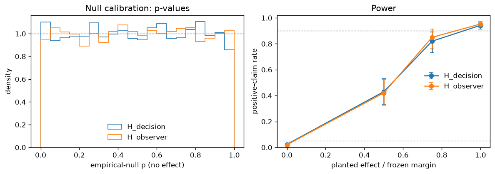

# PREREG-001 null calibration and positive control (stage S)

Stage-S validation of the PREREG-001 pipeline (docs/preregistration/PREREG-001-observer-decision.md). The simulator has no decision or observer effect by construction: these numbers say whether the frozen procedure keeps its false-positive rate and has its planned power, nothing about the hypotheses. Status of the plan: DRAFT (not signed off, not locked).

Every replicate is a complete simulated experiment: offline sequences, a calibration block of 200 valid blocks (seven sealed control arms, slot for slot like a confirmatory block), the frozen calibration (empirical null, margins, theta0_D set, model check), a confirmatory run of N = 400 valid blocks x 7 arms in a random order per block, sealing of every outcome, decoys from the frozen model, the arm-revealing fields sealed with the blinding key, the locked reduction to the episode table, the frozen blinded analysis (2000 null draws per test), unblinding, the complete decision rule. T = 100 steps x S = 400 shots per episode; 4 true fields cycled over replicates; slow laser and contrast drift (OU over episode slots), per-step laser jitter. Decision process: the stand-in threshold rule (see the script).

## Frozen quantities (nominal condition; median over the null replicates, each replicate freezes its own)

- Margin rule (section 5): Delta = Q_{1-alpha/2}(|D|) + Q_{2 MARGIN_POWER - 1}(|D|), D the control-vs-control null of the mean of N = 400 pairs (the shift detected with power 0.975 at Holm's first level; MARGIN_POWER = 1 - alpha_eq).
- Margin, lag 0 (H_observer): 0.001361 [IQR 0.001281-0.001436]; lag 1 (H_decision): 0.001364 [IQR 0.001287-0.001445], in units of the referenced fluorescence r = N_sig / N_ref.
- Control-vs-control SD of the mean of N pairs (lag 0): 0.0003239 [IQR 0.0003055-0.0003421]; margin / SD: 4.19.
- Spin signal of the replayed sequences, C_ref = mean(r_detuned - r_resonant): 0.03109; margin / C_ref: 0.043 (lag 0), 0.043 (lag 1).
- theta0_D set (model runs, phase `model`, per model and per true field: the model of a run is the model of its sample; the plan requires every SE <= margin / 10 = 0.000136):
  - nominal (nominal; 500 runs): theta0_D per field -1.23e-05 +- 3.2e-05, 3.74e-05 +- 2.7e-05, -1.34e-05 +- 3.2e-05, 4.6e-06 +- 2.7e-05; predicted wcorr per field -0.0101, -0.00983, -0.00986, -0.00981.
  - within_drift ({'within_sigma': 0.3, 'within_rho': 0.9}; 500 runs): theta0_D per field -0.00044 +- 3.7e-05, -0.000498 +- 4.6e-05, -0.000515 +- 3.8e-05, -0.000672 +- 4.4e-05; predicted wcorr per field 0.0154, 0.0486, 0.0294, 0.0626.
  - within_noselect ({'within_sigma': 0.3, 'within_rho': 0.9, 'decision': 'offline'}; 500 runs): theta0_D per field 7.27e-05 +- 3.7e-05, 3.88e-05 +- 4.3e-05, -2.41e-05 +- 4.2e-05, -8.56e-05 +- 4.6e-05; predicted wcorr per field 0.0161, 0.0496, 0.03, 0.0652.

## Pass criteria (plan section 12)

Each criterion is a rule on the Clopper-Pearson 95 % interval of a rate. The decisive error rate (the nominal primary family) passes when the upper bound is at most 0.06 at the documented full size (R = 4000 nominal, 1000 per stress condition): a rule that can show the test is calibrated; below the full size it is PENDING. Descriptive error rates pass when the interval is not above their level (lower bound <= level), coverage, power and claim rates when it is not below their target (upper bound >= target).

| criterion | rate [95 % interval] | rule | result |
| --- | --- | --- | --- |
| nominal: primary family, any positive claim (complete rule) [decisive] | 0.039 [0.033, 0.046] (n = 4000) | upper bound <= 0.06 at the full size | PASS |
| nominal: H_decision, p <= 0.05 against the calibration null | 0.054 [0.048, 0.062] (n = 4000) | not above 0.05 | PASS |
| nominal: H_observer, p <= 0.05 against the calibration null | 0.047 [0.041, 0.054] (n = 4000) | not above 0.05 | PASS |
| nominal: primary family, any positive claim (complete rule) | 0.039 [0.033, 0.046] (n = 4000) | not above 0.05 | PASS |
| nominal: secondary family S2-S3, any rejection (complete rule) | 0.033 [0.027, 0.038] (n = 4000) | not above 0.05 | PASS |
| nominal: H_decision 95 % interval covers 0 (runs with an interval) | 0.945 [0.937, 0.952] (n = 3960) | not below 0.95 | PASS |
| nominal: H_observer 95 % interval covers 0 (runs with an interval) | 0.952 [0.945, 0.958] (n = 4000) | not below 0.95 | PASS |
| nominal: H_decision null claim | 0.904 [0.895, 0.913] (n = 4000) | not below 0.9 | PASS |
| nominal: H_observer null claim | 0.921 [0.912, 0.929] (n = 4000) | not below 0.9 | PASS |
| nominal: null-stability check flags the run | 0.055 [0.048, 0.063] (n = 4000) | not above 0.05 | PASS |
| nominal: manipulation check S4 passes | 1.000 [0.999, 1.000] (n = 4000) | not below 0.95 | PASS |
| nominal: arm names absent from every blinded output | 1.000 [0.999, 1.000] (n = 4000) | not below 1 | PASS |
| positive decision, 1 x margin: power of the complete rule | 0.943 [0.915, 0.963] (n = 400) | not below 0.9 | PASS |
| positive decision, 1 x margin: attributed | 0.912 [0.880, 0.938] (n = 400) | not below 0.9 | PASS |
| positive decision, 1 x margin: not equivalent | 0.970 [0.948, 0.984] (n = 400) | not below 0.9 | PASS |
| positive observer, 1 x margin: power of the complete rule | 0.953 [0.927, 0.971] (n = 400) | not below 0.9 | PASS |
| positive observer, 1 x margin: attributed | 0.917 [0.886, 0.943] (n = 400) | not below 0.9 | PASS |
| positive observer, 1 x margin: not equivalent | 0.970 [0.948, 0.984] (n = 400) | not below 0.9 | PASS |
| drift_covered: primary family, any positive claim | 0.048 [0.036, 0.063] (n = 1000) | not above 0.05 | PASS |
| drift_unmodelled: primary family, any positive claim | 0.014 [0.008, 0.023] (n = 1000) | not above 0.05 | PASS |
| nonstationary: primary family, any positive claim | 0.042 [0.030, 0.056] (n = 1000) | not above 0.05 | PASS |
| drift_wrong_member: primary family, any positive claim | 0.018 [0.011, 0.028] (n = 1000) | not above 0.05 | PASS |
| nonstationary, decision effect = 1 x margin: false null claim | 0.010 [0.002, 0.029] (n = 300) | not above 0.025 | PASS |
| nonstationary, observer effect = 1 x margin: false null claim | 0.010 [0.002, 0.029] (n = 300) | not above 0.025 | PASS |
| engineering test, null, normal, two-sided: rejection rate | 0.049 [0.040, 0.059] (n = 2000) | not above 0.05 | PASS |
| engineering test, null, t3, two-sided: rejection rate | 0.051 [0.042, 0.062] (n = 2000) | not above 0.05 | PASS |
| engineering test, null, normal, one-sided: rejection rate | 0.046 [0.037, 0.056] (n = 2000) | not above 0.05 | PASS |
| engineering test, effect = margin, normal, two-sided: power | 0.969 [0.960, 0.976] (n = 2000) | not below 0.9 | PASS |
| engineering test, effect = margin, normal, one-sided: power | 0.967 [0.958, 0.974] (n = 2000) | not below 0.9 | PASS |

All criteria: PASS.

## Null calibration (no effect), nominal condition

| quantity | H_decision | H_observer |
| --- | --- | --- |
| positive claim (complete rule) | 0.024 [0.019, 0.029] (n = 4000) | 0.020 [0.016, 0.025] (n = 4000) |
| Holm rejection against the calibration null alone | 0.033 [0.028, 0.039] (n = 4000) | 0.028 [0.023, 0.034] (n = 4000) |
| p <= 0.05 against the calibration null (uncorrected) | 0.054 [0.048, 0.062] (n = 4000) | 0.047 [0.041, 0.054] (n = 4000) |
| TOST equivalent at the frozen margin | 0.969 [0.963, 0.974] (n = 4000) | 0.974 [0.968, 0.978] (n = 4000) |
| null claim (equivalent, stable null; H_decision: model check) | 0.904 [0.895, 0.913] (n = 4000) | 0.921 [0.912, 0.929] (n = 4000) |
| 95 % interval covers 0 (runs with an interval) | 0.945 [0.937, 0.952] (n = 3960) | 0.952 [0.945, 0.958] (n = 4000) |
| Newey-West check, p <= 0.05 | 0.056 [0.049, 0.063] (n = 4000) | 0.049 [0.042, 0.056] (n = 4000) |

- Model check: the calibration block inside some member's range 0.996 [0.993, 0.998] (n = 4000), the confirmatory sealed controls 0.994 [0.991, 0.996] (n = 4000), one member consistent with both (an interval and a decision for H_decision) 0.990 [0.986, 0.993] (n = 4000).
- Manipulation check S4 (the detuned arm loses the task): passes in 1.000 [0.999, 1.000] (n = 4000).
- Secondary family (S2, S3: decision cells at every consistent member's theta0_D of their statistic, every cell against the calibration and the concurrent null): any rejection 0.033 [0.027, 0.038] (n = 4000); against the calibration null alone 0.054 [0.047, 0.062] (n = 4000).

## Stress conditions (no effect)

| condition | what differs | model set | positive claim, H_decision | positive claim, H_observer | H_decision p <= 0.05 (calibration null alone) | H_observer p <= 0.05 (calibration null alone) | model check passed (a member reproduces both blocks) | null stable |
| --- | --- | --- | --- | --- | --- | --- | --- | --- |
| drift_covered | within-episode contrast drift (sd 0.3, rho 0.9 per step), in the model set | within_drift | 0.027 [0.018, 0.039] (n = 1000) | 0.028 [0.019, 0.040] (n = 1000) | 0.044 [0.032, 0.059] (n = 1000) | 0.057 [0.043, 0.073] (n = 1000) | 0.990 [0.982, 0.995] (n = 1000) | 0.956 [0.941, 0.968] (n = 1000) |
| drift_unmodelled | the same drift, missing from the model set | nominal | 0.000 [0.000, 0.004] (n = 1000) | 0.014 [0.008, 0.023] (n = 1000) | 0.000 [0.000, 0.004] (n = 1000) | 0.043 [0.031, 0.057] (n = 1000) | 0.000 [0.000, 0.004] (n = 1000) | 0.935 [0.918, 0.949] (n = 1000) |
| nonstationary | confirmatory drift 3x larger and 3x faster than in the calibration block | nominal | 0.022 [0.014, 0.033] (n = 1000) | 0.029 [0.020, 0.041] (n = 1000) | 0.065 [0.051, 0.082] (n = 1000) | 0.066 [0.051, 0.083] (n = 1000) | 0.979 [0.968, 0.987] (n = 1000) | 0.722 [0.693, 0.750] (n = 1000) |
| drift_wrong_member | within-episode drift; the set holds the right member and a wcorr-matched member with theta0_D = 0 | within_drift, within_noselect | 0.008 [0.003, 0.016] (n = 1000) | 0.013 [0.007, 0.022] (n = 1000) | 0.022 [0.014, 0.033] (n = 1000) | 0.037 [0.026, 0.051] (n = 1000) | 0.995 [0.988, 0.998] (n = 1000) | 0.959 [0.945, 0.970] (n = 1000) |
| drift_only_wrong_member | within-episode drift; the set holds the wcorr-matched wrong member and a refuted one (no criterion) | nominal, within_noselect | 0.113 [0.094, 0.134] (n = 1000) | 0.022 [0.014, 0.033] (n = 1000) | 0.191 [0.167, 0.217] (n = 1000) | 0.048 [0.036, 0.063] (n = 1000) | 0.988 [0.979, 0.994] (n = 1000) | 0.941 [0.925, 0.955] (n = 1000) |

Nonstationary confirmatory run with an effect of exactly the frozen margin (null claims under nonstationarity: a null claim here is a false equivalence):

| planted | positive claim | false null claim | stability check flags the run |
| --- | --- | --- | --- |
| decision | 0.903 [0.864, 0.934] (n = 300) | 0.010 [0.002, 0.029] (n = 300) | 0.280 [0.230, 0.334] (n = 300) |
| observer | 0.963 [0.935, 0.982] (n = 300) | 0.010 [0.002, 0.029] (n = 300) | 0.330 [0.277, 0.386] (n = 300) |

## Positive control (effect planted in the simulated device)

Decision: E[r] of the decision arm A1 shifted by the size. Observer: E[r] of every observed arm (A1, A2, A4, A5) shifted, the sealed arms not. Size = the replicate's own frozen margin, or a fraction of it (power curve: no pass criterion).

| planted | size | power (complete rule) | attributed (planted rejected, other not) | not equivalent |
| --- | --- | --- | --- | --- |
| decision | 1 x margin | 0.943 [0.915, 0.963] (n = 400) | 0.912 [0.880, 0.938] (n = 400) | 0.970 [0.948, 0.984] (n = 400) |
| decision | 0.5 x margin | 0.430 [0.331, 0.533] (n = 100) | 0.410 [0.313, 0.513] (n = 100) | 0.510 [0.408, 0.611] (n = 100) |
| decision | 0.75 x margin | 0.820 [0.731, 0.890] (n = 100) | 0.810 [0.719, 0.882] (n = 100) | 0.840 [0.753, 0.906] (n = 100) |
| observer | 1 x margin | 0.953 [0.927, 0.971] (n = 400) | 0.917 [0.886, 0.943] (n = 400) | 0.970 [0.948, 0.984] (n = 400) |
| observer | 0.5 x margin | 0.420 [0.322, 0.523] (n = 100) | 0.420 [0.322, 0.523] (n = 100) | 0.450 [0.350, 0.553] (n = 100) |
| observer | 0.75 x margin | 0.850 [0.765, 0.914] (n = 100) | 0.830 [0.742, 0.898] (n = 100) | 0.850 [0.765, 0.914] (n = 100) |

## Engineering comparisons (M7 E-1 / E-2, E5): `paired_margin_test` at its fixed sizes (20 pairs, 20 control repeats)

| condition | rejection rate | TOST equivalent | median margin (units of the diff SD) |
| --- | --- | --- | --- |
| null, normal, two-sided | 0.049 [0.040, 0.059] (n = 2000) | 0.938 [0.926, 0.948] (n = 2000) | 1.31 |
| null, t3, two-sided | 0.051 [0.042, 0.062] (n = 2000) | 0.864 [0.848, 0.879] (n = 2000) | 1.88 |
| null, normal, one-sided | 0.046 [0.037, 0.056] (n = 2000) | 0.900 [0.887, 0.913] (n = 2000) | 1.2 |
| effect = margin, normal, two-sided | 0.969 [0.960, 0.976] (n = 2000) | 0.024 [0.018, 0.032] (n = 2000) | 1.29 |
| effect = margin, normal, one-sided | 0.967 [0.958, 0.974] (n = 2000) | 0.026 [0.020, 0.035] (n = 2000) | 1.18 |

## Reading

- The margin is derived from the control runs by a fixed rule: the effect that the planned experiment detects against the control-vs-control distribution with power 0.975 at Holm's first level (1 - alpha_eq: the positive test and the equivalence test are dual at the margin). Version 1 used the 0.95 quantile of a single control pair (about 40 % of the spin signal, equivalence trivially easy); version 2 used power 0.95, which left the null claims below their 0.90 target.
- No decision uses the calibration null alone: a positive claim needs the concurrent null too, and the decisive criterion is on the complete rule. The uncorrected rates of the calibration null alone are descriptive (the null-calibration table above).
- A positive claim needs a Holm rejection against the frozen calibration controls and against the run's own sealed controls; the nonstationary condition shows why (the calibration null alone is too narrow when the confirmatory run drifts more).
- H_decision depends on a model of the selection effect. In the drift_unmodelled condition (within-episode drift missing from the model set) the model check refuses H_decision: no member reproduces the sealed controls, so H_decision is never tested at the wrong centre (theta0_D = 0 while the unmodelled drift moves the decision cell; the calibration-null column is gated by the same check). In drift_covered the same drift is in the model set: theta0_D is non-zero and the worst-case test keeps its level.
- The model rule: members whose wcorr envelope excludes the sealed controls of the calibration block or of the confirmatory run are dropped, and the worst case is taken over the rest. drift_wrong_member adds a member whose drift matches the device (wcorr) but whose selection effect is wrong (its decision arm cannot select: theta0_D = 0); with the right member also in the set, the worst case keeps the level. drift_only_wrong_member (no criterion) shows the limit of any model check on wcorr: when the set holds only the wrong member and one the controls refute, H_decision is tested at a wrong centre. The set must contain the true selection effect; that is why it is locked with the plan and reviewed before sign-off.
- The Newey-West robustness check (not decisive): p <= 0.05 in the nominal null 0.056 [0.049, 0.063] (n = 4000) (H_decision), 0.049 [0.042, 0.056] (n = 4000) (H_observer).
- Sizes: N = 400 confirmatory blocks (the owner's decision of 2026-11-27, was 100: the margin halves), M_CAL = 200 calibration blocks. M_CAL is not scaled with N: the calibration estimates the spread of one control pair, so the precision of the critical values and of the margin depends on M_CAL, not on N; the null of the N-pair mean is the block bootstrap of the M_CAL series. The model runs per member are not scaled either: theta0_D's Monte Carlo SE and the margin both fall as 1 / sqrt(N).
- The bootstrap block length is the larger of the Newey-West rule and twice the integrated correlation time of the calibration series (Politis-White flat-top window). In this simulation the control pairs are uncorrelated (the slow drift cancels within a block), so it stays at the Newey-West rule: median 4 (lag 0).
- One sealing key and one meta-sealing key per batch of replicates instead of per replicate (speed); every outcome is still sealed and unsealed through the same code. Blinding keys and order seeds are per replicate.
- The stand-in decision process is not the M5 policy, and theta0_D depends on the policy: the M5 policy as a Controller (glowbox.analysis.arms) is M7's adapter, with its own model runs and this validation repeated.

Run sizes here (CPU): nominal 4000, drift_covered 1000, drift_unmodelled 1000, nonstationary 1000, drift_wrong_member 1000, drift_only_wrong_member 1000 null replicates; positive 400 per hypothesis; curve 100 per fraction; 500 model runs per model; engineering 2000 per condition. The documented full size (several hours on this CPU; any machine, no GPU needed):

    uv run python -m glowbox.experiments.prereg_calibration --replicates 4000 --stress-replicates 1000

Wall time here: 282.0 min on a CPU.



## Provenance

- run id: `20261127-164343-prereg-001-calibration-4650`
- git: `87fdd59333e1bfe512d3f572d2f0a54f5d149dd8`
- seed: 20261127
- device: cpu
- python 3.12.3, glowbox 0.1.0, torch 2.11.0+cu128, qutip 5.3.1, numpy 2.5.5, scipy 1.18.1, pyarrow 26.0.1
- started 2026-11-27T16:43:43+00:00, finished 2026-11-27T21:09:24+00:00

## Config

```yaml
conditions:
  drift_covered:
    description: within-episode contrast drift (sd 0.3, rho 0.9 per step), in the
      model set
    device:
      within_rho: 0.9
      within_sigma: 0.3
    models:
    - within_drift
  drift_only_wrong_member:
    description: within-episode drift; the set holds the wcorr-matched wrong member
      and a refuted one (no criterion)
    device:
      within_rho: 0.9
      within_sigma: 0.3
    models:
    - nominal
    - within_noselect
  drift_unmodelled:
    description: the same drift, missing from the model set
    device:
      within_rho: 0.9
      within_sigma: 0.3
    models:
    - nominal
  drift_wrong_member:
    description: within-episode drift; the set holds the right member and a wcorr-matched
      member with theta0_D = 0
    device:
      within_rho: 0.9
      within_sigma: 0.3
    models:
    - within_drift
    - within_noselect
  nominal:
    description: device = the nominal model
    models:
    - nominal
  nonstationary:
    confirmatory:
      contrast_rel_sigma: 0.15
      contrast_tau_slots: 23.3
      laser_rel_sigma: 0.06
      laser_tau_slots: 6.67
    description: confirmatory drift 3x larger and 3x faster than in the calibration
      block
    models:
    - nominal
controller:
  coarse_step: 4
  fine_step: 1
  threshold_below_baseline: 0.03
detuned_offset_hz: 400000000.0
field_pool: 4
measurement:
  amplitude: 0.6
  durations_ns:
  - 100
  f_start_hz: 2770000000.0
  f_stop_hz: 2970000000.0
  init_ns: 1500
  settle_ns: 3000
  step_hz: 2000000.0
  windows_ns:
  - 300
  - 1700
  - 300
models:
  nominal: {}
  within_drift:
    within_rho: 0.9
    within_sigma: 0.3
  within_noselect:
    decision: offline
    within_rho: 0.9
    within_sigma: 0.3
name: prereg-001-calibration
nuisance:
  contrast_rel_sigma: 0.05
  contrast_tau_slots: 70
  laser_jitter_rel: 0.01
  laser_rel_sigma: 0.02
  laser_tau_slots: 20
  within_rho: 0.0
  within_sigma: 0.0
numerics:
  detuning_rule: uniform
  detuning_spacing: 2.0
  n_detuning: 8
prior:
  b_max_t: 0.003
  b_min_t: 0.0005
protocol:
  n_steps: 100
  shots: 400
replicates:
  batch: 500
  curve: 100
  curve_fractions:
  - 0.5
  - 0.75
  engineering: 2000
  model_runs: 500
  n_boot: 2000
  null_runs: 4000
  positive: 400
  stress_positive: 300
  stress_runs: 1000
  workers: 8
seed: 20261127
```

## Final metrics

| metric | value |
| --- | --- |
| fwer_primary_nominal | 0.03925 |
| margin_lag0_median | 0.00136103 |
| margin_lag1_median | 0.00136365 |
| margin_over_c_ref_lag0 | 0.0429131 |
| criteria_passed | 29 |
| criteria_total | 29 |
| power_decision_1 | 0.9425 |
| power_decision_0.5 | 0.43 |
| power_decision_0.75 | 0.82 |
| power_observer_1 | 0.9525 |
| power_observer_0.5 | 0.42 |
| power_observer_0.75 | 0.85 |
